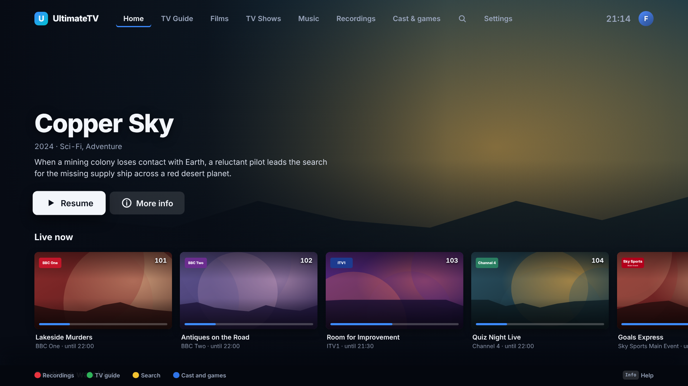
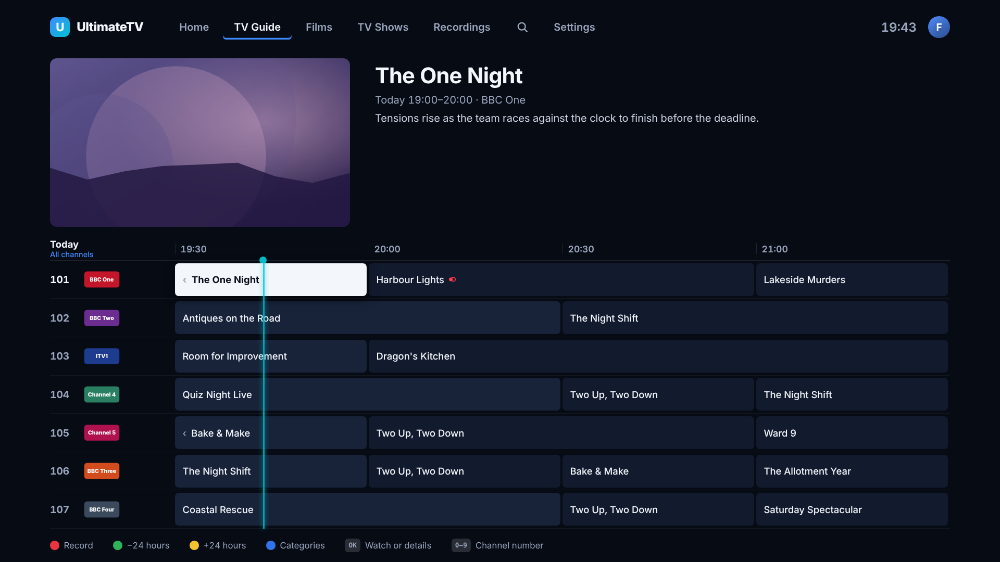
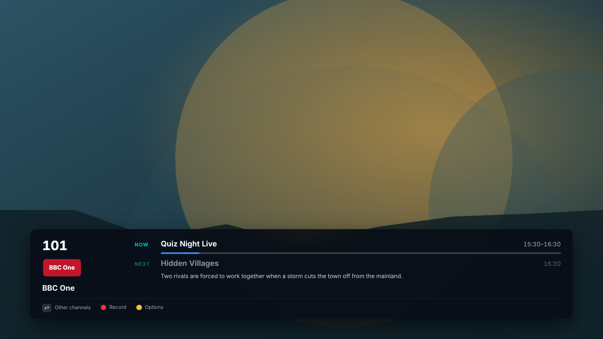
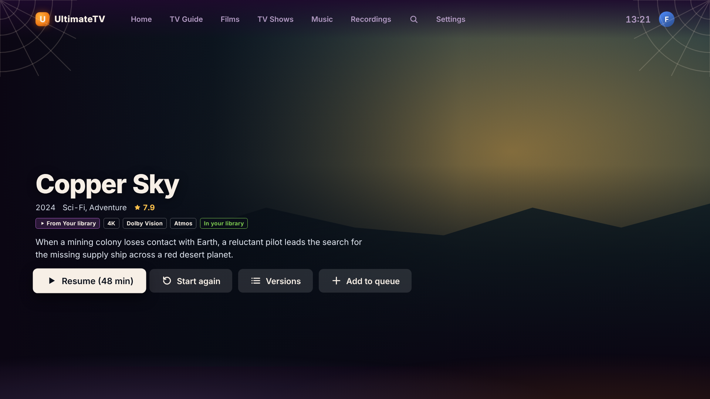
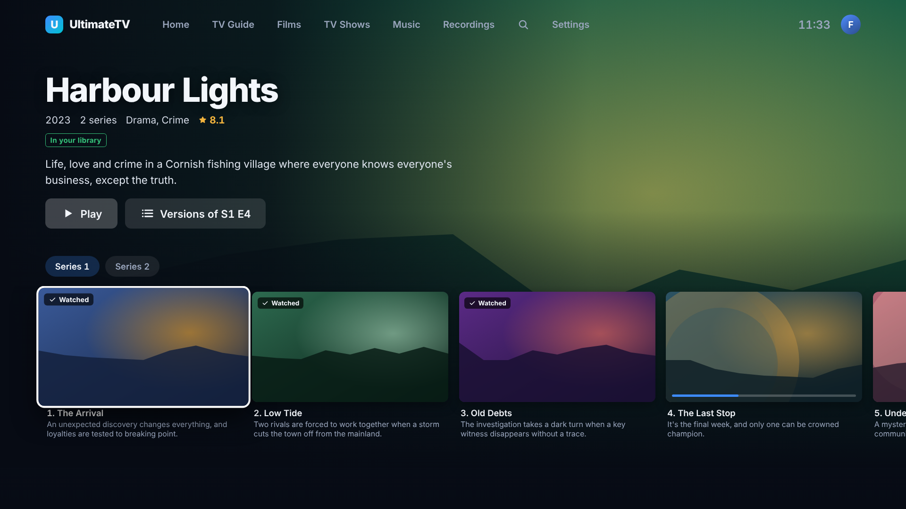
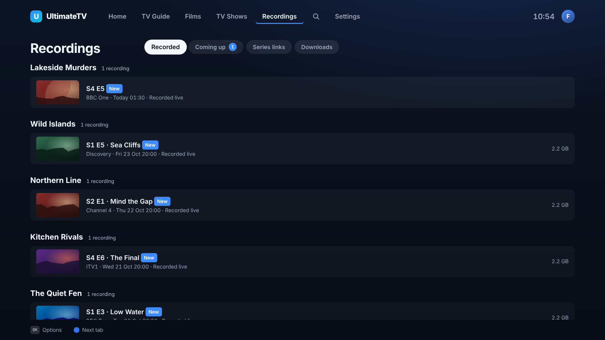
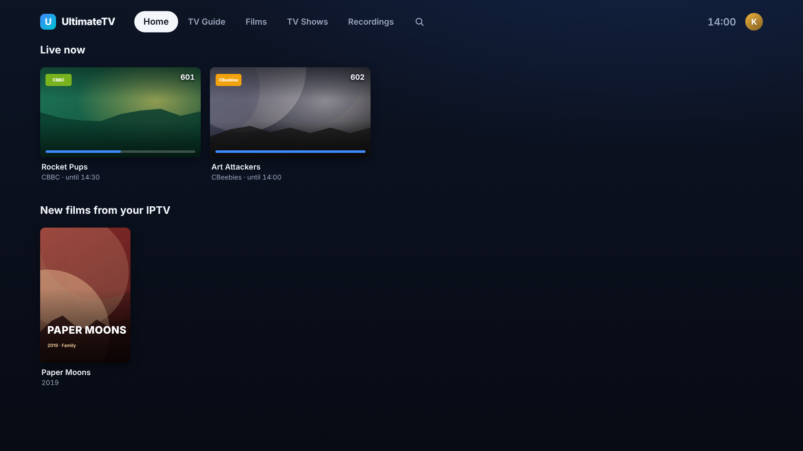

# UltimateTV

A polished, Sky-style TV app for the Hisense 85U7STUK, running on a Linux mini PC plugged into the TV. Live IPTV/Xtream with a full EPG and series link, recordings to the NAS, films and TV from Jellyfin, IPTV VOD and AIOStreams/TorBox in one library, profiles with a locked-down Kids profile, music video channels the Hub curates itself, and a phone remote.



| | | |
|---|---|---|
|  |  |  |
|  |  |  |

All the screenshots are in [docs/screenshots](docs/screenshots/README.md). See [docs/PLAN.md](docs/PLAN.md) for the product and technical plan, and [docs/TESTING.md](docs/TESTING.md) for the end-to-end test run.

## How it fits together

- **The Hub** runs in Docker on the home server. It reads the IPTV playlist and EPG, records to the NAS, talks to Jellyfin, AIOStreams and TorBox, and serves the TV app, the setup page and the phone remote.
- **The box** (the GMKtec mini PC) boots straight into the TV app: an Electron window over mpv, with HDR, refresh rate matching and Dolby passthrough. The TV remote works through a Pulse-Eight USB-CEC adapter.
- **The phone remote** works over Wi-Fi from any Android phone, as a web app or a small installable app.
- **The Android app** watches everything on a phone or tablet at home, and downloads films, episodes and recordings for the road ([docs/android-client.md](docs/android-client.md)).

## Setting it up

1. **Hub:** `docker compose up -d --build` on the Docker LXC, with `HUB_PORT=8095` in `.env` ([docs/phase0/proxmox-setup.md](docs/phase0/proxmox-setup.md)). Update it later with `bash tools/hub/update.sh` (see [CHANGELOG.md](CHANGELOG.md)).
2. **Sources:** open `http://<hub>:8095/setup/` on a phone or laptop and add the IPTV login, Jellyfin, AIOStreams and TorBox.
3. **Box:** netboot it from the PXE server on the Docker LXC, which installs everything unattended ([docs/pxe.md](docs/pxe.md)). Or install Arch Linux by hand and run the installer ([docs/box-install.md](docs/box-install.md)):
   ```sh
   git clone https://github.com/gazoscalvertos/UltimateTV.git && cd UltimateTV
   sudo HUB_URL=http://192.168.0.19:8095 bash tools/box/install.sh
   ```
4. **Phone remote:** scan the code in Settings › Phone remote, or install the Android app ([docs/phone-remote.md](docs/phone-remote.md)).
5. **Music video channels:** Clubland TV, House TV and Halloween TV fill themselves on the first start; make your own in Settings › Music channels ([docs/music-channels.md](docs/music-channels.md)).
6. **Profiles:** set a PIN on the adult profile so the children stay in Kids ([docs/profiles.md](docs/profiles.md)).
7. **Pop-ups:** put the doorbell camera, a meeting or an alarm on the TV from Home Assistant or the phone ([docs/notifications.md](docs/notifications.md)).
8. **When something goes wrong:** the Hub collects the box's log, playback samples and screen details at `/api/diagnostics?format=text` ([docs/diagnostics.md](docs/diagnostics.md)).

## Development

```sh
npm install
npm run typecheck && npm test
npm run build
DEMO=1 npm run dev:hub          # a Hub full of demo channels, films and recordings
npm run dev -w ui               # the TV app at http://localhost:5173/app/, keyboard as the remote
npm run screenshots             # regenerates docs/screenshots from the demo Hub
```

In a normal browser the keyboard is the remote: arrows, Enter (OK), Escape (Back), F1–F4 (red, green, yellow, blue), F5 (Guide), F6 (Info), PageUp/PageDown (channels) and digits. Streams the browser can't decode show their artwork with a running clock instead.

| Folder | What it is |
|--------|------------|
| `shared/` | Types and logic shared by the Hub, the UI and the box (domain model, key map) |
| `hub/` | The home server: sources, EPG, recorder, series link, profiles, API; plus the setup page and phone remote in `hub/public/` |
| `ui/` | The TV app (SolidJS), served by the Hub at `/app/` |
| `box/` | The box shell: Electron, mpv control, display modes, HDMI-CEC |
| `android/` | The Android apps: the phone remote (`app/`) and the watching client (`client/`) |
| `tools/box/` | Box installer and probe |
| `tools/pxe/` | PXE server for reinstalling the box over the network |
| `tools/screenshots/` | Screenshot capture |
| `tools/probe/`, `tools/clips/`, `tools/iptv/` | Phase 0 tools |
| `docs/` | Plan, decisions, guides and screenshots |
