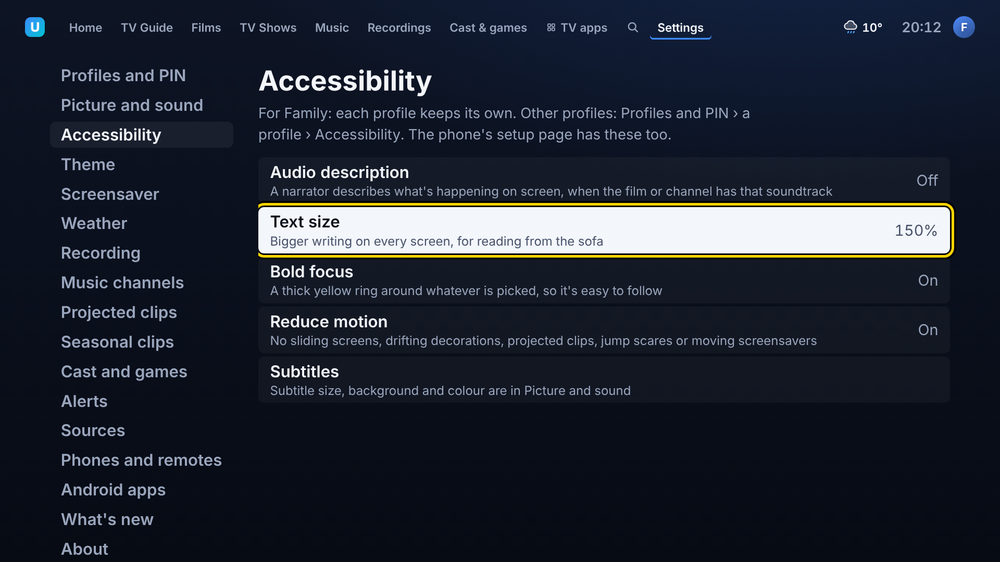
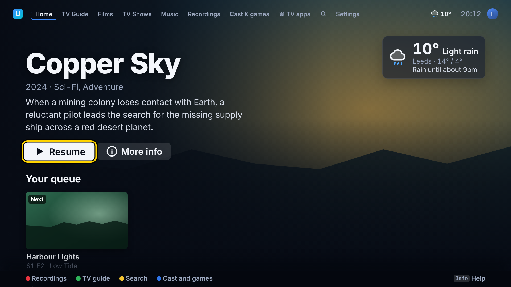
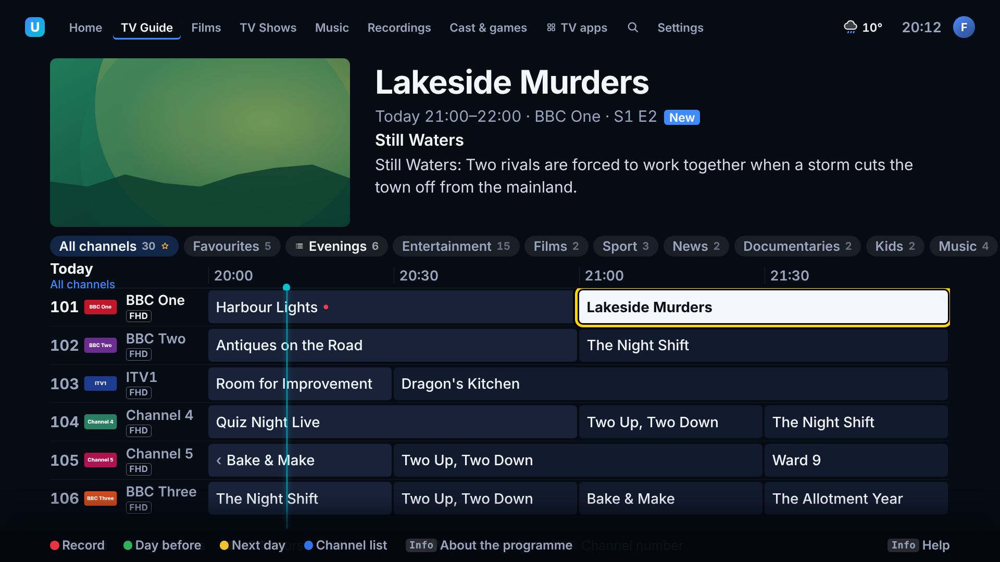
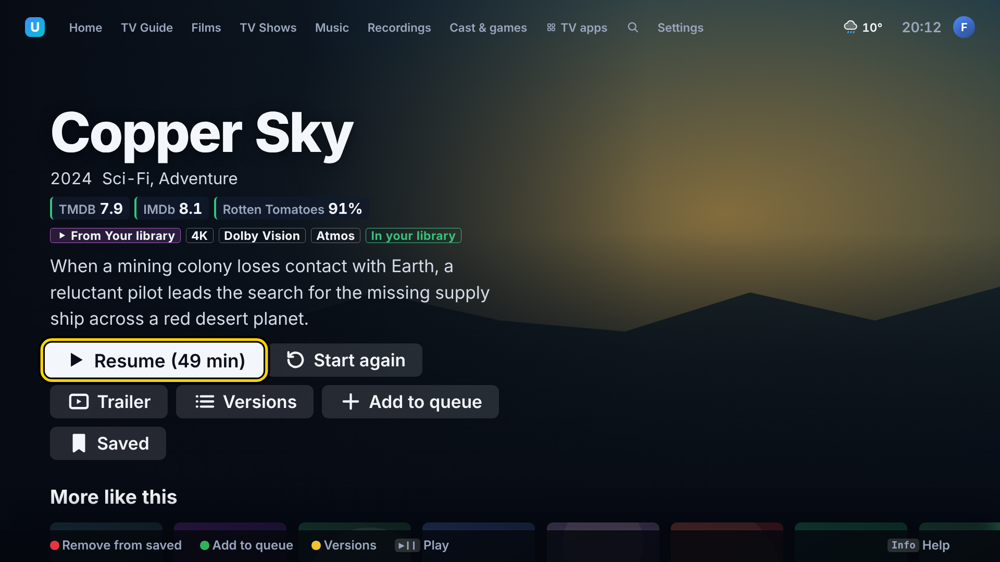
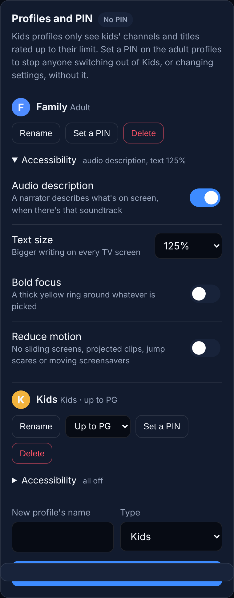

# Accessibility

Each profile has its own **Settings › Accessibility**, for visiting grandparents, anyone who
struggles to read the screen from the sofa, or anyone who'd rather nothing moved about. The same
settings are on the phone's setup page under **Profiles and PIN › a profile › Accessibility**.
Another profile's settings are in **Profiles and PIN › the profile › Accessibility** on the TV.

| Setting | What it does |
|---------|--------------|
| **Audio description** | When a film, episode or channel has a described soundtrack (a narrator saying what's happening on screen), it plays that one. A few seconds after it starts the TV says "Audio description on". With the setting off, a described track that a file picks as its default is swapped for the plain one in the same language. |
| **Text size** | 100%, 125% or 150%. Every bit of writing on every screen grows; the boxes around it stay where they are. At 125% and 150% the top bar shows just the logo (not the app's name) so the tabs, the clock and the profile still fit, and a film's buttons wrap onto a second line. |
| **Bold focus** | A thick yellow ring with a dark edge around whatever is picked, on every theme. In the guide it goes round the programme rather than the whole grid. |
| **Reduce motion** | Screens stop sliding in, nothing drifts or flies about (Halloween bats, the ghosts from the easter eggs, the themes' decorations), projected clips and jump scares don't appear (even ones sent from the phone), and the drawn screensavers become still pictures. A projected clip picked by hand to watch still plays. Rails and lists jump rather than scroll smoothly. |

The TV remembers the last profile's text size, focus ring and motion setting, so the profile
picker and the "Can't reach the Hub" screen keep them too. If the box's own system is set to reduce
motion, that counts as on for everyone.

Subtitle size, a dark box behind them, yellow and a raised position are in **Settings › Picture
and sound** for the whole household ([watching-extras.md](watching-extras.md#how-they-look)), and
each profile can turn subtitles on ([profiles.md](profiles.md)).

## Large text on the main screens

| Home | TV Guide | A film |
|------|----------|--------|
|  |  |  |

On the phone:

## How audio description is found

The box marks an audio track as described when mpv reports the stream's "visually impaired" flag
(UK broadcasts and most rips set it; needs mpv 0.37 or newer, which Arch has) or when its title says
so ("Audio Description", "Described", "AD", "DVS", "Visually impaired"). Options (Yellow) › Audio
shows "Audio description" next to the track either way, so it can be picked by hand.

Live channels from the IPTV provider only have a described track if the provider passes it on; many
don't.

## Not tested yet

All of this is built and passes its tests against the demo Hub, and the screenshots above are from
the demo, but none of it has run on the box or the Hisense:

- Whether the IPTV channels and Jellyfin files actually carry flagged audio description tracks, and
  that the box switches to them.
- How 150% text reads on the 85" screen from the sofa, and whether any screen not in the screenshots
  (Music, the planner, Cast and games) clips its writing.
- Spoken menus (a voice reading out what's picked) were left for later: Electron's speech on Linux
  needs speech-dispatcher and a voice installed on the box.

## For developers

| Part | Where |
|------|-------|
| Settings, defaults, track choice | `shared/src/accessibility.ts` (`cleanAccessibility`, `isAudioDescription`, `audioTrackFor`) |
| Stored per profile | `hub/src/profiles.ts` (`Profile.accessibility`; `PATCH /api/profiles/:id` with `{ accessibility: { textScale: 150 } }` changes just that, `null` clears it) |
| Applied to the page | `ui/src/store.ts` (`wearAccessibility`, `reducedMotion`): the `--ts` multiplier every `font-size` in `ui/src/styles.css` uses, and the `high-contrast` and `reduce-motion` classes |
| Audio description at the start | `ui/src/accessibility.ts`, flagged by `box/src/player.ts` (`tracksFrom`) |
| Settings screens | `ui/src/screens/Settings.tsx` (Accessibility section), `hub/public/setup/index.html` (`accessibilityFor`) |
