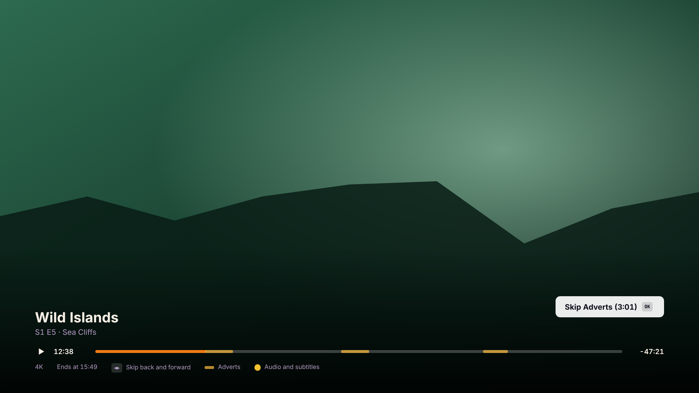
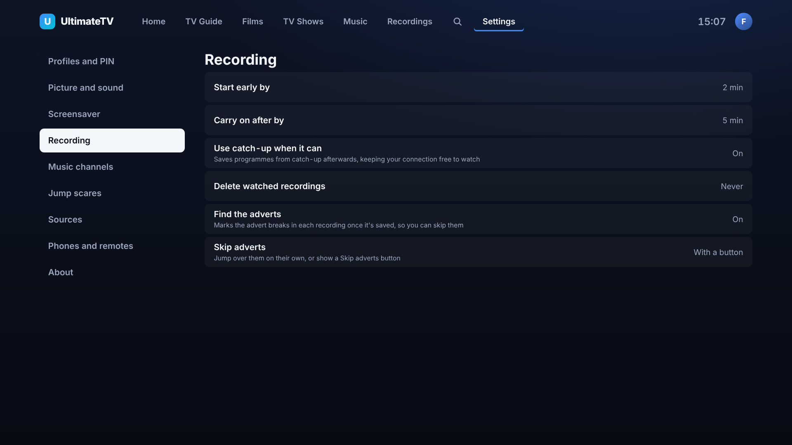
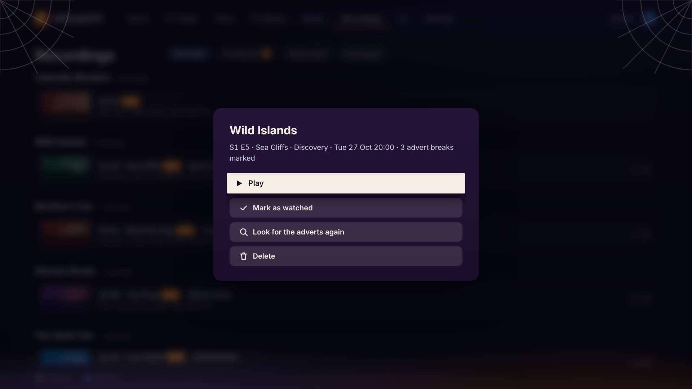

# Skipping adverts in recordings

Once a recording is saved, the Hub looks through it for the advert breaks and marks them. When you
play it, the breaks show on the seek bar and a **Skip adverts** button comes up as each one starts:
press OK to jump to the end of the break. Or let the player jump them on its own.

## Settings

**Settings › Recording** (on the TV, or the phone's setup page):

- **Find the adverts** (on): look for the breaks in each recording once it's saved. Turned off, new
  recordings aren't looked at. Turning it back on catches up with the ones saved meanwhile.
- **Skip adverts**: **With a button** (the default) shows Skip adverts. **On their own** jumps each
  break once, with a note saying how long it skipped. Go back into a break and it stays put, with the
  button, so you can see what you missed.

## How it finds them

The Hub's image includes [comskip](https://github.com/erikkaashoek/Comskip), built from a pinned
commit. Comskip watches for the black frames and silence between adverts, the channel's logo
going away, and changes of scene, and is what most PVRs use. The Hub runs it on one recording at
a time, at low priority, so watching and recording aren't slowed. It hasn't been timed on the N150 yet; expect a few
minutes for an hour of HD.

If comskip isn't there (a Hub run outside Docker, say), ffmpeg does a simpler job: it finds the
moments of black with silence, and calls a run of three or more of them, each a believable advert
length apart, a break. That's less sure than comskip, so it only marks breaks that look like at least
two adverts.

Breaks under 30 seconds (a sponsor's bumper, a channel ident) or over 10 minutes are ignored.

Recordings made before this existed are looked at too, one after another, the first time the Hub
starts with it. BBC channels have no adverts, so their recordings say **No adverts found**.

## Recordings

The recording's menu (OK on it in Recordings) says how many breaks were marked, and has **Look for
the adverts again** (or **Find the adverts**, if it hasn't been looked at, or it failed). Rows with
breaks marked say **Adverts marked**.

Each recording also gets an `.edl` file beside it on the NAS, in Kodi's format with the breaks as
"commercial break", so Kodi skips them too. Deleting the recording deletes it.

## Tuning comskip

The Hub writes its own `comskip.ini` (in `data/adverts/`). To use your own, for example one tuned
for UK channels from the comskip forum, put `comskip.ini` in the Hub's data folder (`/data` in the
container) and it's used instead. `COMSKIP_PATH` points the Hub at a different comskip binary.

If it marks a programme as adverts, or misses a break, **Look for the adverts again** after
changing the ini. The Android app shows **Skip adverts** too.
