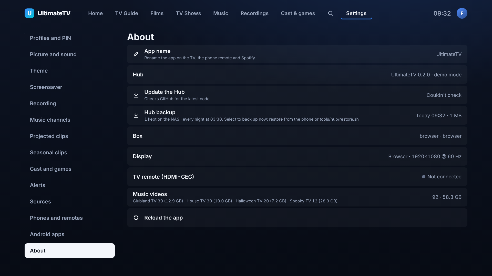
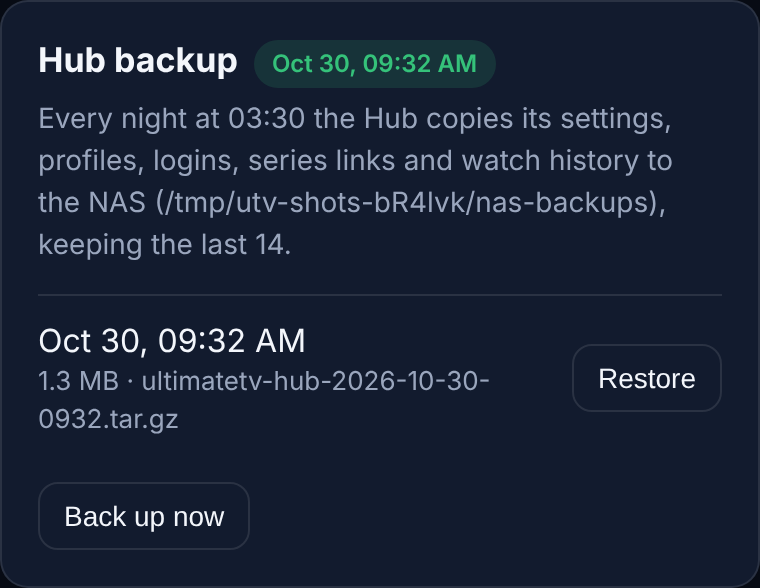
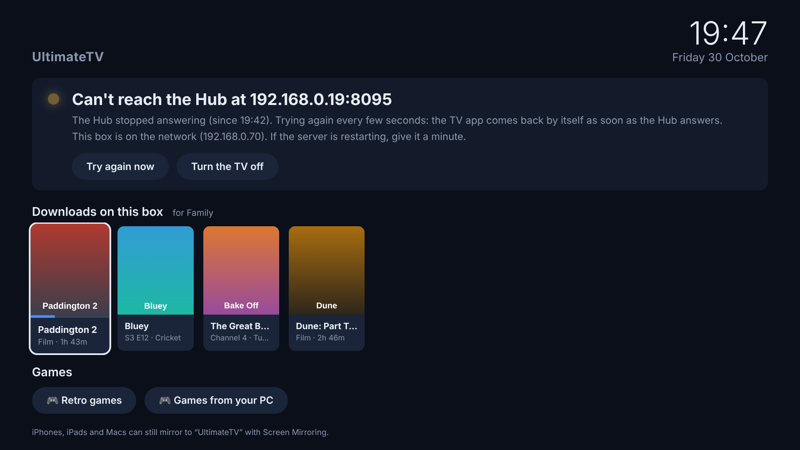

# Hub backup and the box without the Hub

Two safety nets: the Hub copies its data to the NAS every night, and the TV box still starts and
shows something useful when the Hub is down.

## Nightly backup

Everything the household has set up lives in the Hub's database: profiles and PINs, the IPTV and
Jellyfin logins, series links and reminders, watch history and Save for later, guide lists, music
channels, paired phones, themes and alerts. The recordings and films themselves are on the NAS
already and aren't copied.

Every night at **03:30** the Hub takes a consistent copy of its database (SQLite `VACUUM INTO`, so it
carries on while it does) and packs it, with the clips it keeps beside it (jump scares, pop-up
pictures, probe reports), into

```
/mnt/nas/.ultimatetv-backups/ultimatetv-hub-2026-10-30-0330.tar.gz
```

It keeps the **last 14** and deletes older ones. The first backup runs 10 minutes after the Hub
starts if there isn't one from last night, and `tools/hub/update.sh` takes one before every update.

The folder is hidden (starts with a dot) so Jellyfin ignores it. Each file holds the IPTV, Jellyfin
and music logins, so it's readable by its owner only; keep it on the home network.

### Seeing how it went

- **TV:** Settings › About › Hub backup shows when the last one ran, its size and how many are kept.
  Select it to back up now.
- **Phone:** ⚙ Settings › Hub backup lists the last seven, with **Back up now** and **Restore** on each.
- **Alerts:** if a backup fails, or none has worked for two nights, Settings › Alerts (and Home
  Assistant or ntfy, if set up) say so.




### Settings

In the Hub's `.env` on the Docker LXC (then `docker compose up -d`):

| Variable | Default | |
|----------|---------|---|
| `BACKUP` | on | `off` stops the nightly backup (the one before an update still runs) |
| `BACKUP_DIR` | `/mnt/nas/.ultimatetv-backups` | Where the copies go, as the Hub container sees it |
| `BACKUP_KEEP` | 14 | How many to keep |
| `BACKUP_TIME` | 03:30 | When, in the Hub's time zone (`TZ`) |

If the NAS isn't mounted in the Hub (no
`docker-compose.override.yml`), the copies go into the Hub's own data volume instead and the TV and
phone say so: that still protects against a bad update, but not against losing the LXC.

## Restoring

A restore puts the Hub back to how it was when that copy was made. Anything changed since (settings,
series links added, watch history) goes back too. What it replaces is kept in the Hub's data as
`before-restore-<time>`, so a restore can be undone by hand.

**From the phone:** ⚙ Settings › Hub backup › Restore on the one you want. The Hub restarts with it in
under a minute; reload the TV app afterwards (Settings › About › Reload the app).

**On the server** (the Docker LXC), from the repository folder:

```sh
bash tools/hub/restore.sh            # list the backups
bash tools/hub/restore.sh latest     # restore the newest
bash tools/hub/restore.sh ultimatetv-hub-2026-10-30-0330.tar.gz
```

**A new server** (the LXC was lost): set the Hub up as in
[phase0/proxmox-setup.md](phase0/proxmox-setup.md), including `docker-compose.override.yml` so it
sees the NAS, start it with `bash tools/hub/update.sh`, then `bash tools/hub/restore.sh latest`. A
copy kept anywhere else works too: `bash tools/hub/restore.sh /root/ultimatetv-hub-….tar.gz`.

Paired phones and the TV keep working after a restore, since the pairings are in the same data.

## When the Hub is down

The TV app itself comes from the Hub, so the box can't show the guide, the library or live TV
without it. Instead of a blank screen it shows its own:



- The **time and date**, so the TV is still a clock.
- **What's wrong**: which Hub address isn't answering and since when, and whether the box itself is
  on the network.
- **Downloads on this box** play straight from its disk, with the remote: OK pauses, ◀ ▶ skip back 10
  and forward 30 seconds, Back stops (it remembers where you got to).
- **Games** (RetroArch, Moonlight, and the others that are installed) open as usual.
- **AirPlay** from an iPhone or Mac still works.
- **Try again now** and **Turn the TV off**.

It checks the Hub every few seconds and goes back to the TV app by itself once the Hub answers (after
the film, if one is playing from this screen).

The box shows this screen straight away when the Hub doesn't answer as it starts, and switches to it
when the Hub stops answering for a minute while the TV app is up and nothing is playing.

It follows the **profile last used on the TV**: on Kids it only offers the downloads Kids may watch
and no games. Until the TV app has run once with the updated box, it treats whoever's watching as
Kids.

The phone remote and the Android app come from the Hub too, so they don't work while it's down; use
the TV remote.
