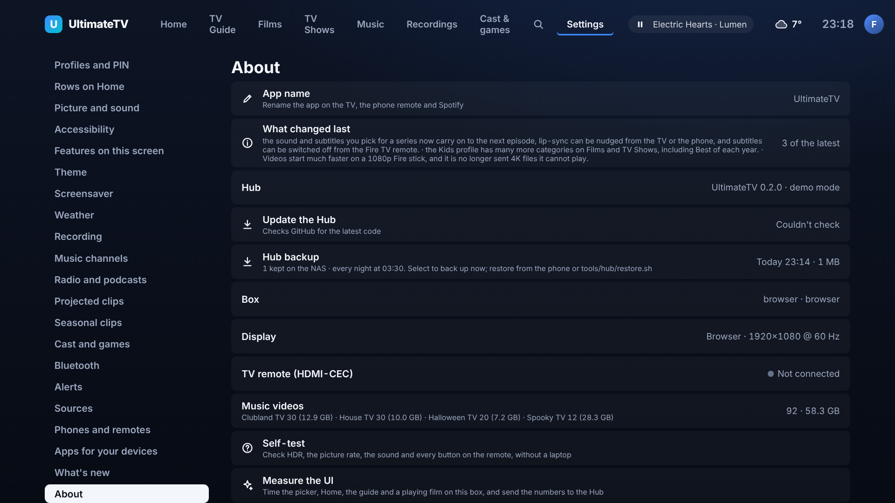
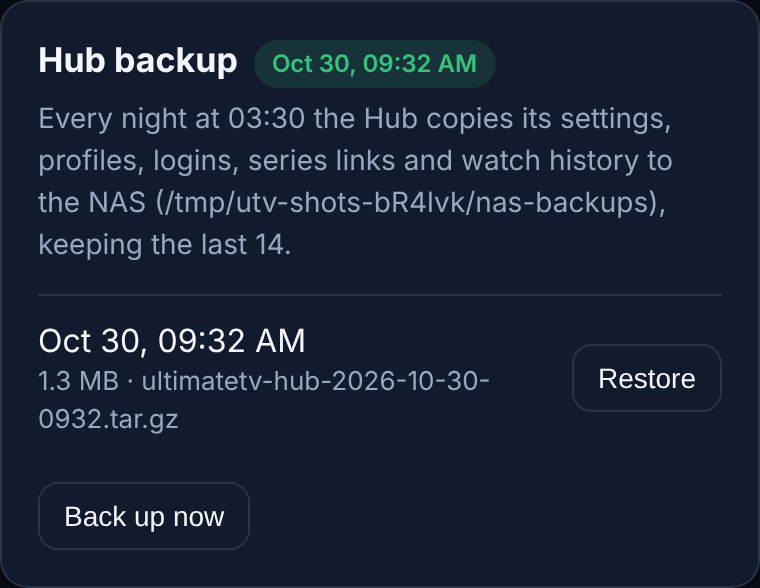
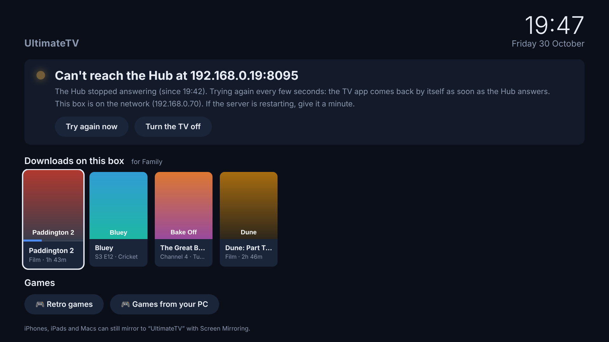

# Hub backup and the box without the Hub

Two safety nets: the Hub copies its data to the NAS every night, and the TV box still starts and
shows something useful when the Hub is down.

## Nightly backup

Everything the household has set up lives in the Hub's database: profiles and PINs, the IPTV and
Jellyfin logins, series links and reminders, watch history and Save for later, guide lists, music
channels, paired phones, themes and alerts. The recordings and films themselves are on the NAS
already and aren't copied.

Every night at **03:30** the Hub takes a consistent copy of its database (SQLite `VACUUM INTO`, so it
carries on while it does) and packs it, with the clips it keeps beside it (jump scares, pop-up
pictures, probe reports), into

```
/mnt/nas/.ultimatetv-backups/ultimatetv-hub-2026-10-30-0330.tar.gz
```

It keeps the **last 14** and deletes older ones. The first backup runs 10 minutes after the Hub
starts if there isn't one from last night, and `tools/hub/update.sh` takes one before every update.

The folder is hidden (starts with a dot) so Jellyfin ignores it. Each file holds the IPTV, Jellyfin
and music logins, so it's readable by its owner only; keep it on the home network.

### A second copy, somewhere else

The NAS is in the same room as the Hub, so a fire, a flood or a theft takes both. `BACKUP_OFFSITE`
has the Hub keep a second copy somewhere that isn't the NAS: another disk, or an rclone remote such
as Google Drive, which can be encrypted at rest.

```sh
# Another disk plugged into the box, mounted where the Hub can see it
BACKUP_OFFSITE=/mnt/usb/ultimatetv

# Or an rclone remote (rclone config on the Docker LXC first): the remote name, a colon, then the folder
BACKUP_OFFSITE=gdrive:UltimateTV/backups
```

The copy goes across **after** the NAS copy has landed, so the two don't race and a second copy that
fails can never lose the first. It keeps its own, shorter rotation, so the second disk doesn't fill
up: the newest copy of each of the last `BACKUP_OFFSITE_KEEP_DAYS` days (7 by default), then one a
week for `BACKUP_OFFSITE_KEEP_WEEKS` more (4 by default). Nothing about the NAS copies changes.

rclone isn't in the Hub's image (it's a static binary of its own), so the Hub asks `rclone version`
once: if it isn't installed, the second copy is reported as a problem to fix and the nightly NAS
backup carries on as normal. On the Docker LXC, install it with `apt install rclone` (or
`curl https://rclone.org/install.sh | sudo bash`), run `rclone config` as root to add the remote, and
`docker compose restart hub`.

A second copy that fails doesn't fail the night's backup: the NAS copy is kept, the failure is shown
in Settings › About (TV) and the setup page, and Settings › Alerts raises **The Hub's second backup
failed** (with Home Assistant or ntfy, if set up).

### Seeing how it went

- **TV:** Settings › About › Hub backup shows when the last one ran, its size and how many are kept.
  Select it to back up now.
- **Phone:** ⚙ Settings › Hub backup lists the last seven, with **Back up now** and **Restore** on each.
- **Alerts:** if a backup fails, or none has worked for two nights, Settings › Alerts (and Home
  Assistant or ntfy, if set up) say so.




### Settings

In the Hub's `.env` on the Docker LXC (then `docker compose up -d`):

| Variable | Default | |
|----------|---------|---|
| `BACKUP` | on | `off` stops the nightly backup (the one before an update still runs) |
| `BACKUP_DIR` | `/mnt/nas/.ultimatetv-backups` | Where the copies go, as the Hub container sees it |
| `BACKUP_KEEP` | 14 | How many to keep |
| `BACKUP_TIME` | 03:30 | When, in the Hub's time zone (`TZ`) |
| `BACKUP_OFFSITE` | off | The second destination: a path, or an rclone `remote:path`. `off` disables it |
| `BACKUP_OFFSITE_DIR` | | A path, when `BACKUP_OFFSITE` is used for the other kind |
| `BACKUP_OFFSITE_RCLONE` | | An rclone `remote:path`, likewise |
| `BACKUP_OFFSITE_KEEP_DAYS` | 7 | Every copy from this many days back is kept at the second destination |
| `BACKUP_OFFSITE_KEEP_WEEKS` | 4 | Then one a week for this many weeks before that |

If the NAS isn't mounted in the Hub (no
`docker-compose.override.yml`), the copies go into the Hub's own data volume instead and the TV and
phone say so: that still protects against a bad update, but not against losing the LXC.

## Restoring

A restore puts the Hub back to how it was when that copy was made. Anything changed since (settings,
series links added, watch history) goes back too. What it replaces is kept in the Hub's data as
`before-restore-<time>`, so a restore can be undone by hand.

**From the phone:** ⚙ Settings › Hub backup › Restore on the one you want. The Hub restarts with it in
under a minute; reload the TV app afterwards (Settings › About › Reload the app).

**From the second copy:** the setup page's backup section lists the copies that are only at the
second destination (the NAS lost them, say) under **Only in the second copy**, and **Restore** on one
of those fetches it from there. The restore itself is the same; the Hub restarts with it. The phone
and the TV use the NAS copy first, so use the setup page when that one has gone. With
`BACKUP_OFFSITE` on a plain disk, the archive can also be restored by hand:

```sh
tar -xzf /mnt/usb/ultimatetv/ultimatetv-hub-2026-10-30-0330.tar.gz -C /path/to/hub/data
```

**On the server** (the Docker LXC), from the repository folder:

```sh
bash tools/hub/restore.sh            # list the backups
bash tools/hub/restore.sh latest     # restore the newest
bash tools/hub/restore.sh ultimatetv-hub-2026-10-30-0330.tar.gz
```

**A new server** (the LXC was lost): set the Hub up as in
[phase0/proxmox-setup.md](phase0/proxmox-setup.md), including `docker-compose.override.yml` so it
sees the NAS, start it with `bash tools/hub/update.sh`, then `bash tools/hub/restore.sh latest`. A
copy kept anywhere else works too: `bash tools/hub/restore.sh /root/ultimatetv-hub-….tar.gz`.

Paired phones and the TV keep working after a restore, since the pairings are in the same data.

## When the Hub is down: Limited mode

The TV app itself comes from the Hub, so the box can't ask it for the guide, the library or a
channel's address. Instead of a blank screen the box shows **Limited mode**: a smaller TV app that
runs from its own disk and plays what it already knows. It is the same page as before, grown up.



**Why it can play at all.** While the Hub is up, the box keeps one small file on its disk (under its
own app data, `limited.json`): the channel list with each channel's own stream address, a week of
guide, every profile with its rules, and the Jellyfin server's address and sign-in. It asks the Hub
for a fresh copy every fifteen minutes and straight after the TV app comes back, so the file is at
most a quarter of an hour behind. It is never the Hub's database: a week of guide for a few hundred
channels, trimmed per channel, and nothing else.

**What works with the Hub off:**

- **Live TV** from those saved channel addresses, straight from your IPTV provider - the box plays
  it itself, no Hub in the way.
- **The guide**, seven days of it, day by day. Picking a programme joins that channel.
- **Jellyfin** films and episodes play directly from your Jellyfin server, and the box tells Jellyfin
  where you got to (it needs no Hub to do that): a film started here shows up half-watched there.
- **Downloads on this box**, straight from its disk, as before.
- **Games** (RetroArch, Moonlight and the others that are installed) and **AirPlay** from an iPhone or
  Mac, as before.
- **The time and date**, what's wrong (which address isn't answering, since when, whether the box
  itself is on the network), **Try the Hub again** and **Turn the TV off**.

**What is present but off, each with one sentence saying why:** Recording, Series links, TorBox and
saved films, and Settings. They are cards on the screen with a plain line under each name - "Recording
needs the Hub. It'll come back when the Hub is on." - rather than things that quietly vanish, so
nobody is left pressing a button that used to work.

**Kids rules still apply.** The saved copy carries each profile's kind, top certificate, channel
categories, hand-allowed channels and the household's allow/block lists, and Limited mode applies the
same rules the Hub does - from one copy of that logic that both use, so they can't drift apart. On a
Kids profile the channels, the guide and the Jellyfin films are all filtered, downloads are the
Kids-safe ones and games stay hidden. The box learns whose profile was last used from the TV app; if
it has never been told, it treats whoever is watching as Kids.

**Coming back.** The box checks the Hub every few seconds. When it answers, the TV app comes back by
itself: straight away if nothing is playing. If a film *is* playing - from this screen or from the TV
app - the box waits: the status line says "The Hub is back", and the swap happens the moment you
stop, so a film is never cut off mid-scene. No restart, no remote needed.

Two things are worth knowing. The cached week is only as fresh as the last time the Hub was up, so a
channel that has moved or a guide that has changed since then is still shown the old way until the Hub
returns. And the Jellyfin sign-in in that file is a real token on the box's disk: the box already
holds one for its own use, and the file is only readable by the box's own user.

The box shows this screen straight away when the Hub doesn't answer as it starts, and switches to it
when the Hub stops answering for a minute while the TV app is up and nothing is playing.

It also watches the TV app itself, not just the Hub. A Hub that answers can still send an app that
draws nothing (that is what happened on 2 November: the app threw while loading, the Hub was healthy
throughout, and the TV sat on a black screen nothing could get out of). After every load the box
gives the page a few seconds, and if nothing has drawn it loads the app again without the cached
copy. Three blank loads in a row and this screen comes up, with the reason, and the box tries the app
again every five minutes, so a Hub fixed later puts the TV right on its own.

The phone remote and the Android app come from the Hub too, so they don't work while it's down; use
the TV remote.
