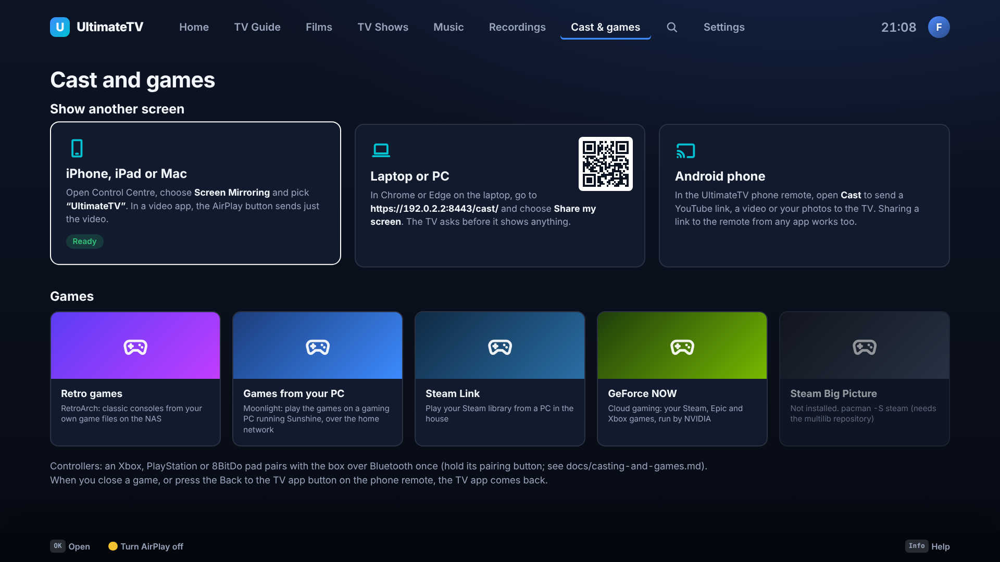

# Other screens, mirroring and light gaming

How a phone, tablet or laptop gets onto the TV, and which games the box can open, with what was
picked and why. Everything here is built but untested on the real box; the last section lists what
needs doing by hand.

## What's in the app

| From | How | What it's good for |
| --- | --- | --- |
| iPhone, iPad, Mac | **AirPlay**: UxPlay runs on the box as a receiver named after the app. Control Centre › Screen Mirroring › the TV. | Mirroring the whole screen, or the AirPlay button in a video app. A Mac can also **Use as separate display** (extend). |
| Laptop or PC (Windows, Mac, Linux, Chromebook) | **Screen share from the browser**: open `https://<hub>:8096/cast/` in Chrome, Edge or Firefox and choose Share my screen. WebRTC, offer and answer through the Hub, picture straight from laptop to TV. The TV asks first. | Slides, photos, web pages, a video call. Duplicate the screen, or extend it with a virtual display (below). |
| Android phone | **Phone remote › Cast**: send a link (YouTube, a video file, a stream) or show a photo or video full screen. Sharing a link to the installed remote from any app opens Cast with it filled in. | "Watch this" moments. The box's mpv plays YouTube through yt-dlp. |
| Games | **Cast and games** on the TV (Blue on Home): RetroArch, Moonlight, Steam Link, GeForce NOW, Steam Big Picture. The TV app hides, the game gets the screen and the controllers, and the app comes back when the game closes. | Retro games from the NAS, PC games streamed from a gaming PC, cloud games. |

Rules: the TV asks before showing a laptop. Nothing can be cast onto the Kids profile (AirPlay is
dropped, a share is refused, links are ignored). Games are off on Kids unless a grown-up turns them
on in Settings › Cast and games. Back on the TV remote ends mirroring or a share; the phone remote's
**Back to the TV app** closes a game.

## Choices and trade-offs

**AirPlay: UxPlay.** The only maintained open-source AirPlay mirroring receiver on Linux, and it's
reliable on Intel graphics with VA-API decoding. It isn't in Arch's main repositories (only the
AUR), so the box installer builds the pinned release (v1.73.7) from source. UxPlay has no "someone
connected" hook, so it runs with `-dacp <file>`: that file exists only while a device is connected,
which the box polls every second to know when to step aside. Trade-offs: mirroring has about a
quarter to half a second of lag (fine for photos and video, not for games); DRM-protected apps
(Netflix, Disney+) show black when mirrored, as on any receiver; YouTube from an iPhone needs UxPlay's
`-hls` mode, which can be added with `UXPLAY_ARGS=-hls` in `/etc/ultimatetv/box.env`. macOS's
"Use as separate display" to a third-party receiver is plausible but unverified.

**Laptops: the browser, not Miracast.** Windows can "Project to a wireless display" (Miracast), but
the Linux receivers (MiracleCast, GNOME Network Displays) need the Wi-Fi card to support P2P mode,
fight NetworkManager for it, and are fragile. Google Cast receivers can't be built without Google's
certification. A browser screen share works on every laptop with nothing installed, over the
existing network. The cost: `getDisplayMedia` only works on an HTTPS page, so the Hub now also
serves HTTPS on port 8443 (published as `HUB_HTTPS_PORT`, 8096 by default) with its own certificate.
The browser warns about it once. The picture goes laptop to TV over WebRTC (the Hub only passes the
offer and answer), with roughly 100–200 ms of lag.

**Extending (second screen).** A browser can only share a screen that exists, so to *extend* rather
than duplicate, the laptop needs a virtual display: on Windows the free
[Virtual Display Driver](https://github.com/VirtualDrivers/Virtual-Display-Driver) adds one, which you
then share; on a Mac, AirPlay's separate display does it natively; on Linux, `xrandr --setmonitor`
or a dummy HDMI plug. The share page explains this.

**Android phones: no mirroring, by design.** Android's browsers can't share the screen, and its
built-in casting is Google Cast (not possible) or, on some phones, Miracast (see above). Sending a
link or a photo covers what people actually do, with less lag and full quality.

**Games.**

- **RetroArch** (Arch's `retroarch` plus a handful of cores) for classic consoles, from your own
  game files (keep them on the NAS, point RetroArch's file browser at the mount). It works with the
  TV remote's arrows via CEC too, but a pad is much better.
- **Moonlight** (`moonlight-qt`, in Arch) streams games from a gaming PC running
  [Sunshine](https://github.com/LizardByte/Sunshine). The best quality and lowest lag of the lot on
  a wired network (the box's N150 decodes HEVC/AV1 in hardware).
- **Steam Link** (Flatpak) does the same with Steam on the PC, with no Sunshine needed.
- **GeForce NOW**: NVIDIA's official Linux app (a Flatpak, needs Mesa 24.2.8 or newer). Cloud
  gaming, so no gaming PC, but it needs a subscription and good internet.
- **Steam Big Picture**: only if the box should run games itself; on an N150 that means light,
  older games. Not installed by default.
- **Xbox Cloud Gaming** isn't in the app: it's a web page (xbox.com/play) that wants Edge or Chrome
  with a controller. It could be added as another "web app" like the music tab's Deezer player.

Launching a game hides the TV app's window so KDE gives the game focus and the controller; a KWin
rule makes each of these apps full screen with no border.

## What it needs from you

1. **Run the box installer again** (or let the PXE reinstall do it): `cd /opt/ultimatetv && sudo git pull && sudo bash tools/box/install.sh`. It now builds UxPlay, turns on Avahi (so iPhones find the TV), and installs RetroArch, Moonlight, Bluetooth and the Steam Link and GeForce NOW Flatpaks. Skip parts with `AIRPLAY=0`, `GAMES=0` or `CLOUD_GAMES=0`.
2. **Update the Hub** (`bash tools/hub/update.sh`), then publish the HTTPS port: add `HUB_HTTPS_PORT=8096` to `.env` if 8096 is taken (the Jellyfin LXC is on a different IP, so it usually isn't). The Hub's image now carries comskip for advert skipping.
3. **Trust the certificate once** on each laptop: the first visit to the share page shows a warning; choose Advanced › Continue.
4. **Pair a controller** with the box once, over SSH: `bluetoothctl`, then `power on`, `scan on`, hold the pad's pairing button, `pair <MAC>`, `trust <MAC>`, `connect <MAC>`. Xbox and 8BitDo pads work out of the box; a PS5 pad does too.
5. **Moonlight**: install Sunshine on the gaming PC and pair it from Moonlight the first time (it shows a PIN to type on the PC).
6. **RetroArch**: put game files on the NAS (for example `/mnt/nas/Games/<console>`), mount it on the box, and add that folder in RetroArch the first time.
7. **GeForce NOW**: sign in once in the app with a controller or keyboard.

## Tried and left out

- **Miracast receiving** (MiracleCast): Wi-Fi P2P on the K7's card is unknown and the stack is fragile. Worth an experiment later behind a setting.
- **Google Cast / Chromecast receiving**: needs Google certification; not possible for a home-built app.
- **DLNA renderer** (gmrender-resurrect): would let some Android apps "play to" the TV. Low demand now that links work; easy to add later.
