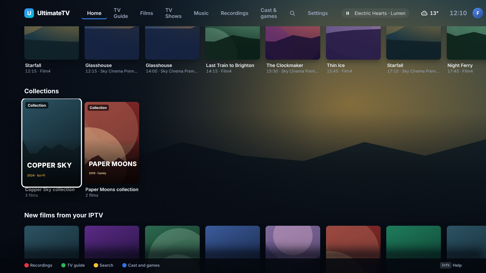
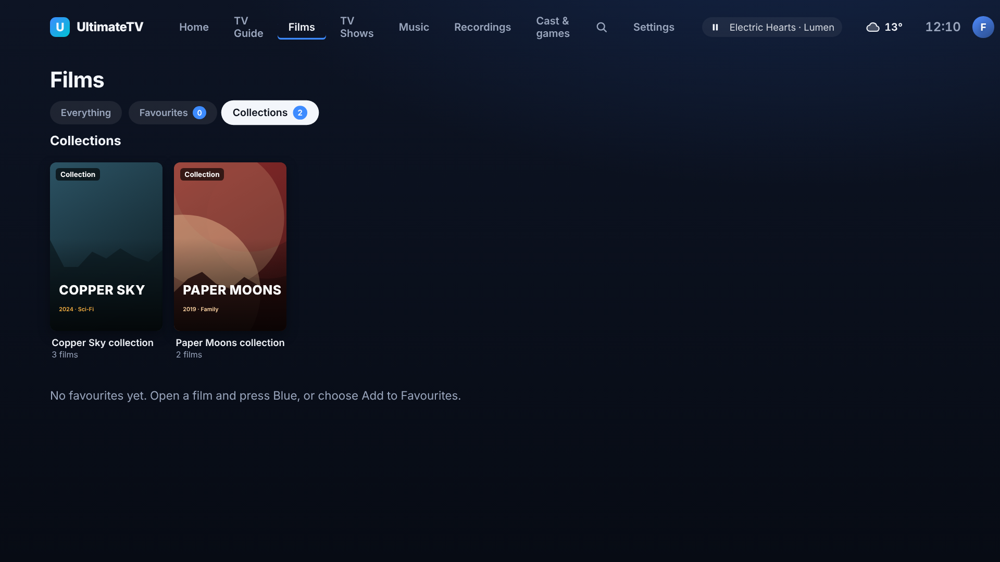
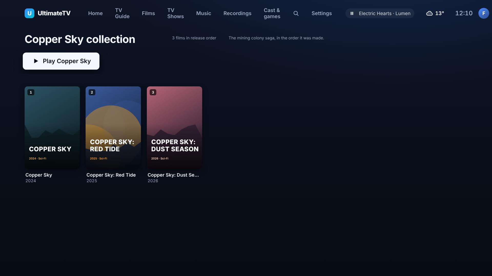
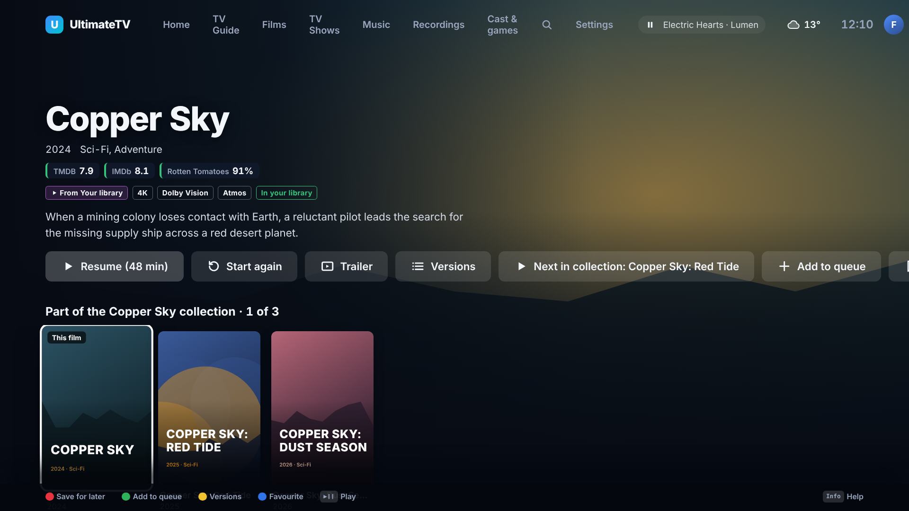

# Collections and franchises

Issue #238. Bond, Harry Potter, Marvel: films that belong together are shown together, in the order
they came out, with **Next in collection** to carry on. Plex, Jellyfin, Apple TV and Kodi all do
this; families binge franchises.

## What you see

- **Collections row on Home** (turn it off or move it in Settings › Home rows): one card per
  franchise with how many films you can watch in it. OK opens the collection.
- **Collections in Films**: a **Collections** chip next to Everything and Favourites lists every
  franchise. The chip only appears when there is at least one.

- **A collection's page**: the films in release order, numbered, with a **Play** button that starts
  the first film not watched yet (or "Play next: …" once you have started). Films you have watched
  say so.

- **On a film's page**: "Part of the Bond collection · 3 of 24", a row of the other films in order
  with this one marked **This film**, **See the whole collection**, and a **Next in collection:
  Goldfinger** button next to Play.

- **After a film ends**: the Up Next card says "Next in Bond" and the next film starts after the
  countdown, exactly like the next episode of a series (Settings › Playback › Autoplay next controls
  it; Back stops it). A film with no later unwatched film in its collection just ends.

## Where collections come from

1. **Your media server**: Jellyfin and Emby BoxSets, and Plex collections (Plex: each film library's
   Collections). Make them the usual way (Jellyfin: the Collections plugin or the TMDb Box Sets
   plugin makes them for you). The Hub reads them and keeps them for ten minutes.
2. **TMDB**: a film that is not in a BoxSet but belongs to a TMDB collection ("The James Bond
   Collection") still shows its franchise, using the TMDB key from Settings › Sources. The page
   lists every film in the franchise; the ones your library has say **In your library**, the others
   open to their own page (to play from an addon or to Request).

If both exist for a film, the media server's collection wins, so a collection you tidied by hand is
what you see.

## Order

Release date (from the server, or TMDB), then year, then name. Films with no date go last.
**Chronological (story) order is not offered**: neither Jellyfin, Plex nor TMDB holds it, so the
Hub cannot know that, say, a prequel sits earlier in the story. If you want a different order, a
parent could re-date the films in Jellyfin.

## Kids and Guests

Ratings are applied **per film, never per collection**. A Kids profile sees only the films it is
allowed (the rating, then a parent's allow and block list, as everywhere), the count on the card
and page is that number, Next in collection picks the next film that profile may watch, and a
collection with fewer than two such films is not listed at all. A Guest only gets Collections if it
has Films.

## Hub

- `GET /api/collections`: the cards (Films page).
- `GET /api/collections/:id`: one collection, `collection:jellyfin:<id>`, `collection:plex:<id>`
  (`collection:tmdb:<id>` for a TMDB one).
- `GET /api/titles/:id/collection`: the collection a film is in, where it sits and the film after it.
- Playback info for a film carries `next` and a `label`, which is how the Up Next card knows.
- Code: `hub/src/collections.ts`, `shared/src/collections.ts`, the `collections()` and
  `collectionItems()` calls on each media server (`hub/src/services/`), `ui/src/screens/Collection.tsx`.
- Screenshots: `node tools/screenshots/collections.mjs` (demo Hub, which has two made-up franchises).

## Not built yet

- Phone remote and Android screens (the TV only for now).
- Chronological order.
- Creating or editing a collection from UltimateTV: do that in Jellyfin or Plex.
- Series franchises (a collection of shows).

## Not tested on real hardware

Written against the Jellyfin, Emby and Plex APIs and tested with a pretend server and the demo Hub.
Try it on the real library: does the Collections row show, do the film orders look right, and does
the next film start after one ends?
