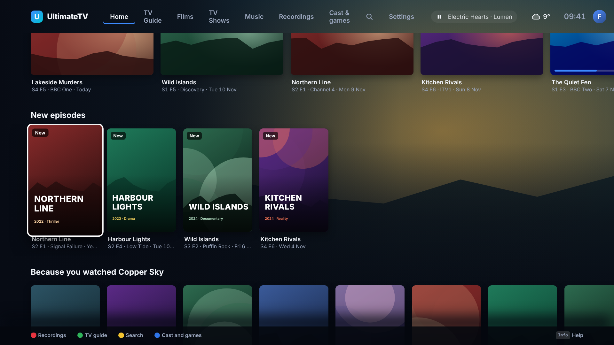
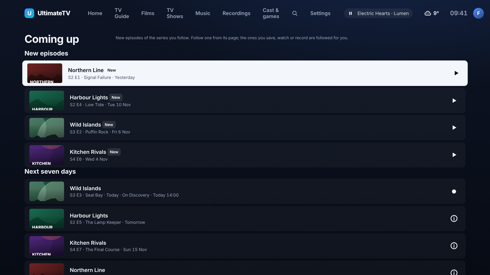
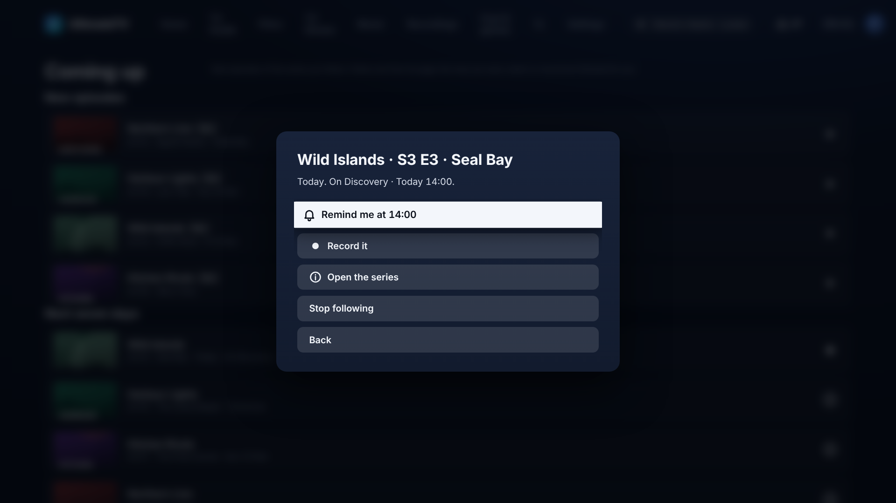
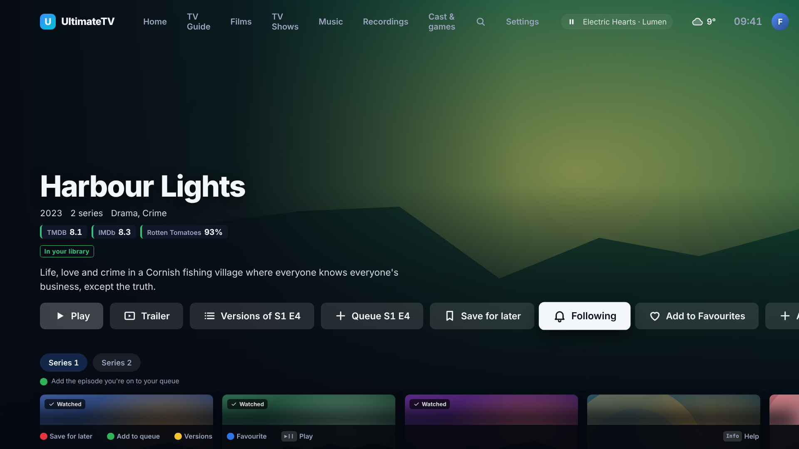

# Coming up: new episodes of the series you follow

Issue #226. Follow a series and UltimateTV tells you when a new episode is out and what is due this
week, the way Apple TV's Up Next and Trakt's calendar do.

## What you see

- **New episodes row on Home** (after Next up): one card per followed series whose latest episode
  arrived in the last 14 days and has not been watched. The card has a **New** badge and says which
  episode ("S2 E1 · Signal Failure · Yesterday", or "In your library" when a media server has it).
  OK opens the series on that episode.
- **Coming up screen** (Home › Coming up button): the new episodes again, then **Next seven days**
  (every followed episode with an air date from today to a week away, with the day), then the list
  of series being **Followed** and why. OK on an air date offers **Remind me** and **Record it** when
  the guide has that episode on a channel, **Open the series** and **Stop following**.

- **Follow button** on a series' page (next to Save for later). Pressing it again unfollows.

- **Pop-up**: when a followed series' new episode arrives, the TV shows "New episode of X: S2 E5"
  for the profile that follows it. Coming up has a switch for it (on by default).

## Who is followed

Each profile has its own list. A series is on it when:

1. you pressed **Follow** on its page; or
2. it is in **Saved for later**, **Continue watching** (including "Next:" after a finished episode),
   the **play queue**, or you have a **series link** (a recording rule) for it.

Stopping to follow a series that was added by itself is remembered, so it does not come back (press
Follow to bring it back). At most 40 series are looked at per profile. A Guest only has what it
follows by choice, because the household's history is not its business.

**Kids rules.** A Kids profile only follows, and is only told about, series its rating allows (and a
parent's allow and block list wins, as everywhere). Series added by itself are filtered the same way,
and a series link is looked up on TMDB first so it has a real rating to check.

## Where the dates come from

- **Air dates**: TMDB. The Hub asks for each series' last and next episode (kept six hours), and for
  the next episode's season so a run of episodes in the week all show. TMDB gives dates, not times, so
  "Today" means some time today. Needs the TMDB key (Settings › Sources); without it the screen says so.
- **A new episode in a library**: Jellyfin, Plex and Emby's latest episodes of a followed series
  that premiered in the last 14 days count as new, with or without TMDB.
- **On a channel** (Remind, Record): the guide, matched by programme name. It is only offered when
  the airing is within about two days of the air date, so a repeat of an old episode is not offered
  as the new one. The Hub only finds the earliest airing of the name, so a show that repeats older
  episodes right before the new one can miss the match; Record from the guide works as always.
- **Watched**: an episode the Hub saw finished (TV, desktop, phone, or from Jellyfin) is dropped.

## The pop-up

The Hub looks every hour (and a minute after it starts). The first look at a series only learns where
it is up to, so following a show with a back catalogue does not flood the TV. After that each newer
episode is announced once per profile. The household-wide list is not announced to Kids or Guest.
Phones are not notified yet (the Home Assistant and ntfy routes in Settings › Alerts are for
problems, not for this).

## Home row

Coming up is a row like the others: Settings › Home rows can hide or move **New episodes**, and
Simple Home leaves it off. The row is not fetched when it is off.

## For developers

- `shared/src/following.ts`: the types; `episode.new` and `following.changed` are Hub events.
- `hub/src/following.ts`: the store (per profile, in the settings database under
  `following:<profile>`), the TMDB look-ups (`TmdbClient.schedule`), the view and the arrival check.
  `hub/src/followingroutes.ts`: `GET/POST /api/following`, `DELETE /api/following/:id?name=`,
  `PUT /api/following/popups` (all need pairing). Home's row is added in `GET /api/home`.
- `ui/src/following.ts`, `ui/src/screens/ComingUp.tsx`, the Follow button in `Details.tsx`.
- The demo Hub (`DEMO=1`) has made-up air dates (`demoSchedule` in `hub/src/demo.ts`).
  Screenshots: `node tools/screenshots/coming-up.mjs`.
- Tests: `hub/test/following.test.ts`.

## Not done yet

- A phone remote or Android screen for Coming up (the TV, the Hub API and the Home row are done).
- A phone notification when an episode arrives (the pop-up is on the TV only).
- Air times: TMDB has no time of day, so "Today" is the whole day.

Untested against a real TMDB key, Jellyfin or the box: built and checked on the demo Hub only.
