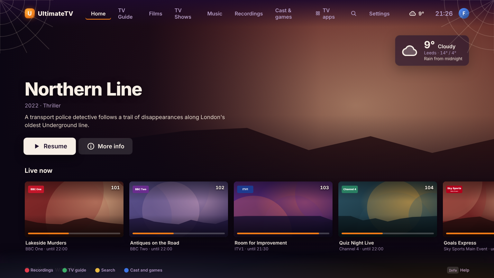
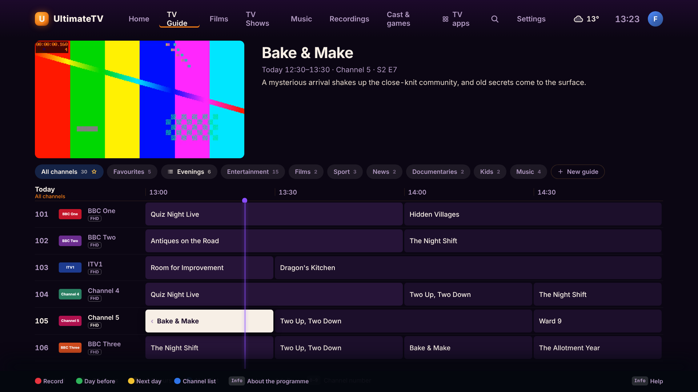
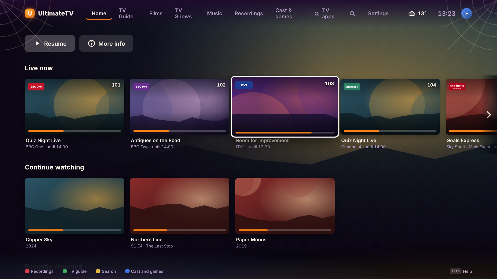
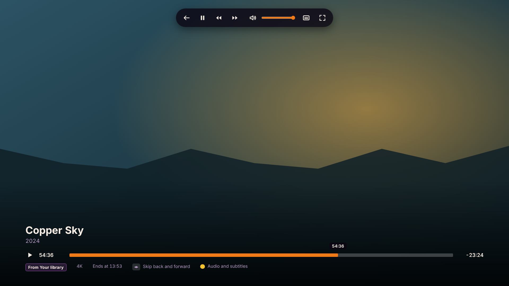

# The TV app on a desktop computer (Windows, Mac, Linux)

The same app that runs on the TV box also runs on an ordinary computer: a **Windows 10 or 11 PC**
(#127), a **Mac** with Apple Silicon or Intel (#128), or a **Linux desktop** such as a Fedora laptop
or an Omarchy (Arch and Hyprland) PC, where it comes as one **AppImage** file. It opens in a normal
window, plays through **mpv**, and uses the same Hub, profiles, guide, recordings and Jellyfin
library as the TV.

How you get it:

| | Download | Installed by |
| --- | --- | --- |
| Windows 10/11 | `UltimateTV-Setup-x64.exe` (or `-arm64`) | The installer, for you alone. No administrator prompt. |
| Mac (Apple Silicon) | `UltimateTV-arm64.dmg` | Dragging the app to Applications. |
| Mac (Intel) | `UltimateTV-x64.dmg` | The same. |
| Linux | `UltimateTV-x86_64.AppImage` | Nothing: it is one file you run. |

All of them are on the repository's
[`desktop-app` release](https://github.com/gazoscalvertos/UltimateTV/releases/tag/desktop-app), and
the Hub offers them too, with QR codes, in **Settings › Apps for your devices** on the TV and under
**Apps** on the phone's settings page, so a computer in the house can be set up without typing a URL.



> **Untested on real desktops.** On Linux the AppImage builds and starts, loads the Hub's TV app,
> plays a test video in mpv's window and goes back to the app (checked in a virtual X11 screen with
> mpv 0.37). The Windows installer and the Mac disk images have **not been built at all yet**: this
> repository has the configuration, the build scripts and the CI jobs for them, but no Windows or
> macOS machine has run them. Read [What's untested](#whats-untested) and
> [What still isn't done](#what-still-isnt-done) before promising either to anyone.

## Which computer it runs on

| | TV box (`tools/box/install.sh`) | A desktop (this page) |
| --- | --- | --- |
| Distributions | Arch Linux, Debian 13 | Windows 10/11, macOS 11 or newer, any recent x86_64 or arm64 Linux |
| Desktop | Takes the machine over: logs straight into a KDE (KWin) kiosk with no desktop | Your own desktop: Windows, macOS, GNOME, KDE, Hyprland, Sway…, on Wayland or X11 |
| Window | Full screen, see-through, over mpv's video | A normal window (F11 for full screen) |
| Video | Under the TV app, inside the guide's preview and behind the player's controls | In mpv's own window, full screen, with mpv's own controls |
| Screen refresh rate, HDR | Switched to match each film | Left alone |
| Sound | Moved to the TV's HDMI, full volume, Dolby passed through | Left alone: your speakers or headphones, everything decoded |
| TV remote (HDMI-CEC) | Pulse-Eight adapter | Off (set `CEC_DEVICE` to use one) |
| Phone remote, Home Assistant | Work the box | Ignored, so they keep working the TV box |
| Updates | Settings › About, through the box's root services | Settings › About: downloads the new build from GitHub |
| mpv | Installed by the box installer | Bundled inside the Windows and Mac apps; on Linux the distribution's |

**Don't run the box installer on a desktop**, Omarchy included. It turns the computer into a TV
box: it logs a `tv` user straight into a kiosk and replaces the login screen.

## Windows

1. Get `UltimateTV-Setup-x64.exe` (most PCs) or `UltimateTV-Setup-arm64.exe` (a Snapdragon or other
   ARM PC) from the [release](https://github.com/gazoscalvertos/UltimateTV/releases/tag/desktop-app),
   or scan the Windows code in the TV's Settings › Apps for your devices with the PC's own camera.
2. Run it. Windows SmartScreen will say the publisher is unknown, because the installer isn't signed
   with a paid certificate (**More info → Run anyway**); this is the same choice as the Mac's
   right-click below, and [Signing](#signing) explains what a certificate would change.
3. It installs **for you alone** into `%LOCALAPPDATA%\Programs\UltimateTV` — no administrator
   password, no UAC prompt, nothing else to download — and offers to put a shortcut on the desktop
   and in the Start menu. There is a **Browse** button if you want it elsewhere.
4. Start it from the Start menu. It shows a four-letter code; let it in on the TV
   ([pairing](#the-first-start-pairing)) and it plays.

Its settings are in **`%APPDATA%\ultimatetv\box.env`** — the same `KEY=value` file as on Linux, so
`HUB_URL=http://192.168.0.19:8095` is the one line most people need. Its log is
`%LOCALAPPDATA%\ultimatetv\logs\ultimatetv-desktop.log`. Uninstalling is **Settings › Apps ›
UltimateTV › Uninstall**, and it keeps `%APPDATA%\ultimatetv` (your pairing and settings) unless you
delete it.

There is also a **`.zip`** beside the installer (`UltimateTV-x64.zip`): unzip it anywhere and run
`UltimateTV.exe`. It is for a PC whose policy blocks installers, and it updates the same way.

The Windows build carries its own **mpv** in its resources folder, so playback works on a PC that has
never had a media player on it. No separate download, no `PATH` setup. `MPV_BIN` in `box.env`
overrides it if you'd rather use another build.

## Mac

1. Get `UltimateTV-arm64.dmg` (Apple Silicon: an M1 or later) or `UltimateTV-x64.dmg` (an Intel Mac)
   from the [release](https://github.com/gazoscalvertos/UltimateTV/releases/tag/desktop-app), or scan
   the Mac code in Settings › Apps for your devices. The Hub's Mac link points at the Apple Silicon
   one, because that is most Macs; the Intel `.dmg` is the line underneath it.
2. Open the `.dmg` and drag **UltimateTV** into **Applications**.
3. **The first time, right-click the app in Applications and choose Open**, then Open again in the
   dialog. That is what macOS asks for an app that isn't signed with a paid Apple certificate —
   double-clicking it would only say the app "cannot be opened because the developer cannot be
   verified". Once is enough per machine.
4. Start it, and let the code in on the TV ([pairing](#the-first-start-pairing)).

Its settings are in **`~/Library/Application Support/ultimatetv/box.env`** and its log in
`~/Library/Logs/UltimateTV/ultimatetv-desktop.log`. To uninstall, drag it from Applications to the
Bin; the settings folder stays until you remove it.

### Signing

Two options, and this repository ships the free one:

| | What it is (what this build does) | Paid Developer ID + notarisation |
| --- | --- | --- |
| Cost | Nothing | 99 USD a year (Apple Developer Program) |
| First start | Right-click → Open, once per Mac | Double-click, like any App Store app |
| Warnings | "cannot be opened because the developer cannot be verified" until you do | None |
| Downloads from a browser | Safari may want a second confirmation | None |
| What CI needs | Nothing (`identity: null` in `tools/desktop/electron-builder.yml`) | A Developer ID Application certificate, its password, an app-specific password and the team id, as CI secrets, plus `notarize` settings |
| Where it is checked | Gatekeeper, on the machine | Gatekeeper and Apple's notary service, before it ships |

The free route is what `mac.identity: null` means: electron-builder does not go looking for a
certificate that isn't there, and the app is ad-hoc signed (enough for Apple Silicon to run it at
all). Nothing else has to change to switch: add the certificate's `base64` to `CSC_LINK`, its
password to `CSC_KEY_PASSWORD`, and `notarize: true` under `mac:` (with `APPLE_ID`,
`APPLE_APP_SPECIFIC_PASSWORD` and `APPLE_TEAM_ID` in the environment), and the same build script
produces a notarised `.dmg`. The `.dmg` and the app inside it have to be signed — electron-builder
does both.

The Mac build also carries its own **mpv** in `UltimateTV.app/Contents/Resources/mpv/`, so playback
works on a Mac that has never had Homebrew on it. That copy has to be made relocatable before it is
put there: see [Bundling mpv](#bundling-mpv). It is the one part of the Mac build that needs real
work before the `.dmg` is worth shipping.

## Linux (the AppImage)

One **AppImage** file that works on any distribution. It opens in a normal window, plays through the
computer's own **mpv**, and updates itself by downloading a new copy of itself.

### Which Linux it runs on

Anything recent, on x86_64 or arm64, Wayland or X11. The AppImage is the one CI publishes; an arm64
one can be built ([Building it yourself](#building-it-yourself)).

### What you need

- **mpv**, 0.37 or newer. The app plays everything through it. Unlike Windows and the Mac, a Linux
  copy is not bundled: the distribution's mpv uses the distribution's own graphics drivers, so
  hardware decoding works out of the box ([why](#how-it-works)).
- **FUSE 2**, which AppImages use to run. If it's missing, the AppImage says so and won't start;
  `--appimage-extract-and-run` is a way round it.
- The **Hub** on your home network.
- Optional: **yt-dlp** (YouTube links sent from a phone and some music channels),
  **go-librespot** (Spotify in the Music tab), **UxPlay** (AirPlay), **RetroArch** and
  **Moonlight** (Cast & games). The app works without them; their parts of the app say they're
  missing.

### Fedora (Workstation, GNOME)

1. Install mpv and FUSE 2:

   ```sh
   sudo dnf install mpv fuse fuse-libs yt-dlp
   ```

2. **Strongly recommended:** Fedora's own FFmpeg leaves out H.264 and HEVC, which most TV channels
   and films use, and its graphics drivers can't decode them in hardware. Turn on RPM Fusion and
   swap in the full versions:

   ```sh
   sudo dnf install \
     https://mirrors.rpmfusion.org/free/fedora/rpmfusion-free-release-$(rpm -E %fedora).noarch.rpm \
     https://mirrors.rpmfusion.org/nonfree/fedora/rpmfusion-nonfree-release-$(rpm -E %fedora).noarch.rpm
   sudo dnf swap ffmpeg-free ffmpeg --allowerasing
   # Intel graphics:
   sudo dnf install intel-media-driver
   # AMD graphics:
   sudo dnf swap mesa-va-drivers mesa-va-drivers-freeworld
   ```

3. Download the AppImage and tell it where the Hub is:

   ```sh
   mkdir -p ~/Applications
   curl -L -o ~/Applications/UltimateTV.AppImage \
     https://github.com/gazoscalvertos/UltimateTV/releases/download/desktop-app/UltimateTV-x86_64.AppImage
   chmod +x ~/Applications/UltimateTV.AppImage
   mkdir -p ~/.config/ultimatetv
   echo 'HUB_URL=http://192.168.0.19:8095' > ~/.config/ultimatetv/box.env
   ~/Applications/UltimateTV.AppImage
   ```

4. **Add it to the app grid** (optional): install **Gear Lever** from Flathub, open it and drop the
   AppImage on it; or add the menu entry by hand (see [A menu entry](#a-menu-entry)).

### Omarchy (Arch Linux, Hyprland)

Omarchy already has mpv. Add FUSE 2 and yt-dlp, then download the AppImage as above:

```sh
sudo pacman -S --needed mpv fuse2 yt-dlp
# Intel graphics, for hardware decoding (AMD's comes with mesa):
sudo pacman -S --needed intel-media-driver
mkdir -p ~/Applications
curl -L -o ~/Applications/UltimateTV.AppImage \
  https://github.com/gazoscalvertos/UltimateTV/releases/download/desktop-app/UltimateTV-x86_64.AppImage
chmod +x ~/Applications/UltimateTV.AppImage
mkdir -p ~/.config/ultimatetv
echo 'HUB_URL=http://192.168.0.19:8095' > ~/.config/ultimatetv/box.env
~/Applications/UltimateTV.AppImage
```

Then add the [menu entry](#a-menu-entry) so it shows in Omarchy's launcher (Super + Space).

Hyprland tiles the app's window like any other. mpv's video window asks for full screen by itself.
If you'd rather the app float, or the video stay in a window, add rules to
`~/.config/hypr/hyprland.conf` (the app's class is `ultimatetv`, the video's `ultimatetv-video`):

```ini
windowrule = float, class:^(ultimatetv)$
windowrule = size 1600 900, class:^(ultimatetv)$
# Video in a window rather than full screen (also add MPV_ARGS=--no-fullscreen to box.env):
# windowrule = float, class:^(ultimatetv-video)$
```

Hyprland's rule syntax changes between releases; `hyprctl clients` shows each window's class if a
rule doesn't take.

### A menu entry

```sh
mkdir -p ~/.local/share/applications ~/.local/share/icons
cd /tmp && ~/Applications/UltimateTV.AppImage --appimage-extract usr/share/icons/hicolor/512x512/apps/ultimatetv.png >/dev/null
cp /tmp/squashfs-root/usr/share/icons/hicolor/512x512/apps/ultimatetv.png ~/.local/share/icons/ultimatetv.png
cat > ~/.local/share/applications/ultimatetv.desktop <<EOF
[Desktop Entry]
Name=UltimateTV
Comment=Live TV, films and series from the Hub
Exec=$HOME/Applications/UltimateTV.AppImage %U
Icon=$HOME/.local/share/icons/ultimatetv.png
Type=Application
Categories=AudioVideo;Video;TV;
StartupWMClass=ultimatetv
EOF
```

## The first start: pairing

The Hub only lets paired screens in. The desktop shows a four-letter code and waits; on the TV,
Settings › Phones and remotes, or on the phone's settings page, it appears as *"<computer name>
wants to join"*. Let it in if the code matches ([pairing.md](pairing.md)). After that, pick a
profile as on the TV.

Windows and the Mac don't start in TV mode the way a box does: on any platform other than Linux the
app is a desktop app without being told, so there is no mode to pick.

## Using it

- **Keyboard:** arrows move, Enter selects, Escape or Backspace goes back, Home goes Home. The
  remote's other buttons: F1–F4 (or R, G, Y, B) are the red, green, yellow and blue keys, F5 the
  guide, F6 info, Page Up and Page Down change channel, 0–9 type a channel number.
- **Mouse:** everything works with the mouse alone, on all three platforms.
  - Pointing at something selects it, as the arrows would; clicking it is OK. Using the keyboard
    afterwards carries on from what you pointed at, and the pointer hides until the mouse moves.
  - **Right-click**, or the mouse's **back button**, is Back.
  - The **wheel** scrolls the page. A row of posters scrolls sideways with Shift and the wheel, a
    touchpad's sideways swipe, or the arrows that show at its ends while you point at it.
  - The **coloured key hints** along the bottom (and "OK to close" on a pop-up) are buttons:
    clicking one presses that key, on whatever is selected.
  - In the **guide**, pointing at a programme selects it, clicking watches it (or opens it if it's
    later), the wheel goes up and down the channels, and Shift and the wheel goes through time.
  - In the **player**, moving the mouse brings up buttons along the top: back, play and pause, skip
    or channel up and down, volume, audio and subtitles, and full screen. A film's bar can be
    clicked or dragged to go to a point, and a double-click is full screen.
  - The pointer hides after three seconds without moving.

  
  
  
- **F11:** full screen and back.
- **While a video plays** it's in mpv's window, which has the keyboard: Space pauses, ←/→ skip
  5 seconds, ↑/↓ a minute, F toggles full screen, M mutes, J changes subtitles, # the sound
  track, and mpv's controls show when the mouse moves (its bar to seek, double-click for full
  screen, right-click to pause, the wheel to seek). **Q, Escape, Backspace, the mouse's back
  button or closing the window** stops the video and goes back to the app.
- **The guide's preview shows live TV**, as on the TV box. mpv's window can't be put inside the
  guide on a desktop (Wayland doesn't let apps place windows, and Windows and macOS don't either), so
  the app plays the channel's picture itself while mpv plays the sound. It costs no extra IPTV
  connection: the Hub shares one stream of a channel with everyone watching it. A channel whose
  picture the computer can't play in the app (HEVC without a hardware decoder, for instance) says
  *Sound only here · OK for the picture* instead. Leaving the guide for Home while something plays
  closes mpv's window; the sound carries on, and opening the player brings the picture back.

## Settings

Settings are one `KEY=value` file per line, in a different folder on each platform:

| | The file |
| --- | --- |
| Windows | `%APPDATA%\ultimatetv\box.env` |
| Mac | `~/Library/Application Support/ultimatetv/box.env` |
| Linux | `~/.config/ultimatetv/box.env` |

Anything set in the environment when the app starts wins (`HUB_URL=… ./UltimateTV.AppImage`), and
`--hub=http://…` on the command line wins over both.

| Setting | What it does |
| --- | --- |
| `HUB_URL` | The Hub (default `http://192.168.0.19:8095`) |
| `MPV_BIN` | A different mpv than the one that comes with the app |
| `MPV_ARGS` | Extra mpv options, space separated, e.g. `--no-fullscreen --fs-screen=1 --hwdec=no` |
| `AUDIO_DEVICE` | mpv's `--audio-device` (`mpv --audio-device=help` lists them) |
| `CEC_DEVICE` | A CEC adapter to use, e.g. `/dev/cec0` (off on a desktop unless set) |
| `UTV_MODE` | `tv` to run as the box would (full screen, see-through, owns the screen and sound). Only for a KDE kiosk session; `--tv` does the same |
| `UPDATE_URL` | Where updates come from (default the repository's `desktop-app` release) |
| `DOWNLOADS_DIR` | Where downloads go (see below) |
| `SELFTEST_DIR` | Where the self-test's clips are kept |
| `SPOTIFY_API` | go-librespot's local API, if you run it yourself (default `http://127.0.0.1:3678`) |

The app's own data (its pairing, the name, AirPlay and download settings) is in Electron's per-user
data folder for the platform, which is `%APPDATA%\ultimatetv` on Windows,
`~/Library/Application Support/ultimatetv` on a Mac, and `~/.config/ultimatetv` on Linux. The log,
fresh each start, is `%LOCALAPPDATA%\ultimatetv\logs\ultimatetv-desktop.log`,
`~/Library/Logs/UltimateTV/ultimatetv-desktop.log`, and `~/.local/state/ultimatetv-desktop.log`.
Downloads default to `Videos\UltimateTV` (Windows), `~/Movies/UltimateTV` (Mac) and
`~/.local/share/ultimatetv/downloads` (Linux).

## Updates

CI builds every desktop build from every change on `main` and puts them on the repository's
[`desktop-app` release](https://github.com/gazoscalvertos/UltimateTV/releases/tag/desktop-app), with
`ultimatetv-desktop.json` (and `ultimatetv-windows.json`, `ultimatetv-macos.json` beside it) naming
the commit they were built from.

**Settings › About** in the app shows the version it runs and whether there's a newer one. What
**Update** does next depends on the platform, and the difference is not cosmetic:

| | Update does | Roll back |
| --- | --- | --- |
| Linux (AppImage) | Downloads the new AppImage next to the old one, swaps them and restarts. Fully automatic. | Works: the old file is kept as `UltimateTV.AppImage.old`. |
| Windows | Downloads the new `UltimateTV-Setup-*.exe` into `%LOCALAPPDATA%\ultimatetv\updates` and **opens it**. The installer upgrades the app in place and restarts it. Windows asks you to click through the wizard. | Not offered: there is no older installer on the machine to go back to. Install an older one from the release page by hand. |
| Mac | Downloads the new `.dmg` into `~/Library/Application Support/ultimatetv/updates` and **opens it**. Drag the app to Applications to replace it, then quit and start it again. | Not offered, for the same reason. |

That is deliberate rather than a shortcut: an installed Windows or Mac app is owned by its installer,
and the person using it need not be an administrator, so the app cannot swap its own files the way an
AppImage can. The app does the part it can do without asking for anything (finding the new build,
downloading it, checking it is really an installer and not an error page) and then hands over to the
installer that already knows how to upgrade itself. The folder the AppImage is in has to be writable
by you (`~/Applications` is). The phone's Update button only updates the TV box, never a desktop.

The desktop app is only the shell: the screens come from the Hub, so most new features arrive when
the Hub is updated, without updating the app at all.

## Bundling mpv

The app doesn't use libmpv: it runs **`mpv` as a separate program** (`box/src/mpv.ts`) and drives it
over mpv's JSON IPC socket. On Linux that program is the distribution's mpv. Windows and macOS have
no mpv to rely on, so those two installers carry one:

```
tools/desktop/vendor/mpv/          <- the source folder, not in git (tools/desktop/vendor/.gitignore)
  mpv.exe                          Windows: the binary …
  libmpv-2.dll, *.dll              … and every library that came with it
or
  mpv                              Mac: the binary …
  lib/                             … and the folder of libraries it loads
    libavcodec.60.dylib, *.dylib
```

The Mac folder keeps its `lib/` subfolder because that is how a relocatable macOS build addresses
its libraries: `@executable_path/lib/libavcodec.60.dylib`. Flattening them beside the binary, as a
Windows build has them, produces an app whose mpv cannot load a single library. `fetch-mpv.sh`
keeps the subfolder for that reason and checks every `@executable_path/...` it finds actually
resolves.

`electron-builder.yml` copies that folder into the app's resources (`extraResources`), so inside an
installed app it is at:

```
%LOCALAPPDATA%\Programs\UltimateTV\resources\mpv\mpv.exe
UltimateTV.app/Contents/Resources/mpv/mpv
```

and `box/src/platform.ts`'s `mpvBinary()` looks there first, then on `PATH`, so a bundled copy always
wins and `MPV_BIN` always wins over both. The Windows IPC socket is a named pipe
(`\\.\pipe\ultimatetv-mpv`) because that is the only form mpv offers there, and `mpvSocket()` says so.

**Where the binaries come from.** Neither is in this repository (they are tens of megabytes and
belong to other projects), and neither is downloaded by the build:

- **Windows:** [shinchiro's builds](https://github.com/shinchiro/mpv-winbuild-cmake/releases) are the
  usual source. Take `mpv-x86_64-*.7z` (or `mpv-aarch64-*` for an ARM PC), unpack it, and its
  contents are what goes in `vendor/mpv`.
- **macOS:** there is no official binary, but there are relocatable builds: the ones at
  [laboratory.stolendata.net](https://laboratory.stolendata.net/~djinn/mpv_osx/) are an `.app` whose
  `Contents/MacOS/` already has `mpv` beside a `lib/` folder addressed as
  `@executable_path/lib/...`, which is exactly the layout `vendor/mpv` wants. Take
  `mpv-arm64-*.tar.gz` for Apple Silicon and `mpv-*.tar.gz` for Intel (mind the `arm64` in the
  name — the plain one is the Intel build). `fetch-mpv.sh mac` unpacks either and copies both parts.
  A Homebrew build also works, but it must be made relocatable first, because its libraries are
  addressed by absolute path — rewrite every install name to point inside the bundle and copy the
  libraries into `vendor/mpv/lib`:

  ```sh
  brew install mpv            # the binary and its libraries, on the Mac doing the build
  mkdir -p tools/desktop/vendor/mpv/lib
  cp "$(command -v mpv)" tools/desktop/vendor/mpv/
  # Then, for each /opt/homebrew/… path otool -L reports (and for each of those libraries'
  # own dependencies, one level at a time):
  otool -L tools/desktop/vendor/mpv/mpv
  cp /opt/homebrew/opt/mpv/lib/libmpv.2.dylib tools/desktop/vendor/mpv/lib/
  install_name_tool -change /opt/homebrew/opt/mpv/lib/libmpv.2.dylib \
    @executable_path/lib/libmpv.2.dylib tools/desktop/vendor/mpv/mpv
  ```

  Repeat until `otool -L` on the binary and on every library names only `@executable_path/…` and
  `/usr/lib/…`. `fetch-mpv.sh` checks for `/opt/homebrew` and `/usr/local` paths and refuses a build
  that still points at them, which is the cheapest way to catch this.

`bash tools/desktop/fetch-mpv.sh win|mac` does the download-and-copy half when `MPV_WIN_URL` or
`MPV_MAC_URL` is set (a `.zip`, `.tar.xz` or `.tar.gz` of the above), and says what it wants when
they aren't. Without the folder, `build-win.sh` and `build-macos.sh` stop before electron-builder
would fail on the missing `extraResources` source. `ALLOW_NO_MPV=1` builds anyway, for looking at the
interface with an mpv from `PATH`.

## If it goes wrong

- **"AppImages require FUSE to run"**: install FUSE 2 (`fuse-libs` on Fedora, `fuse2` on Arch), or
  start it with `--appimage-extract-and-run`.
- **Windows: "Windows protected your PC"**: More info → Run anyway. The installer is unsigned; see
  [Signing](#signing).
- **Mac: "UltimateTV cannot be opened because the developer cannot be verified"**: right-click the
  app in Applications → Open → Open. See [Signing](#signing).
- **The app opens but nothing plays**: the log says `mpv couldn't start (<path>)` or shows mpv's own
  error. On Windows and the Mac check that the app's `resources/mpv` folder is there; on Linux, that
  `mpv --version` works.
- **Choppy or black video**: try `MPV_ARGS=--hwdec=no` to rule out the hardware decoder, and see
  the RPM Fusion step for Fedora. `mpv --hwdec=auto-safe somefile.mkv -v | grep hwdec` shows what
  your mpv can do.
- **"The Hub didn't answer"** screen: check `HUB_URL` in the `box.env` named under
  [Settings](#settings).
- **The TV's phone remote also moves the desktop app**: it shouldn't; the desktop ignores phone
  commands. Make sure the Hub is up to date (the UI that knows comes from the Hub).

## What's untested

Built and checked here: the AppImage builds with electron-builder, starts in desktop mode, reads
`box.env`, loads the Hub's TV app in a 1536×864 window, plays a test file in mpv's own window,
closes the video window outside the player and brings it back, stops on Q, reports its build in
Settings › About, and ignores phone commands. The update and roll back are covered by unit tests
with a pretend download.

Not yet tried:

- **Anything on Windows or macOS at all.** Neither installer has been built, installed, started or
  updated. The YAML for both is valid against electron-builder's own schema and the build scripts
  pass `bash -n`, but that is all that is known: `electron-builder` has not run for either platform,
  and no `.exe`, `.zip` or `.dmg` exists.
- The mouse and the guide's live preview in the real AppImage. Both were checked in Chromium with
  the Hub in demo mode (a stand-in for the box shell): pointing, clicking, right-click, the wheel,
  the row arrows, the key hints, the seek bar, and the preview playing an H.264 stream whose AC-3
  sound the Hub took out. The picture in the preview may run a second or so apart from mpv's sound.
- Fedora with GNOME on Wayland, and Omarchy with Hyprland: window behaviour, focus going back to
  the app after the video, full screen on the right monitor.
- Hardware decoding through VA-API on a real GPU, HDR films on an HDR desktop monitor. On Windows
  the equivalent is D3D11VA and on the Mac VideoToolbox; neither has been tried.
- Sound through PipeWire on a desktop, WASAPI on Windows, CoreAudio on a Mac.
- The real update from the GitHub release (the release only exists once this is merged and CI has
  run on `main`), and roll back.
- A downloaded desktop installer from the Hub's own copy (`/api/desktop/windows/installer`): the
  routes, the QR codes and the validation are tested with a fake GitHub, not with a real release.
- Spotify, AirPlay, games and downloads to the computer.
- An arm64 AppImage.
- Two monitors, display scaling above 100%, and a Windows or Mac laptop's own media keys.

## What still isn't done

For #127 and for #128, in the order that matters:

1. **No mpv is in the repository**, so neither installer can play anything until someone puts one in
   `tools/desktop/vendor/mpv` (see [Bundling mpv](#bundling-mpv)). This is the hard part and it is
   not done: what exists is the wiring (electron-builder copies it in, `mpvBinary()` finds it, the
   build scripts refuse to build without it) and a `fetch-mpv.sh` that will fetch one once it is
   told where from. A Mac mpv needs making relocatable first.
2. **The CI jobs are not in the workflow.** `.github/workflows/ci.yml` is unchanged — the token this
   was done with can't touch workflows. The exact YAML is in
   [ci-desktop-jobs.md](ci-desktop-jobs.md), with the two repository variables it needs. Until
   someone pastes it in, no Windows or Mac build exists to download, and the Hub's Windows and Mac
   links lead to a 503 saying the Hub couldn't get the app from GitHub.
3. **Nothing is signed.** Windows shows SmartScreen's "publisher unknown"; the Mac needs
   right-click → Open. [Signing](#signing) says what a paid certificate would change and what it
   would cost.
4. **Roll back doesn't exist on Windows or the Mac**, for the reason in [Updates](#updates).
5. **The Hub's Windows and Mac pages have no version label** the way the Android apps do
   (`/setup/client-app.json`). It could show the release's date; nothing does yet.

## Building it yourself

```sh
bash tools/desktop/build-appimage.sh             # tools/desktop/out/UltimateTV-x86_64.AppImage
ARCH=arm64 bash tools/desktop/build-appimage.sh  # for arm64

bash tools/desktop/build-win.sh                  # Windows installer and .zip (needs vendor/mpv)
ARCH=arm64 bash tools/desktop/build-win.sh       # an ARM PC

bash tools/desktop/build-macos.sh                # Mac .dmg, for this Mac's architecture
ARCH=x64 bash tools/desktop/build-macos.sh       # an Intel .dmg from an Apple Silicon Mac
```

The Linux and Windows builds run anywhere Node 22 does (`build-win.sh` works on Linux, macOS and
Windows' Git Bash; electron-builder needs Wine on a Linux host to make an installer). The Mac build
runs **only on macOS**: the `.app` is assembled with Apple's `codesign` and the disk image with
`hdiutil`. All of them need an internet connection, because electron-builder fetches Electron and
the packaging tools. The Windows and Mac ones also need `tools/desktop/vendor/mpv` filled in
([Bundling mpv](#bundling-mpv)).

To run the app from a checkout without packaging it:
`npm run build -w shared && npx tsc -b box && npx electron box/dist/main.js --desktop`.

## How it works

- `box/src/mode.ts` decides the mode: desktop for an AppImage (`$APPIMAGE` is set), for anything on
  Windows or macOS, or with `--desktop`; TV on a Linux box otherwise.
- `box/src/platform.ts` is where a desktop install keeps everything, per platform: the settings file,
  the state folder, the log, the downloads folder, the heartbeat, the mpv path and the mpv IPC
  socket (a named pipe on Windows), plus the installer's file name. It takes its platform, its
  environment and its home folder as arguments, so it is tested on any machine
  (`box/test/platform.test.ts`).
- `box/src/main.ts` opens a normal, opaque window in desktop mode and leaves the screen, sound
  and CEC alone; `Display` only reads the screen's modes, and the box's diagnostics aren't sent
  (the Hub keeps the TV box's).
- `box/src/mpv.ts` starts mpv with `--force-window=no` (a window only while there's video),
  mpv's controls and keys, an input file that turns Q, Escape and closing the window into
  `stop` (the mouse's back button too), and no Dolby passthrough. `Player.setLayout` switches the
  video track off outside the full-screen player, which closes the window.
- The guide's preview: `ui/src/components/LivePreview.tsx` plays the channel's
  `/api/live/<id>.ts?video=only` with [mpegts.js](https://github.com/xqq/mpegts.js) (loaded only on
  a desktop). The Hub's live relay shares the one IPTV stream; `hub/src/tsfilter.ts` drops the
  sound, subtitle and teletext packets and rewrites the programme map, so a sound track the
  browser can't decode (AC-3) doesn't stop the picture. The preview has its own holder
  (`…:preview`), so it doesn't take mpv's stream away.
- The mouse: `ui/src/mouse.ts` (on everywhere but the TV box; `html.mouse`). The player's
  full-screen button asks the shell (`toggleFullscreen`), which toggles mpv's window.
- The preload tells the UI it's on a desktop (`window.ultimatetv.desktop`). The UI then doesn't
  start the remote and phone bridges or Home Assistant reporting, because the Hub sends those to
  every paired screen.
- The updates: `box/src/appimage-updates.ts` swaps a new AppImage in for the running one;
  `box/src/desktop-app-updates.ts` does the Windows and Mac version, which downloads the installer
  and opens it. Both have the same face (`status`, `start`, `rollBack`, `history`) as
  `box/src/updates.ts`, which updates the box through its root services, so Settings › About is the
  same screen on all three.
- The builds: `tools/desktop/stage-app.sh` bundles the box shell with esbuild into a plain folder
  that electron-builder can package (shared by `build-win.sh` and `build-macos.sh`), and
  `build-appimage.sh` does the same for Linux by itself. `tools/desktop/electron-builder.yml` has
  the `linux`, `win` and `mac` sections; the file names it produces must match
  `shared/src/desktop.ts`, which is where the Hub's links and the update check get them from.
- The Hub: `hub/src/remoteapp.ts` keeps a copy of each download in its data folder and serves it at
  `/api/desktop/<kind>/installer`, so a computer on the home Wi-Fi can install without reaching
  GitHub; `/api/apps/<name>/qr.svg` draws the codes the TV and the phone show.
- Why mpv isn't inside the AppImage on Linux: the computer's own mpv uses the computer's own
  graphics drivers for hardware decoding. A bundled mpv would carry its own and often fall back to
  slow software decoding. Windows and macOS are the opposite case: there is no system mpv to lean
  on, so a bundled one is the only way playback can work at all.
