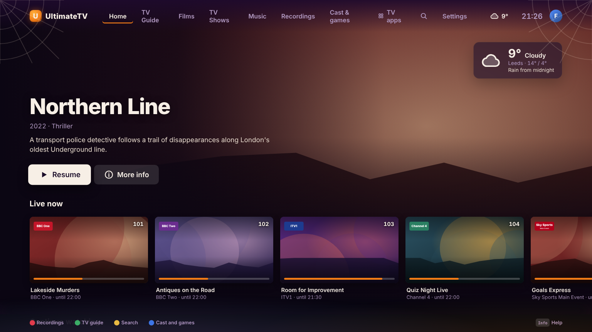
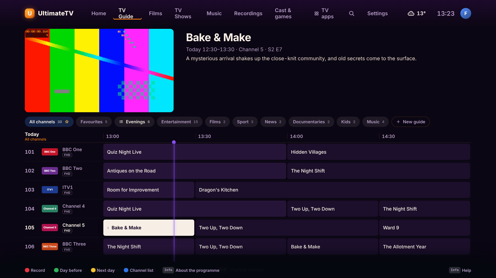
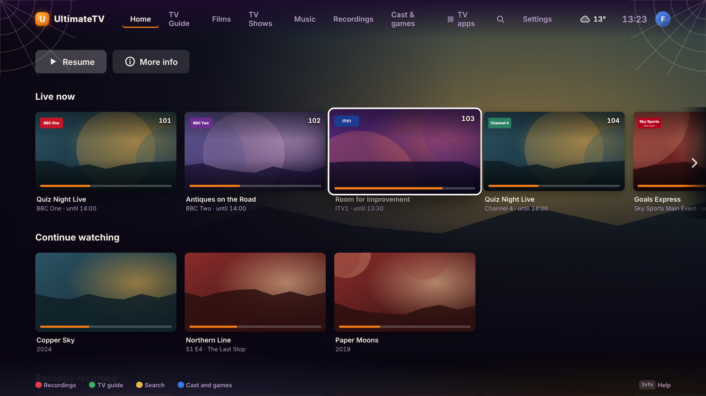
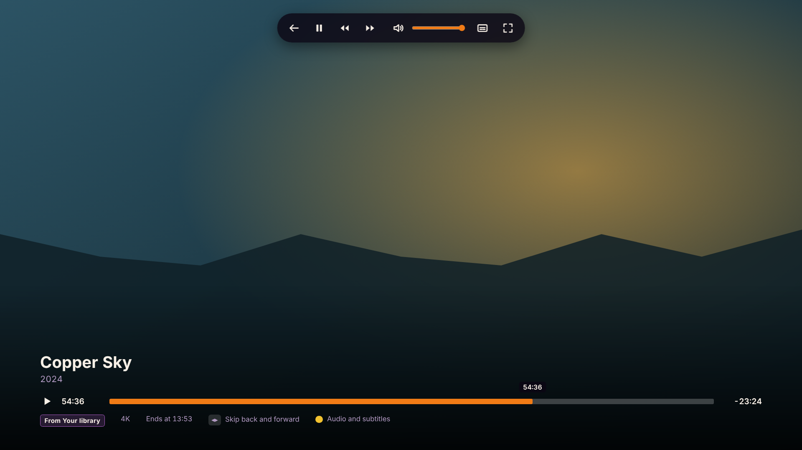

# The TV app on a Linux desktop (AppImage)

The same app that runs on the TV box also runs on an ordinary Linux desktop, such as a Fedora
laptop or an Omarchy (Arch and Hyprland) PC. It comes as one **AppImage** file that works on any
distribution. It opens in a normal window, plays through the computer's own **mpv**, and uses the
same Hub, profiles, guide, recordings and Jellyfin library as the TV.



> **Untested on real desktops.** The AppImage builds, starts, loads the Hub's TV app, plays a test
> video in mpv's window and goes back to the app (checked in a virtual X11 screen with mpv 0.37).
> Fedora (GNOME, Wayland), Omarchy (Hyprland), hardware video decoding, sound, the in-app update
> and roll back have **not** been tried on real machines yet. See [What's untested](#whats-untested).

## Which Linux it runs on

| | TV box (`tools/box/install.sh`) | Desktop (this AppImage) |
| --- | --- | --- |
| Distributions | Arch Linux, Debian 13 | Any recent x86_64 Linux: Fedora, Arch, Omarchy, Ubuntu, Debian… |
| Desktop | Takes the machine over: logs straight into a KDE (KWin) kiosk with no desktop | Your own desktop: GNOME, KDE, Hyprland, Sway…, on Wayland or X11 |
| Window | Full screen, see-through, over mpv's video | A normal window (F11 for full screen) |
| Video | Under the TV app, inside the guide's preview and behind the player's controls | In mpv's own window, full screen, with mpv's own controls |
| Screen refresh rate, HDR | Switched to match each film | Left alone |
| Sound | Moved to the TV's HDMI, full volume, Dolby passed through | Left alone: your speakers or headphones, everything decoded |
| TV remote (HDMI-CEC) | Pulse-Eight adapter | Off (set `CEC_DEVICE` to use one) |
| Phone remote, Home Assistant | Work the box | Ignored, so they keep working the TV box |
| Updates | Settings › About, through the box's root services | Settings › About: downloads the new AppImage from GitHub |

**Don't run the box installer on a desktop**, Omarchy included. It turns the computer into a TV
box: it logs a `tv` user straight into a kiosk and replaces the login screen.

The computer architecture isn't a limit: nothing in the app is x86-only, and an arm64 AppImage can
be built (see [Building it yourself](#building-it-yourself)). CI only publishes the x86_64 one.

## What you need

- **mpv**, 0.37 or newer. The app plays everything through it; without it the app opens but
  nothing plays. Its window shows the video, so mpv's own key bindings work there too.
- **FUSE 2**, which AppImages use to run. If it's missing, the AppImage says so and won't start;
  `--appimage-extract-and-run` is a way round it.
- The **Hub** on your home network.
- Optional: **yt-dlp** (YouTube links sent from a phone and some music channels),
  **go-librespot** (Spotify in the Music tab), **UxPlay** (AirPlay), **RetroArch** and
  **Moonlight** (Cast & games). The app works without them; their parts of the app say they're
  missing.

## Fedora (Workstation, GNOME)

1. Install mpv and FUSE 2:

   ```sh
   sudo dnf install mpv fuse fuse-libs yt-dlp
   ```

2. **Strongly recommended:** Fedora's own FFmpeg leaves out H.264 and HEVC, which most TV channels
   and films use, and its graphics drivers can't decode them in hardware. Turn on RPM Fusion and
   swap in the full versions:

   ```sh
   sudo dnf install \
     https://mirrors.rpmfusion.org/free/fedora/rpmfusion-free-release-$(rpm -E %fedora).noarch.rpm \
     https://mirrors.rpmfusion.org/nonfree/fedora/rpmfusion-nonfree-release-$(rpm -E %fedora).noarch.rpm
   sudo dnf swap ffmpeg-free ffmpeg --allowerasing
   # Intel graphics:
   sudo dnf install intel-media-driver
   # AMD graphics:
   sudo dnf swap mesa-va-drivers mesa-va-drivers-freeworld
   ```

3. Download the AppImage and tell it where the Hub is:

   ```sh
   mkdir -p ~/Applications
   curl -L -o ~/Applications/UltimateTV.AppImage \
     https://github.com/gazoscalvertos/UltimateTV/releases/download/desktop-app/UltimateTV-x86_64.AppImage
   chmod +x ~/Applications/UltimateTV.AppImage
   mkdir -p ~/.config/ultimatetv
   echo 'HUB_URL=http://192.168.0.19:8095' > ~/.config/ultimatetv/box.env
   ~/Applications/UltimateTV.AppImage
   ```

4. **Add it to the app grid** (optional): install **Gear Lever** from Flathub, open it and drop the
   AppImage on it; or add the menu entry by hand (see [A menu entry](#a-menu-entry)).

## Omarchy (Arch Linux, Hyprland)

Omarchy already has mpv. Add FUSE 2 and yt-dlp, then download the AppImage as above:

```sh
sudo pacman -S --needed mpv fuse2 yt-dlp
# Intel graphics, for hardware decoding (AMD's comes with mesa):
sudo pacman -S --needed intel-media-driver
mkdir -p ~/Applications
curl -L -o ~/Applications/UltimateTV.AppImage \
  https://github.com/gazoscalvertos/UltimateTV/releases/download/desktop-app/UltimateTV-x86_64.AppImage
chmod +x ~/Applications/UltimateTV.AppImage
mkdir -p ~/.config/ultimatetv
echo 'HUB_URL=http://192.168.0.19:8095' > ~/.config/ultimatetv/box.env
~/Applications/UltimateTV.AppImage
```

Then add the [menu entry](#a-menu-entry) so it shows in Omarchy's launcher (Super + Space).

Hyprland tiles the app's window like any other. mpv's video window asks for full screen by itself.
If you'd rather the app float, or the video stay in a window, add rules to
`~/.config/hypr/hyprland.conf` (the app's class is `ultimatetv`, the video's `ultimatetv-video`):

```ini
windowrule = float, class:^(ultimatetv)$
windowrule = size 1600 900, class:^(ultimatetv)$
# Video in a window rather than full screen (also add MPV_ARGS=--no-fullscreen to box.env):
# windowrule = float, class:^(ultimatetv-video)$
```

Hyprland's rule syntax changes between releases; `hyprctl clients` shows each window's class if a
rule doesn't take.

## A menu entry

```sh
mkdir -p ~/.local/share/applications ~/.local/share/icons
cd /tmp && ~/Applications/UltimateTV.AppImage --appimage-extract usr/share/icons/hicolor/512x512/apps/ultimatetv.png >/dev/null
cp /tmp/squashfs-root/usr/share/icons/hicolor/512x512/apps/ultimatetv.png ~/.local/share/icons/ultimatetv.png
cat > ~/.local/share/applications/ultimatetv.desktop <<EOF
[Desktop Entry]
Name=UltimateTV
Comment=Live TV, films and series from the Hub
Exec=$HOME/Applications/UltimateTV.AppImage %U
Icon=$HOME/.local/share/icons/ultimatetv.png
Type=Application
Categories=AudioVideo;Video;TV;
StartupWMClass=ultimatetv
EOF
```

## The first start: pairing

The Hub only lets paired screens in. The desktop shows a four-letter code and waits; on the TV,
Settings › Phones and remotes, or on the phone's settings page, it appears as *"<computer name>
wants to join"*. Let it in if the code matches ([pairing.md](pairing.md)). After that, pick a
profile as on the TV.

## Using it

- **Keyboard:** arrows move, Enter selects, Escape or Backspace goes back, Home goes Home. The
  remote's other buttons: F1–F4 (or R, G, Y, B) are the red, green, yellow and blue keys, F5 the
  guide, F6 info, Page Up and Page Down change channel, 0–9 type a channel number.
- **Mouse:** everything works with the mouse alone.
  - Pointing at something selects it, as the arrows would; clicking it is OK. Using the keyboard
    afterwards carries on from what you pointed at, and the pointer hides until the mouse moves.
  - **Right-click**, or the mouse's **back button**, is Back.
  - The **wheel** scrolls the page. A row of posters scrolls sideways with Shift and the wheel, a
    touchpad's sideways swipe, or the arrows that show at its ends while you point at it.
  - The **coloured key hints** along the bottom (and "OK to close" on a pop-up) are buttons:
    clicking one presses that key, on whatever is selected.
  - In the **guide**, pointing at a programme selects it, clicking watches it (or opens it if it's
    later), the wheel goes up and down the channels, and Shift and the wheel goes through time.
  - In the **player**, moving the mouse brings up buttons along the top: back, play and pause, skip
    or channel up and down, volume, audio and subtitles, and full screen. A film's bar can be
    clicked or dragged to go to a point, and a double-click is full screen.
  - The pointer hides after three seconds without moving.

  
  
  
- **F11:** full screen and back.
- **While a video plays** it's in mpv's window, which has the keyboard: Space pauses, ←/→ skip
  5 seconds, ↑/↓ a minute, F toggles full screen, M mutes, J changes subtitles, # the sound
  track, and mpv's controls show when the mouse moves (its bar to seek, double-click for full
  screen, right-click to pause, the wheel to seek). **Q, Escape, Backspace, the mouse's back
  button or closing the window** stops the video and goes back to the app.
- **The guide's preview shows live TV**, as on the TV box. mpv's window can't be put inside the
  guide on a desktop (Wayland doesn't let apps place windows), so the app plays the channel's
  picture itself while mpv plays the sound. It costs no extra IPTV connection: the Hub shares one
  stream of a channel with everyone watching it. A channel whose picture the computer can't play in
  the app (HEVC without a hardware decoder, for instance) says *Sound only here · OK for the
  picture* instead. Leaving the guide for Home while something plays closes mpv's window; the sound
  carries on, and opening the player brings the picture back.

## Settings

Settings go in `~/.config/ultimatetv/box.env`, one per line. Anything set in the environment
when the app starts wins (`HUB_URL=… ~/Applications/UltimateTV.AppImage`), and `--hub=http://…`
on the command line wins over both.

| Setting | What it does |
| --- | --- |
| `HUB_URL` | The Hub (default `http://192.168.0.19:8095`) |
| `MPV_ARGS` | Extra mpv options, space separated, e.g. `--no-fullscreen --fs-screen=1 --hwdec=no` |
| `AUDIO_DEVICE` | mpv's `--audio-device` (`mpv --audio-device=help` lists them) |
| `CEC_DEVICE` | A CEC adapter to use, e.g. `/dev/cec0` (off on a desktop unless set) |
| `UTV_MODE` | `tv` to run as the box would (full screen, see-through, owns the screen and sound). Only for a KDE kiosk session; `--tv` does the same |
| `UPDATE_URL` | Where updates come from (default the repository's `desktop-app` release) |
| `DOWNLOADS_DIR` | Where downloads go (default `~/.local/share/ultimatetv/downloads`) |
| `SPOTIFY_API` | go-librespot's local API, if you run it yourself (default `http://127.0.0.1:3678`) |

The app's own data (its pairing, the name, AirPlay and download settings) is in
`~/.config/ultimatetv`. The log is `~/.local/state/ultimatetv-desktop.log`, fresh each start.

## Updates

CI builds the AppImage from every change on `main` and puts it on the repository's
[`desktop-app` release](https://github.com/gazoscalvertos/UltimateTV/releases/tag/desktop-app),
with `ultimatetv-desktop.json` naming the commit it was built from.

**Settings › About** in the app shows the version it runs and whether there's a newer one;
**Update** downloads the new AppImage next to the old one, swaps them and restarts. The old file is
kept as `UltimateTV.AppImage.old`, so **Roll back** puts it back. The folder the AppImage is in
has to be writable by you (`~/Applications` is). The phone's Update button only updates the TV box,
never a desktop.

The desktop app is only the shell: the screens come from the Hub, so most new features arrive
when the Hub is updated, without updating the AppImage.

## If it goes wrong

- **"AppImages require FUSE to run"**: install FUSE 2 (`fuse-libs` on Fedora, `fuse2` on Arch), or
  start it with `--appimage-extract-and-run`.
- **The app opens but nothing plays**: is mpv installed (`mpv --version`)? The log says
  `mpv didn't start` or shows mpv's own error.
- **Choppy or black video**: try `MPV_ARGS=--hwdec=no` to rule out the hardware decoder, and see
  the RPM Fusion step for Fedora. `mpv --hwdec=auto-safe somefile.mkv -v | grep hwdec` shows what
  your mpv can do.
- **"The Hub didn't answer"** screen: check `HUB_URL` in `~/.config/ultimatetv/box.env`.
- **The TV's phone remote also moves the desktop app**: it shouldn't; the desktop ignores phone
  commands. Make sure the Hub is up to date (the UI that knows comes from the Hub).

## What's untested

Built and checked here: the AppImage builds with electron-builder, starts in desktop mode, reads
`box.env`, loads the Hub's TV app in a 1536×864 window, plays a test file in mpv's own window,
closes the video window outside the player and brings it back, stops on Q, reports its build in
Settings › About, and ignores phone commands. The update and roll back are covered by unit tests
with a pretend download.

Not yet tried:

- The mouse and the guide's live preview in the real AppImage. Both were checked in Chromium with
  the Hub in demo mode (a stand-in for the box shell): pointing, clicking, right-click, the wheel,
  the row arrows, the key hints, the seek bar, and the preview playing an H.264 stream whose AC-3
  sound the Hub took out. The picture in the preview may run a second or so apart from mpv's sound.

- Fedora with GNOME on Wayland, and Omarchy with Hyprland: window behaviour, focus going back to
  the app after the video, full screen on the right monitor.
- Hardware decoding through VA-API on a real GPU, HDR films on an HDR desktop monitor.
- Sound through PipeWire on a desktop.
- The real update from the GitHub release (the release only exists once this is merged and CI has
  run on `main`), and roll back.
- Spotify, AirPlay, games and downloads to the computer.
- An arm64 build.

## Building it yourself

```sh
bash tools/desktop/build-appimage.sh             # tools/desktop/out/UltimateTV-x86_64.AppImage
ARCH=arm64 bash tools/desktop/build-appimage.sh  # for arm64
```

It needs Node 22 and an internet connection (electron-builder fetches Electron and the AppImage
tools). To run the app from a checkout without packaging it:
`npm run build -w shared && npx tsc -b box && npx electron box/dist/main.js --desktop`.

## How it works

- `box/src/mode.ts` decides the mode: desktop for an AppImage (`$APPIMAGE` is set) or with
  `--desktop`, TV otherwise. In desktop mode it reads `~/.config/ultimatetv/box.env`.
- `box/src/main.ts` opens a normal, opaque window in desktop mode and leaves the screen, sound
  and CEC alone; `Display` only reads the screen's modes, and the box's diagnostics aren't sent
  (the Hub keeps the TV box's).
- `box/src/mpv.ts` starts mpv with `--force-window=no` (a window only while there's video),
  mpv's controls and keys, an input file that turns Q, Escape and closing the window into
  `stop` (the mouse's back button too), and no Dolby passthrough. `Player.setLayout` switches the
  video track off outside the full-screen player, which closes the window.
- The guide's preview: `ui/src/components/LivePreview.tsx` plays the channel's
  `/api/live/<id>.ts?video=only` with [mpegts.js](https://github.com/xqq/mpegts.js) (loaded only on
  a desktop). The Hub's live relay shares the one IPTV stream; `hub/src/tsfilter.ts` drops the
  sound, subtitle and teletext packets and rewrites the programme map, so a sound track the
  browser can't decode (AC-3) doesn't stop the picture. The preview has its own holder
  (`…:preview`), so it doesn't take mpv's stream away.
- The mouse: `ui/src/mouse.ts` (on everywhere but the TV box; `html.mouse`). The player's
  full-screen button asks the shell (`toggleFullscreen`), which toggles mpv's window.
- The preload tells the UI it's on a desktop (`window.ultimatetv.desktop`). The UI then doesn't
  start the remote and phone bridges or Home Assistant reporting, because the Hub sends those to
  every paired screen.
- `box/src/appimage-updates.ts` does the updates; `tools/desktop/build-appimage.sh` bundles the box
  shell with esbuild and packages it with electron-builder (`tools/desktop/electron-builder.yml`);
  the `desktop-appimage` CI job publishes it.
- Why mpv isn't inside the AppImage: the computer's own mpv uses the computer's own graphics
  drivers for hardware decoding. A bundled mpv would carry its own and often fall back to slow
  software decoding.
