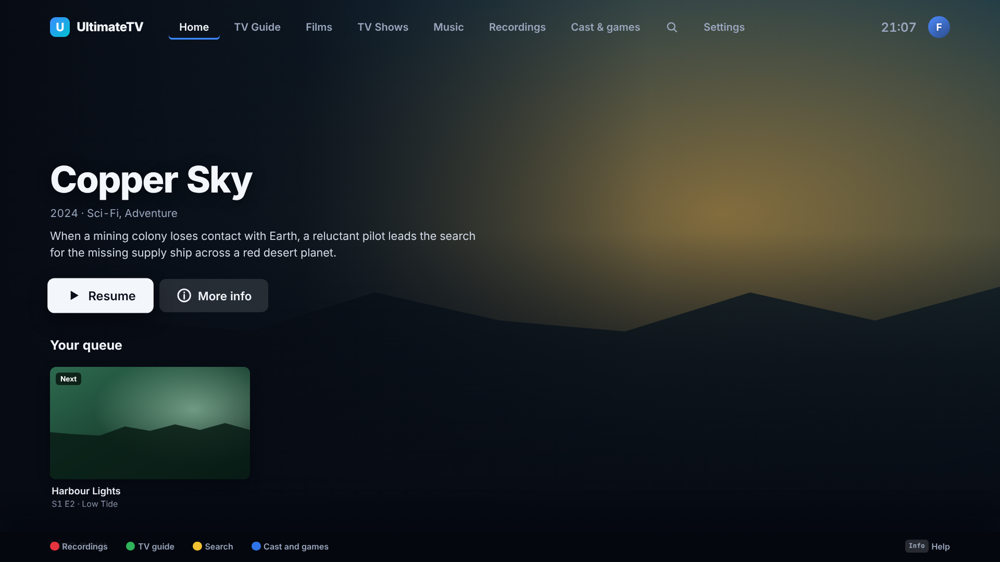

# Everyday extras

The small things that make the TV easier to live with: what the buttons do, the sleep timer, alerts
before things break, Save for later, skipping the adverts in recordings, and seasonal clips.

## What the buttons do

A strip along the bottom of each screen says what the colour keys do there, as Sky Q does. **Info**
opens a help screen with the remote drawn and every button explained (in the TV guide, Info still
opens the programme; help is a press away anywhere else). On Home the colour keys are shortcuts:
**Red** Recordings, **Green** TV guide, **Yellow** Search, **Blue** Cast and games.



## Sleep timer

From **Options** while watching (Yellow), the phone remote's moon button, or by voice ("sleep in half
an hour", "sleep at the end of this", "cancel the sleep timer"). 15 minutes to 2 hours, or the end of
the programme, film or episode. A minute before, a card asks **Still watching?** (OK gives another 15
minutes). Then the sound fades, playback and music stop, and the TV goes to standby over HDMI-CEC. The
top bar shows a moon with the time while one is set.

## Alerts

The Hub checks every 30 minutes for the things that stop TV working, and says so before they do:

- the IPTV subscription running out (from the provider's `exp_date`) and TorBox premium running out,
  14 days ahead by default;
- the TV guide not updating (so it would run out and recordings be missed);
- recordings failing;
- the NAS getting full (under 50 GB free by default);
- live TV failing to start (the TV reports it; the viewer gets a kind message rather than an error).

They go to a **Home Assistant webhook** (a JSON POST with `title`, `message`, `level` and `key`, ready
for a notify action) and/or an **ntfy** topic for a phone notification without Home Assistant, and
show as a small card on the TV for the grown-ups (never on Kids). Set them in **Settings › Alerts** on
the TV or through `PUT /api/alerts/settings`. Each problem is sent once, and again only if it gets worse.

```yaml
# Home Assistant: an automation with a webhook trigger, forwarding to your phone
trigger: { platform: webhook, webhook_id: ultimatetv-alerts, local_only: true }
action:
  - service: notify.mobile_app_your_phone
    data: { title: "{{ trigger.json.title }}", message: "{{ trigger.json.message }}" }
```

The webhook URL is then `http://homeassistant.local:8123/api/webhook/ultimatetv-alerts`.

## Save for later

Red (or **Save for later**) on a film or series page, **Save for later** on the phone's title page,
or by voice ("save Dune for later", "add The Bear to my watchlist"). Each profile has its own list,
shown as a **Saved for later** row on Home. Things saved from a phone or by voice, which don't know who
is watching, go on the household's list, which every profile sees with its own (Kids only what its
rating allows). A name saved before any source has it ("that film from work") waits and turns into
the title once a search finds it.

## Skip the adverts in recordings

The Hub runs [comskip](https://github.com/erikkaashoek/Comskip) over each new recording (it's built
into the Hub's Docker image) and keeps the breaks it finds. Playing the recording then shows **Skip
adverts** in each break, like Skip intro, or jumps straight past them if **Settings › Recording ›
Adverts in a recording** says so. Comskip is good on UK channels with logos and silent breaks, but not
perfect: going back into a break plays it, and a break it misses just plays. Older recordings can be
scanned with `POST /api/recordings/:id/adscan`.

## Seasonal clips

Like the projections people put in their windows: now and then, something friendly drifts across the
TV while a season lasts. With nothing uploaded the TV draws its own: a sleigh, snow and presents at
Christmas, fireworks at New Year and on Bonfire Night, hearts on Valentine's Day, a hopping bunny and
eggs at Easter, a friendly ghost and bats at Halloween, balloons and confetti for a birthday.

- **Settings › Seasonal clips**: on or off, follow the calendar or keep one season on (a birthday
  party), how often, how long, how loud, on Kids too (on by default: they're friendly).
- **Your own**: the phone remote's **Cast › Seasonal clips › Add your own** uploads a GIF, animated
  WebP, short video or picture, with its season and how it moves (across the top, along the bottom,
  falling, rising, or in a corner).
- **Shared by others**: the TV lists the community library in
  [community/clips](../community/clips/README.md) and downloads a clip in one press. Jump scares can be
  shared there too. Anyone can add theirs with a pull request.


