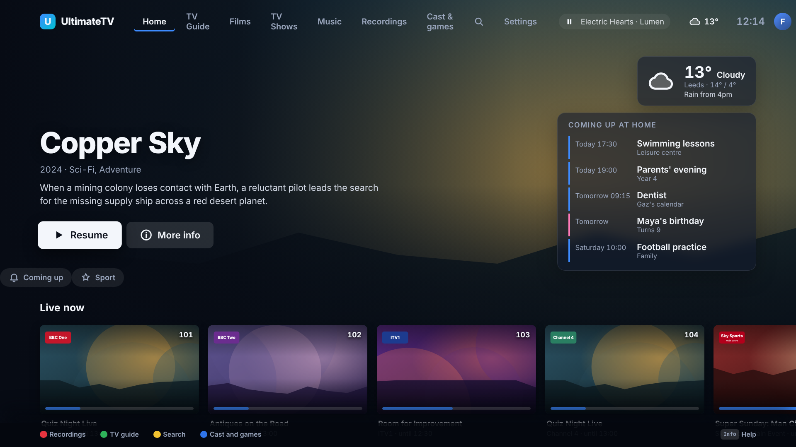
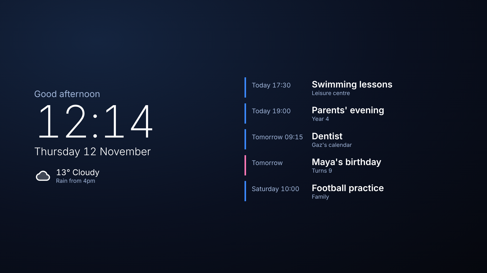

# Family board: today at home

Issue #233. Google Nest Hub and Samsung's ambient mode make the TV useful when nobody is watching.
This is the same idea: one view of the household's day on Home and when the TV is idle.

## What it shows

The next five things in the coming week, soonest first (today's first), each with a coloured bar:

- **Calendar events** (blue) from the calendars you add. Events that have finished drop off.
- **Birthdays** (pink), with "Turns 7" when you gave the year.
- **Bin day** (green), and a line like "Green bin out tonight" from 17:00 the evening before, or
  "collected today" on the day.
- **School run** (amber): "School run 08:15" on school days, until a quarter of an hour after it.

On Home it's a card under the weather (Settings › Family board › Card on Home, 3 to 8 items). As an
idle screen it's the **Today** screensaver: pick it in Settings › Screensaver (or the phone's
Screensaver section). It has a big clock, the date and a greeting, the weather and its headline,
the bin line, and the list. It moves a little every minute so nothing burns in. It isn't in
Shuffle. With nothing set up (or on a Guest profile) it falls back to Landscapes.

## Setting it up

Settings › Family board on the TV, or **Family board** on the phone's Settings page (much easier for
pasting links).

| What | How |
|---|---|
| Calendar link | Any iCal (.ics) address: Google Calendar › Settings › your calendar › **Secret address in iCal format**; Nextcloud/iCloud share link; Outlook published calendar. `webcal://` works. Repeating events, exceptions, edited occurrences and time zones are understood. |
| Home Assistant calendar | The Home Assistant address and a long-lived access token (your profile page in Home Assistant), then the entity, like `calendar.family`. The Hub keeps the token and never sends it back to a screen. |
| Birthdays | Name and date (14 March, 14/3, or 14/3/2017 for the age). |
| Bin day | **A schedule**: each bin, its weekday, how often, and one date it is collected (so alternate weeks line up). Or **Home Assistant**: sensors whose state is the next collection date (or days to go). |
| School run | A label, a time and the days. |

Calendars are read every 15 minutes (and when you save); **Read the calendars now** says which one
failed and why. The last good reading is kept if a calendar is away.

## Privacy

- Calendar links can be secret addresses, so the settings (and the token) are for grown-ups only:
  the Hub asks for the PIN, like other settings.
- A calendar is **grown-ups only** until you tick *Kids can see it*. The Hub removes everything else
  before it answers a Kids profile, so it never reaches that screen.
- **Kids profiles** see a reduced version: today and tomorrow only, three things at most. Birthdays
  can be switched off for them.
- A **Guest** sees nothing from the board.

## How it works

`shared/src/family.ts` has the settings, date rules and wording; `hub/src/ical.ts` reads iCal;
`hub/src/family.ts` fetches, caches and serves `GET /api/family` (cleaned for the profile asking)
and `GET/PUT /api/family/settings` (adults). The TV loads it in `ui/src/family.ts` and refreshes on
the `family.changed` event. Demo mode makes up a household for the screenshots
(`node tools/screenshots/family.mjs`).

## Not done

Untested against real Google, Nextcloud and Home Assistant servers; no phone remote or Android
screen; no weather-aware school run or commute times; Today isn't in Shuffle.
