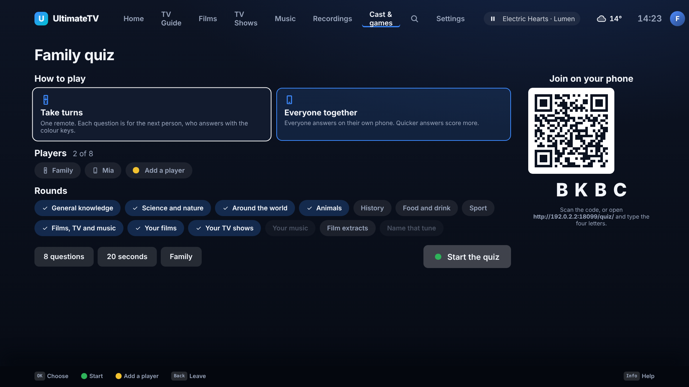
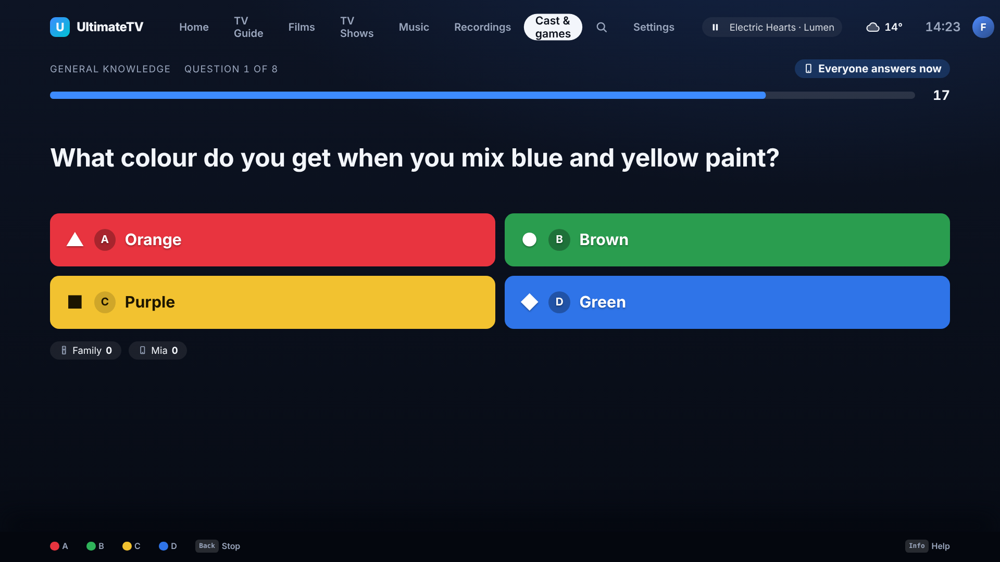
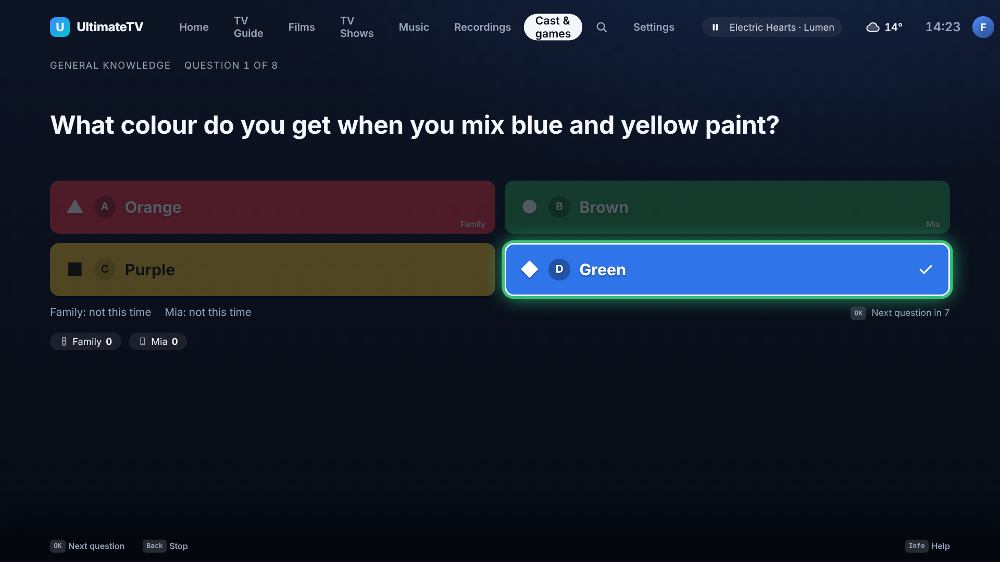
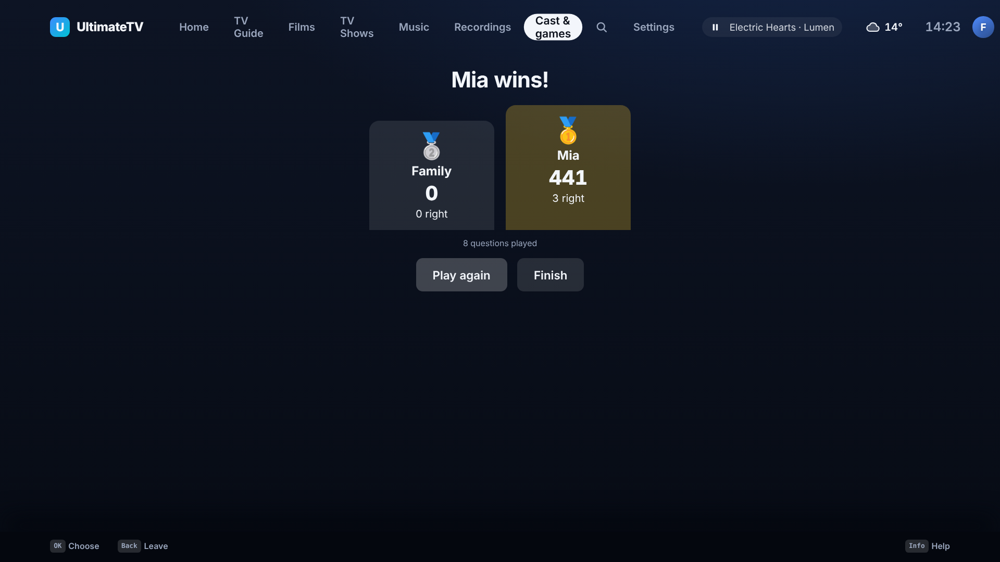
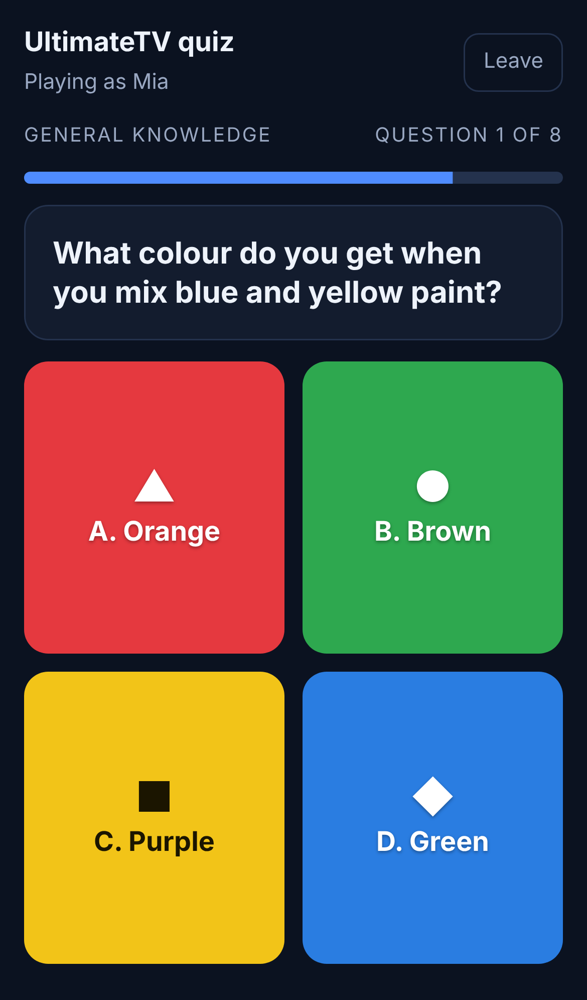

# Family quiz

Issue #264. A quiz for the sofa: a question appears on the TV with four coloured answers, and
people answer with the remote's **Red, Green, Yellow and Blue** keys, or on their own phones. It is
in **Cast and games** (Blue on Home), next to the games, and it works on the Kids profile too.

## How a game goes

1. **Cast and games › Family quiz.** Whoever opened it is the first player. **Add a player** (Yellow)
   types a name for someone using the remote.
2. Pick **how to play**:
   - **Take turns**: one remote. Each question is for the next person, who answers with the colour keys.
   - **Everyone together**: everyone answers at once on their own phone, and quicker right answers
     score more (100 points, up to 50 more for speed). One person can also play with the remote.
3. Pick **rounds** (see "Where the questions come from"), the **number of questions** (8, 12, 20, 30),
   the **time** to answer (15, 20 or 30 seconds, or no limit) and the **difficulty**.
4. **Start the quiz** (Green). The question and its four answers fill the screen.

- **Red = A (▲), Green = B (●), Yellow = C (■), Blue = D (◆).** Each answer also carries a letter
  and a shape, for anyone who can't tell the colours apart.
- Once the question is over the right answer lights up, who picked what is shown, and the scores
  update. **OK** moves on, or it moves on by itself after nine seconds, so a game played only on
  phones needs no remote.
- At the end there is a podium, with **Play again** (same players, fresh questions) and **Finish**.

## If the colour keys don't arrive

The Hisense remote reaches the box over HDMI-CEC and the colour keys already drive Home (Red
Recordings, Green TV guide, Yellow Search, Blue Cast and games), so they should work. If the TV keeps
them to itself, three fallbacks work with no setup: the number keys **1 to 4**, the **arrows and OK**
(press an arrow to pick an answer, OK to lock it in), or answering on a **phone**.

## Phones

The lobby shows a QR code and four letters. A phone scans it (or opens the address and types the
letters), types a name and gets four big coloured buttons. No app, no pairing: the code is the key
to that one game, and all it grants is a seat in it. The phone remote's **Cast** sheet has **Join
the quiz on this phone**, which opens the same page with the code filled in.

The page works in any browser on the home network. The Hub runs the whole game, so the TV and every
phone always agree, and a phone that reloads rejoins where it was. The Android watching app has no
quiz screen of its own yet: use the phone's browser.

## Where the questions come from

Nothing copyrighted is bundled. Questions come from two places:

- **The built-in bank** (`hub/src/quizbank.ts`): about a hundred general knowledge questions written
  for this app in eight rounds (General knowledge, Science and nature, Around the world, Animals,
  History, Food and drink, Sport, Films TV and music). Each is easy, medium or hard, and the game
  picks by the difficulty. Add your own by adding a line.
- **Your own library**, made on the fly from what the Hub already knows:
  - **Your films** and **Your TV shows** (Jellyfin, Plex or Emby): *Which film is this?* with the
    poster blurred until the answer is out; the description with the title blanked out; *Who was in
    it?*, with actors from your other films as the wrong answers; and *which year*.
  - **Your music**: *Who sings this?* and *Which of these songs is by …?* from the videos on the music
    channels.
  - **Film extracts** and **Name that tune**: the TV plays about fifteen seconds from the middle of
    one of your films, or twelve of a music video, full screen with the name hidden, then asks what
    it was. The Back key skips it. It plays through the normal player, so it never counts as
    watched or shows in Continue watching.

Library rounds only appear once the library has enough to make four different answers (at least four
films, say, or four artists). A round with too little shows greyed out.

## Kids and the family

- The Kids profile only gets **Easy** and **Family** questions, and only films and shows it is
  allowed to see (the same rule as the rest of the app, including a parent's allow and block lists).
  Music videos are never used for Kids or Guest profiles. Kids can open Cast and games even when
  games are off, to reach the quiz; the games stay behind the grown-ups' switch.
- **Easy** is for little ones (blurred posters, simple questions), **Family** is the default, and
  **Tricky** is for the grown-ups.
- A wrong answer never costs points. A game is not saved; ending it clears the table.

## Choices you may want to change

- **One quiz at a time**, run on the Hub, not on the TV: that is what lets phones and the remote
  share one game. It is in memory, so a Hub restart ends it.
- **Scoring**: 100 for a right answer, plus up to 50 for speed when everyone answers together; no
  speed bonus when taking turns. It is `quizPoints` in `shared/src/quiz.ts`.
- **Turns**: one player answers, nobody else can steal. Say if you'd rather the next person gets a
  go when it is wrong.
- **The Kids profile always has the quiz**, even with games switched off, and the quiz follows the
  Cast and games switch in Settings › Features on each screen.
- **Extracts** play a fixed few seconds from between 15% and 70% into a film, so one can land on a
  quiet or dark stretch; the host can skip a question.

## Needs from you

Nothing to install. Update the Hub (`bash tools/hub/update.sh`) and the box's app; the phone remote
needs a reload to show the new Cast sheet button. Built untested on the real TV: try it first with
the colour keys on the Hisense, then with a phone, then a film extract.
