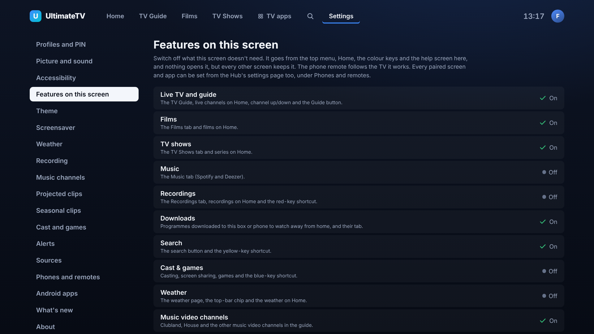
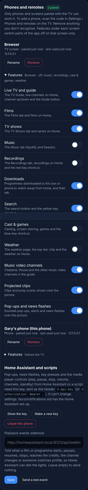
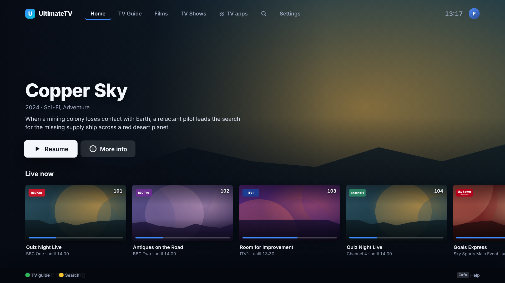
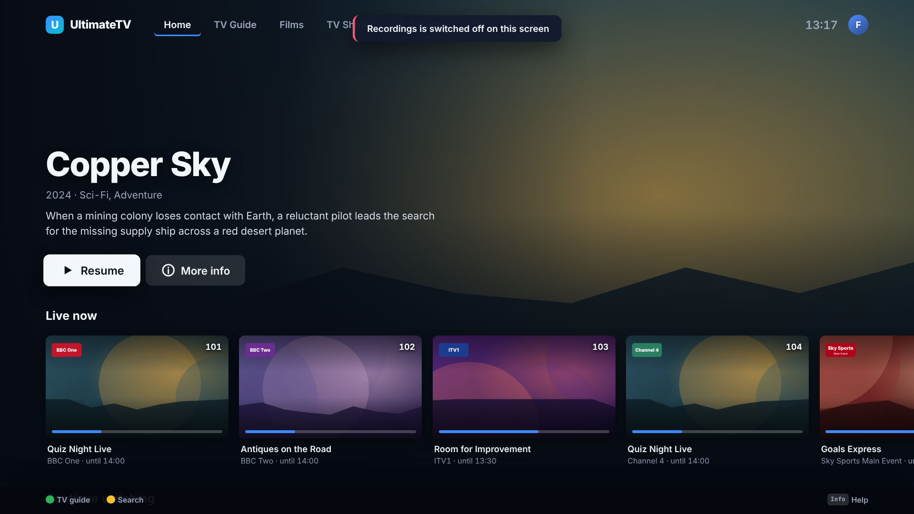
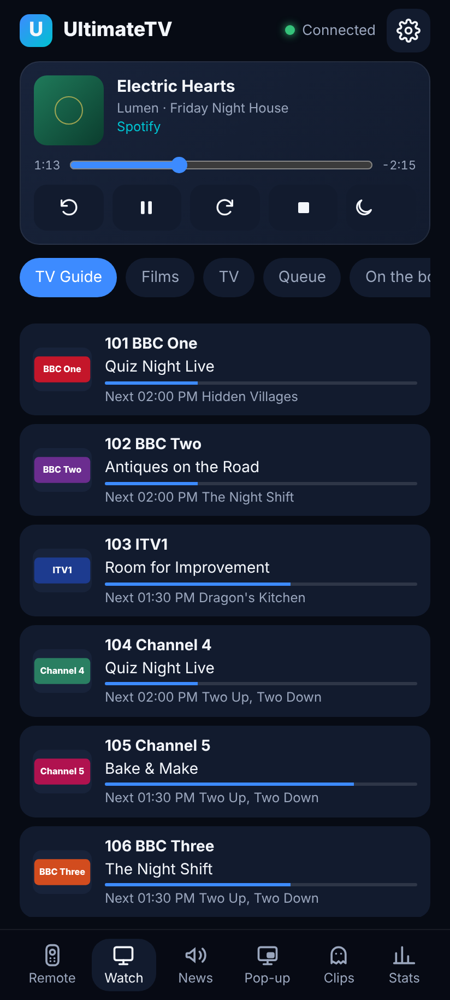

# Features on each screen

Each screen and app can switch off the parts of UltimateTV it doesn't need. The TV box in the living
room can drop Cast & games, a desktop in the study can drop Live TV, and a child's tablet can be just
Films and TV shows. Switching something off on one screen leaves every other screen as it was.
(Issue #124.)

## Where to set it

- **On the TV or the desktop app:** Settings › Features on this screen. OK switches the row on or off.
- **On the Hub's settings page** (the phone's Settings button, or `/setup/`): Phones and remotes, then
  Features under any paired screen or app. This is the place to set a screen you aren't sitting at.
- **On the Android watching app:** Settings › Features on this phone. The phone has to be paired with
  the TV (Settings › Pair with the TV) so the Hub can tell it apart from other phones.

Changes need a grown-up's PIN once one is set, the same as the rest of Settings. Kids profiles never
see Settings.

## What can be switched off

| Feature | What goes |
|---|---|
| Live TV and guide | The TV Guide tab, live channels on Home, channel up/down, the Guide button, channels in search |
| Films | The Films tab, films on Home and in search; a film's page doesn't open |
| TV shows | The TV Shows tab, series on Home and in search; a series' page doesn't open |
| Music | The Music tab (Spotify and Deezer) |
| Recordings | The Recordings tab, recordings on Home and in search, the red key on Home |
| Downloads | Downloading to the box or phone, and the Downloaded tab. Downloads already going carry on. |
| Search | The search button and the yellow key on Home |
| Cast & games | The Cast & games tab, the blue key, screen sharing, AirPlay and links sent from a phone |
| Weather | The weather page, the temperature in the top bar and the weather on Home |
| Music video channels | Clubland, House and the other music video channels in the guide |
| Projected clips | Clips and jump scares shown over the picture |
| Pop-ups and news flashes | Doorbell pop-ups, alerts and news flashes over the picture |

The Android app only offers the ones it has (Live TV, Films, TV shows, Recordings, Downloads, Search).
Home, Settings and the player can't be switched off.

## Nothing reaches a switched-off feature

A switched-off feature isn't just hidden. The TV app refuses to open its screens, whatever asks: a tab,
a colour key, the Guide button, a phone remote request, voice ("watch BBC One" with Live TV off), or a
link into the app. It says "… is switched off on this screen" instead.

## The phone remote

The phone remote has no list of its own: it follows the TV it works. Something switched off on the TV
box goes from the remote too (the Guide button, the Watch tab's lists, Cast, Clips, News and Pop-up).
With more than one TV box, the remote only hides what is off on all of them. The desktop app is left
out, as it doesn't take phone commands.

## Where it's kept

On the Hub, in its database (`client-features`, by paired-device id), so it survives restarts and app
updates and goes into the nightly backup. Each screen also remembers its own list, so a switched-off
feature stays hidden while the Hub is slow to answer after a restart. Removing a paired device forgets
its list. With `PAIRING=off` on the Hub, screens can't be told apart and everything stays on.

## For developers

- The list of features: `shared/src/features.ts` (`FEATURES`, `featureOfRoute`, `featureOfPlayback`).
- Hub: `hub/src/features.ts`; `GET /api/features?client=box|desktop|browser|android|remote`,
  `GET /api/features/devices`, `PUT /api/features/:id { off: [...] }` (settings PIN). A change sends
  `features.changed` to the screens.
- TV app: `ui/src/features.ts`; `nav` in `ui/src/store.ts` refuses blocked screens and `play()` refuses
  blocked playback.
