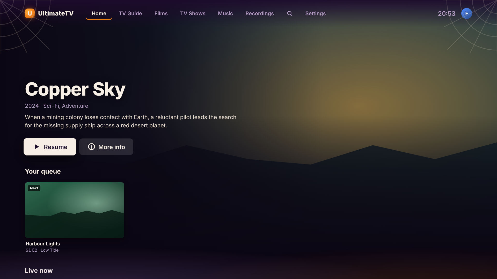
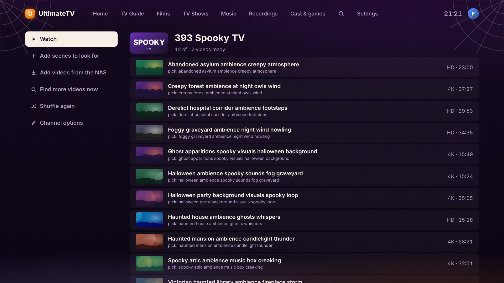
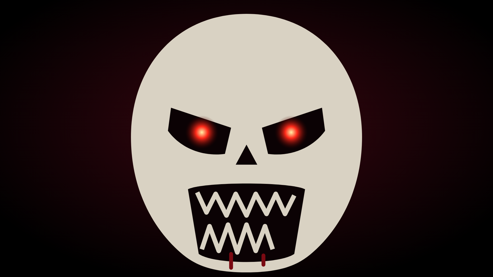
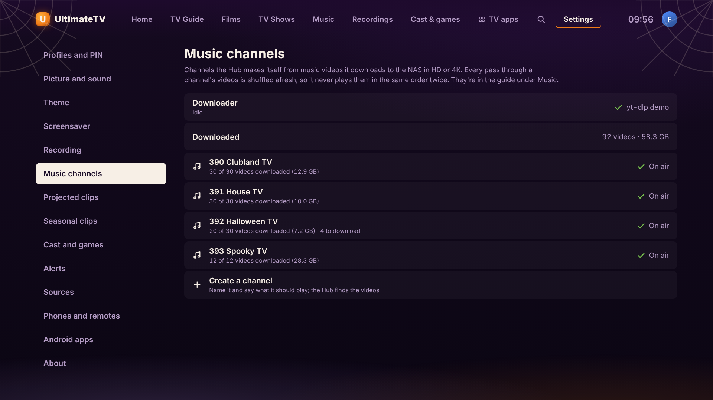
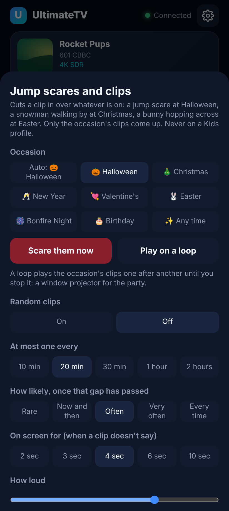
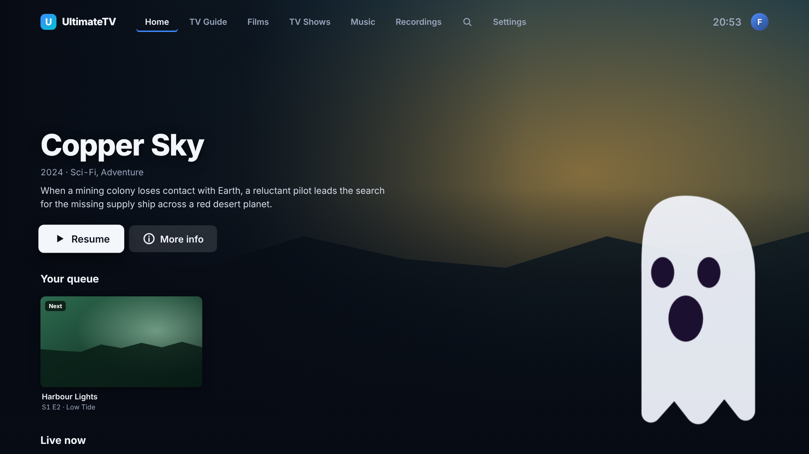
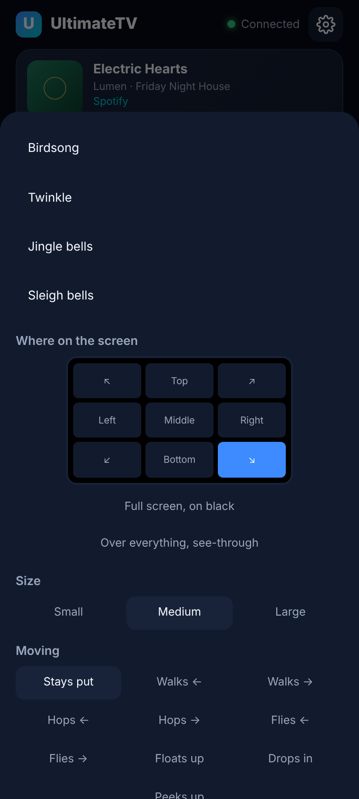

# Halloween: the theme, Spooky TV and jump scares

Three separate things, each of which can be left on all year or turned off entirely:

- a **Halloween theme** for the TV app, with decorations and a few hidden easter eggs,
- **Spooky TV**, a channel of haunted houses and ghost sounds the Hub fills itself,
- **jump scares**, a short clip cut in over whatever is on, worked from the phone remote.



## The theme

TV › **Settings › Theme**, or the phone remote's ⚙ › Theme. It's one of several themes (see
[themes.md](themes.md)); with **Seasonal themes** on, the default, it comes out by itself from
25 October to 1 November and your own theme comes back after.

When it's on, the menus are orange on deep purple, cobwebs hang in the top corners, fog drifts
along the bottom, and a bat flaps across every minute or so. None of it appears while something is
playing, and none of it on a Kids profile.

### Easter eggs

These work whatever the theme is (but not on a Kids profile). Press on the remote, or the phone's
pad:

| Keys | What happens |
| --- | --- |
| Up, Up, Down, Down, Left, Right, Left, Right | Three ghosts drift up the screen with a wail, and the Halloween theme comes on until you change it back (Settings › Theme). |
| Red, Red, Red | The lights flicker. |
| 1, 3, 1, 3 | Pumpkins rain down the screen. |

Each run has to be done in one go: a gap of more than about two seconds starts it again.

## Spooky TV (channel 393)

A made-up channel like the music ones (see [music-channels.md](music-channels.md)), but of a
different sort: an **atmosphere** channel. The Hub searches YouTube for long, good-looking
clips — haunted houses, foggy graveyards, drifting apparitions, creaking doors — downloads them to
`<media>/Music Videos` and plays them in a never-repeating shuffle, so it can be left on in the
background at a party or while the trick-or-treaters come to the door.



An atmosphere channel is judged differently from a music one:

- length is welcome (up to 90 minutes, rather than 10), and a clip as short as 45 seconds is fine,
- nothing has to look like a single, so "official video" counts for nothing and words such as
  "1 hour" don't rule a clip out,
- two different haunted houses aren't a duplicate, so only near-identical titles are skipped.

Any channel can be either sort: on the channel's screen, **Channel options › Plays**. Adding to an
atmosphere channel takes scenes to look for ("foggy graveyard", "candlelit library"), not
`Artist - Title`.

Spooky TV arrives when the Hub updates — the Hub records which starter channels it has made by
name, so new ones appear and ones the household deleted stay deleted.

## Jump scares

Jump scares are now one kind of [projected clip](projected-clips.md): the same clips, built
clips and settings, with occasions (Christmas, Easter and more), moving clips, packs to share and
starter packs. The phone's **Scares** tab is now **Clips**, and **Settings › Jump scares** on the TV
is **Settings › Projected clips**.

A clip cut in **full screen over whatever is on**, for a few seconds, then gone. OK or Back takes
it away early. Never on a Kids profile, and never while the app is in the background.



Set up on the phone remote's **Scares** tab, or on the TV in **Settings › Jump scares**:

| Setting | Default | Notes |
| --- | --- | --- |
| Random scares | Off | Nothing happens by itself until this is on. |
| At most one every | 20 min | Nothing ever comes closer together than this. |
| How likely | Often (25%) | The chance of a scare in each minute, once the gap has passed. |
| On screen for | 4 sec | A clip shorter than this ends the scare when it finishes. |
| How loud | 70% | A scare with no clip (or a picture) screams instead. |
| Live TV too | On | Off means only films, episodes and recordings. |
| Only while watching | On | Off lets one land on the menus as well. |




**Scare them now** on the phone sets one off at once, whether or not the random ones are on, and
each clip in the list has its own **Show** button.

With no clips uploaded, the TV draws its own face and screeches, so it works out of the box.

### Clips

Uploaded from the phone's Scares tab (**Add a clip**): a short MP4, WebM or MOV video, a JPEG,
PNG, GIF or WebP picture (transparent ones work), or an MP3, OGG, WAV or M4A sound, up to 200 MB.
The Hub keeps up to 40 of them in its own data directory, not on the NAS, and serves them to the TV.

A two-to-four second clip works best: a face, a slam, a scream. Random scares pick from your built
scares and your pictures and videos; a sound on its own only plays as part of a built scare or
when you press its **Play** button.

### Green-screen clips (a zombie over the film)

A video filmed on a green screen, such as a zombie lurching at the camera, can have its green
taken out, so only the zombie shows and the film, TV or menu carries on behind it.

1. On the phone remote, open the **Clips** tab and tap **Add a clip** under **Your uploads**.
   Pick the video (MP4, WebM or MOV, up to 200 MB). A file with "green screen", "green" or
   "chroma" in its name is set up as a green-screen clip by itself.
2. Otherwise tap **Green screen** on the clip in the list. It turns green and the clip says
   "green keyed out". Tap it again to show the clip as it is.
3. Tap **Show** to try it on the TV. It's in the random jump scares from then on, or use it in
   **Build a clip** to place it in a corner, make it smaller, or walk it across the screen.

Full screen or placed, a green-screen clip has nothing behind it (no black), and its own sound
plays. The TV does the keying itself as it plays (a small WebGL shader in
`ui/src/components/GreenScreen.tsx`), so there's nothing to convert first. Any fairly even
green works, a home-made one in shadow included; green clothes on the zombie would go see-through
too. Pictures (a JPEG of a zombie on green) can be keyed the same way.

From a script: `POST /api/scares/clips?name=Zombie&greenScreen=1` uploads one keyed, and
`PATCH /api/scares/clips/:id` with `{"greenScreen":true}` or `false` switches it.

### Sound over a film

A film's Dolby Digital or DTS sound goes to the TV untouched (passthrough), and while it does
nothing else can be heard: that's why scares had sound on live TV (whose sound is usually decoded)
but not in films. Now, when a clip with sound lands on a film whose sound is passed through, the
box decodes the film's sound for as long as the clip is on, then passes it through again. You may
hear a moment's quiet in the film just before the scare and just after it.

### Building your own

**Build a scare** on the Scares tab puts clips together:

- **a picture or video**, a **sound**, or both: a transparent GIF of a ghost with a scream, a
  silent video with a creak of your own, or just a whisper in the dark,
- **where on the screen**: one of nine spots, or full screen,
- **size** (a third, about half, or nearly all of the screen's height) for a placed picture,
- **play the video without its own sound**, so only your sound is heard,
- **how long** it stays on, or the general setting.

A placed scare has nothing behind it, so a transparent GIF floats over the film rather than
blacking it out. A video playing with a sound of its own loops until the time is up.




Saved scares are listed under **Your scares**, each with Show and Delete; deleting a clip takes it
out of the scares that use it.

### From a script or Home Assistant

The jump scare endpoints take the same API key as pop-ups (see
[notifications.md](notifications.md)), so a script can do it too:

```bash
# Scare whoever is watching, now.
curl -X POST http://hub:8095/api/scares/now -H "X-Api-Key: $KEY"

# Turn the random ones on until the morning, one every ten minutes at most.
curl -X PUT http://hub:8095/api/scares -H "X-Api-Key: $KEY" -H 'Content-Type: application/json' \
  -d '{"enabled":true,"minGapMinutes":10,"chancePercent":50}'

# Upload a clip.
curl -X POST "http://hub:8095/api/scares/clips?name=Doorway" -H "X-Api-Key: $KEY" \
  -H 'Content-Type: video/mp4' --data-binary @doorway.mp4
```

| Endpoint | What it does |
| --- | --- |
| `GET /api/scares` | The settings, the clips and the built scares. |
| `PUT /api/scares` | Changes any of the settings above. |
| `POST /api/scares/now` | Scares the TV now; `{"mixId":"…"}` picks a built scare and `{"clipId":"…"}` a clip, otherwise one at random. |
| `POST /api/scares/clips?name=…` | Uploads a clip (the body is the file). |
| `PATCH /api/scares/clips/:id` | Renames a clip or keys out its green screen: `{"name","greenScreen"}`. |
| `DELETE /api/scares/clips/:id` | Deletes one. |
| `POST /api/scares/mixes` | Builds a scare: `{"name","visualId","audioId","spot","size","muteVideo","seconds"}`. `spot` is `top-left`, `top`, `top-right`, `left`, `center`, `right`, `bottom-left`, `bottom`, `bottom-right` or `full`; `size` is `small`, `medium` or `large`. |
| `DELETE /api/scares/mixes/:id` | Deletes a built scare. |

## Turning the lot off

- Theme: Settings › About › Theme › Plain.
- Spooky TV: its channel screen › Channel options › Turn off (or Delete channel).
- Jump scares: Settings › Jump scares › Random scares › Off.
