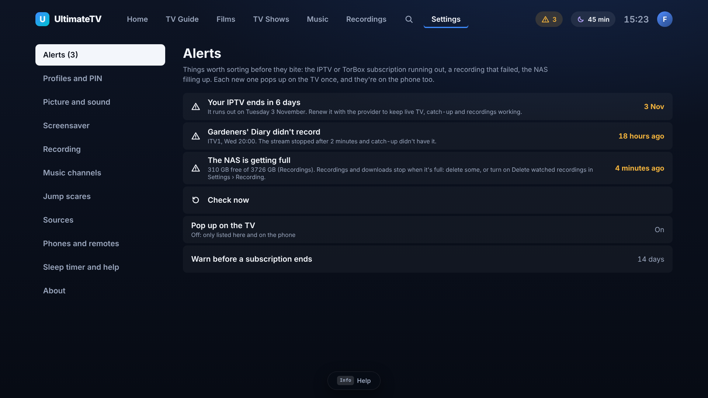
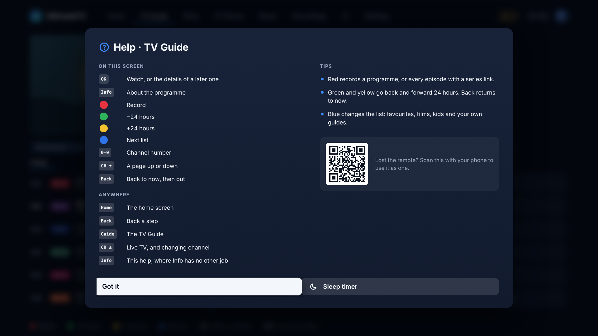
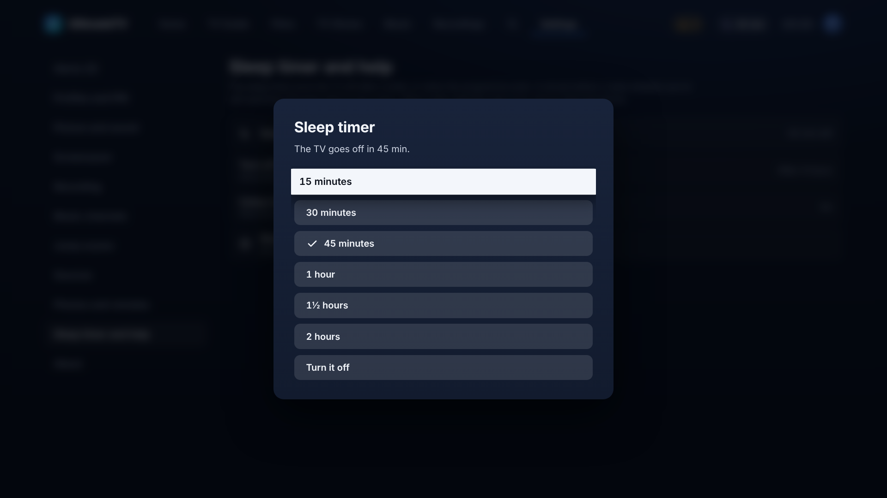
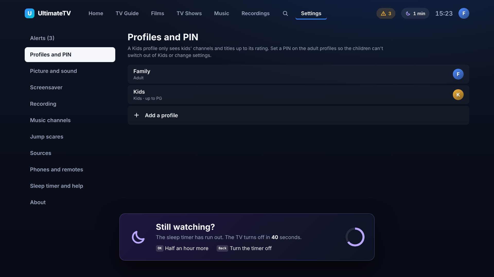
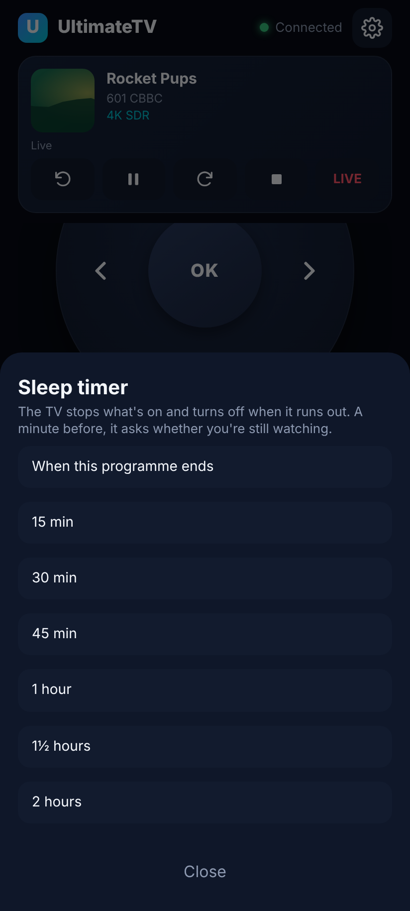
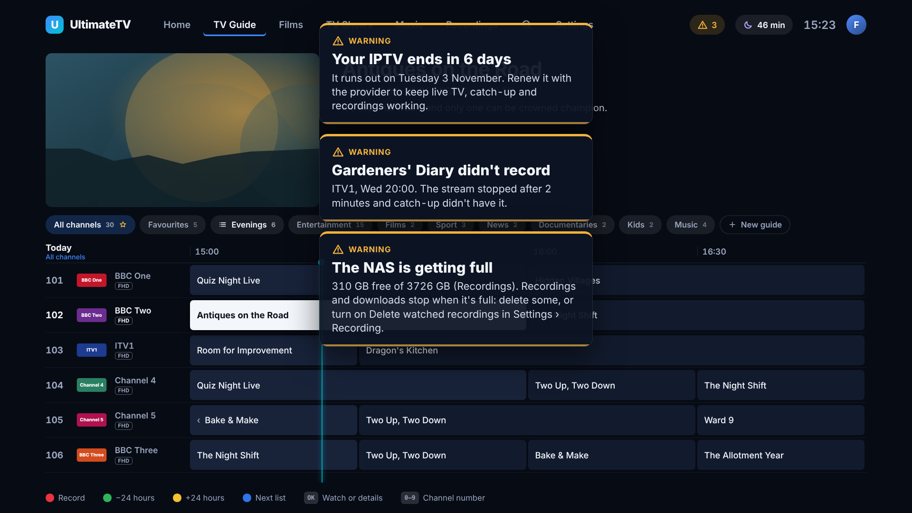

# Help, the sleep timer and alerts

Three things that make the TV easier to live with: knowing what the buttons do, turning the TV off by itself, and hearing about problems before they bite.

## Colour button hints and the help screen

Each screen says what its buttons do. The colour buttons' jobs show in a small bar along the bottom of the screen (the TV Guide and the guide builder keep their own legend, so the bar stays out of the way there). Settings › Sleep timer and help › Colour button hints turns the bar off.

The help screen lists every button on the screen you're on, the buttons that work anywhere, a few tips, the sleep timer, and a QR code for using a phone as the remote. It opens with:

- **Info**, on any screen where Info has no other job (Home, Films, Settings and so on). In the guide and while watching, Info still shows the programme.
- **Help**, on remotes that have one (CEC code 0x36, mapped to F10 in `tools/box/files/cec-keymap.toml`), or `h` / `?` on a keyboard.
- **Help on the TV**, a button on the phone remote.
- Yellow (Options) › Help while watching, and Settings › Sleep timer and help › Show the help screen.

## Sleep timer

Set it from Yellow (Options) while watching, Settings › Sleep timer and help, the help screen, the moon in the top bar, or the phone remote's **Sleep timer** button: 15, 30 or 45 minutes, 1, 1½ or 2 hours, or **when this programme ends** (the live programme's end in the guide, or the rest of the film or episode; a paused film moves it back).

The top bar shows the time left. A minute before the end the TV asks **Still watching?**: OK gives half an hour more, Back turns the timer off. Otherwise the TV stops what's on, pauses the music, goes back to Home and sends **standby to the TV over HDMI-CEC**. Without the Pulse-Eight adapter (or on a box app older than this change) it still stops playing; only the standby needs CEC.

**Auto-off**: when nothing has been pressed on the remote (or the phone) for 4 hours, the same warning comes up and any button keeps it on. Change it, or set it to Never, in Settings › Sleep timer and help or on the phone's settings page. It only counts while the TV is showing the box.

The Hub keeps the timer so the TV and the phone see the same one (`GET`/`PUT`/`DELETE /api/sleep`, paired devices only); the TV does the counting down and the standby.

## Alerts

The Hub looks every half hour (and when a recording fails or the guide refreshes) for:

| Alert | When | How bad |
|-------|------|---------|
| IPTV subscription ending | The provider's expiry date (Xtream `exp_date`) is within 14 days | Bad in the last 3 days and once it's ended |
| TorBox plan ending | TorBox's `premium_expires_at` is within 14 days (asked at most every 6 hours) | Same |
| A recording failed | In the last 3 days, with what went wrong | Warning |
| The NAS is filling up | Under 10% or 20 GB free on the recordings, films or TV folder's disk | Bad under 3% or 5 GB |

Each new alert pops up on the TV once (through the same pop-ups as `/api/notify`), and again only if it gets worse. Warnings go after two minutes; bad ones stay until OK or Back. Pop-ups wait until the TV app is connected rather than go unseen.

They're also listed in the top bar (the amber triangle), Settings › Alerts on the TV, at the top of the phone remote, on the phone's settings page and on the Stats page. Dismissing one hides it until it gets worse, or until a renewed subscription is about to run out again. Settings › Alerts can turn the TV pop-ups off and change the 14 days to 3, 7 or 30.

API: `GET /api/alerts`, `POST /api/alerts/check`, `POST /api/alerts/:id/dismiss` (paired devices).

## Testing on the box

- Press Info on Home: the help screen opens; Back closes it. Check the bar on Home, Films and Recordings.
- Set a 15 minute timer from the phone and check the TV's top bar shows it. Wait for the warning, press OK, and check it goes up by 30 minutes. Let it run out: playback stops and the TV goes to standby (needs the CEC adapter).
- "When this programme ends" on a live channel, from the phone: the TV should fill in the time within a second or two.
- Alerts: Settings › Alerts › Check now. If the IPTV subscription ends within 14 days it should be listed.
