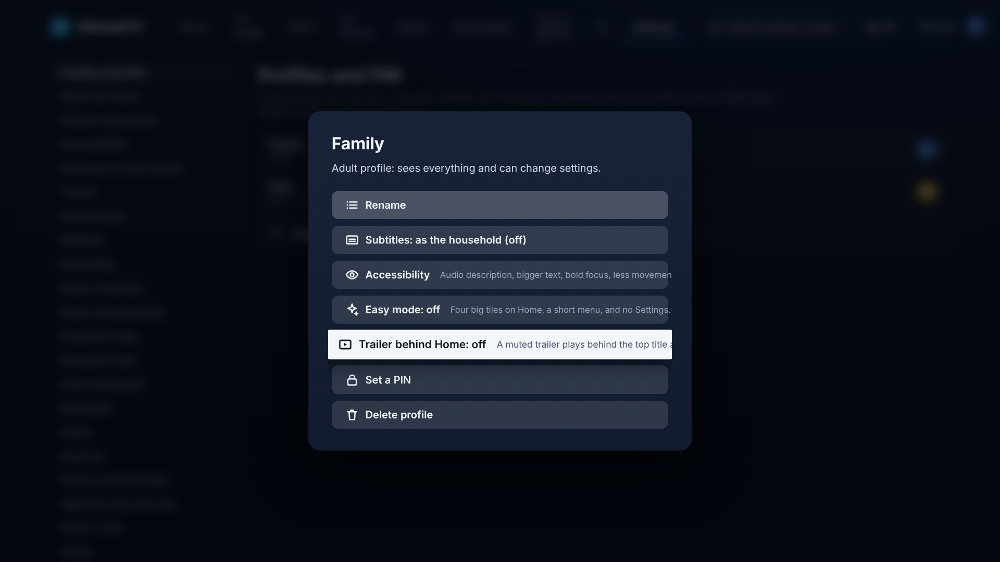

# Muted trailer behind the Home hero

Issue #240. After a few seconds on Home, the top title's trailer fades in behind its details, muted, like Netflix and Apple TV. It is **off by default** and chosen **per profile**.

## Turning it on

Settings › Profiles › pick the profile › **Trailer behind Home**. Each profile has its own switch (`heroTrailer` on the profile). A Kids profile has it only if a grown-up switches it on there; nothing turns it on by itself.

## What it does

- Home asks the Hub for the hero's extras (the same call the details page makes) as soon as the hero shows, so the trailer's address is ready and the first seconds are buffering while it waits. That is the one trailer ahead.
- After **4 seconds** on the same hero it plays, looping and muted, and fades in over the still (1.2 s). The still stays underneath the whole time, so any failure just leaves the still.
- It never runs while something is playing or loading in mpv (so it can't compete with a film or the live preview), nor while the app is hidden, nor for a profile with **reduced motion** on, nor on a hero that is live TV.
- If the browser reports that **a quarter or more of its frames were dropped** (checked six seconds in), the trailer stays off until the app restarts. That is the fallback for a box that can't keep up.

## How the Hub serves it

TMDB gives a YouTube page. The Hub's `GET /api/trailers/:key` (`hub/src/trailers.ts`) asks yt-dlp for a picture-only H.264 stream of 720p or less, keeps the address for two hours (they last about six), and passes the bytes on with Range support, so the page's own video element can buffer and loop. The address is tied to the Hub's connection, which is why the box doesn't fetch it directly. Without yt-dlp on the Hub (and on the demo Hub, which plays its own clip) it answers 503 and the still stays. The key is validated as a YouTube id before it reaches yt-dlp.

## Still to do on the hardware

CPU and GPU use on the K7 Plus while the trailer plays hasn't been measured. Electron's decoder needs to take H.264 (it does on the box's build; a laptop Chromium without proprietary codecs just shows the still). If it costs too much, the 25% dropped-frames rule is the first thing to tune (`ui/src/trailerHealth.ts`).
