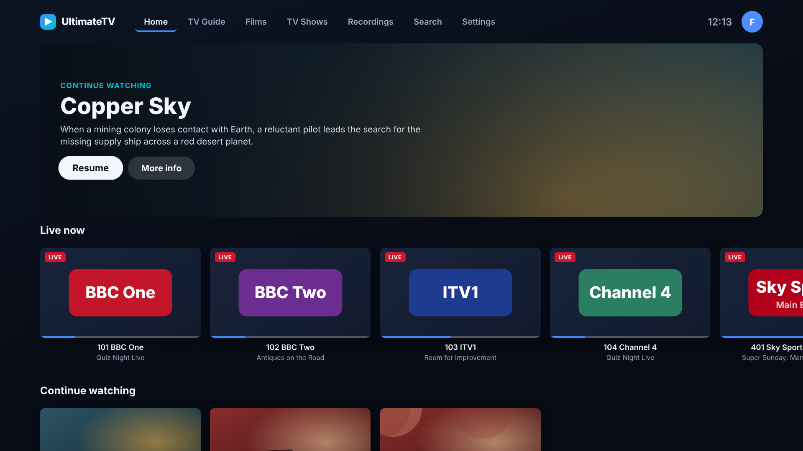

# LG TVs (webOS)

UltimateTV has an app for LG smart TVs (webOS). It is the Samsung app's twin ([samsung.md](samsung.md)):
the same top bar, cards, rails and themes as the TV app, the same Hub calls, and playback through the
TV's own hardware decoder (an HTML5 `<video>`, which webOS decodes in hardware). It was asked for
for an LG **NANO90 43"** (a 2021 set, which should be webOS 6), and uses nothing newer than the old
Chromium 53 engine of webOS 4, so it should run on any LG from about 2018 on.

**Not tested on a real TV.** The screens were run in a desktop browser against a demo Hub
(`node tools/screenshots/lg.mjs`, also in CI) and the package and key codes were written from LG's
documentation. Treat the first install as an experiment and send back what the screen shows if something
is off. Video playback in particular has only been exercised as far as a desktop browser goes.

## Does the TV need jailbreaking? No

LG's own **Developer Mode** app lets you install your own apps with a free LG developer account. Nothing
is modified on the TV. The catch: the Developer Mode **session is limited** (people report about 50 hours;
the app shows a *Remain Session* counter). When it runs out and the TV is restarted, Developer Mode turns
off and **the apps you installed under it are removed**. So the app has to be kept alive by pressing
**Extend** now and then (see below), or installed again afterwards. Rooting (webOS Brew) is possible on
some firmware but is not needed and is not covered here.

## What you need

- A computer on the same home network as the TV (Windows, macOS or Linux).
- A free **LG developer account** (<https://webostv.developer.lge.com>).
- LG's **webOS TV CLI**: install Node.js, then `npm install -g @webos-tools/cli`. (The community
  [Dev Manager Desktop](https://www.webosbrew.org/devmode/) is a point-and-click alternative to the
  commands below.)

## Install, step by step

1. **Get the package.** In a checkout of this repository run `tools/lg/build.sh`. It writes
   `lg/build/home.ultimatetv.lg_0.1.0_all.ipk` using LG's `ares-package` when it is installed. Without
   the CLI it builds the same package by hand, which is the less-proven path: install the CLI and run
   `ares-package lg/ --outdir lg/build` if the TV refuses it.
2. **Put the TV in Developer Mode.** On the TV open the **LG Content Store**, search for **Developer
   Mode**, install it and open it. Sign in with the LG developer account, switch **Dev Mode Status** on
   and let the TV restart. Open the app again and switch **Key Server** on: the six-character
   **passphrase** it shows at the bottom left is needed in step 4. The TV's IP address is under Settings ›
   Network. Leave the Developer Mode app's screen as it is: it can be closed once the key server is on.
3. **Tell the CLI about the TV.** Run `ares-setup-device`, choose **add**, and enter: a name (say
   `lgtv`), the TV's **IP address**, port **9922**, user **prisoner**; no password is needed. Make it the
   default when asked.
4. **Get the TV's key.** Run `ares-novacom --device lgtv --getkey` and type the passphrase from step 2.
   `ares-device --system-info --device lgtv` should now print the TV's model and webOS version (if you
   send that back it tells us which webOS version it is).
5. **Install.** `ares-install --device lgtv lg/build/home.ultimatetv.lg_0.1.0_all.ipk`, then
   `ares-launch --device lgtv home.ultimatetv.lg`. After that **UltimateTV** is on the TV's home bar (the
   app list), with its icon.

## Keeping Developer Mode alive

The install is only good while the session lasts, so extend it before it runs out:

- **By hand:** open **Developer Mode** on the TV and press **Extend** (the app shows *Remain Session*).
  This needs the TV on the network, and cannot be done once the session has run out.
- **Automatically:** Developer Mode has no documented web address to extend the session, and a
  token-based script has been reported not to work, so the Hub does not try. What does work, for people
  who run Home Assistant, is to automate the remote: wake the TV, open the *Developer Mode* app, press ▼ ▼
  then OK (the Extend button), wait, then switch the TV off, once a day when the TV is off (see
  [Keeping webOS Developer Mode alive with Home Assistant](https://elis.nu/blog/2022/07/keeping-webos-developer-mode-alive-with-home-assistant/)).
  The button positions can differ between webOS versions, so try it once by hand.
- If the app disappears anyway, repeat steps 2 to 5 (the Hub's data and profiles are kept).
- **New versions of the app need no reinstall.** The screens load from the Hub ([tv-updates.md](tv-updates.md)): update the Hub, then close and reopen the app. Only the Developer Mode session needs keeping alive.

## First run

1. The app looks for the Hub at `http://192.168.0.19:8095`. If it can't reach it, choose **Change Hub
   address** and type the right one with the on-screen keyboard.
2. If another screen is already paired, this TV shows a four-letter code. On the main TV open
   **Settings › Phones and remotes** and allow **LG TV** after checking the code matches
   ([pairing.md](pairing.md)).
3. Choose who's watching. Profiles with a PIN ask for it (the number keys work); a Kids profile only sees
   what it sees on the main TV. The app remembers the profile.

## What it does

The same as the Samsung app: Home (the profile's rows, in order), TV Guide (OK plays live; **CH+/CH−**
change channel in the player), Films, TV Shows, title details with seasons and episodes and **Other versions** (on an episode, press the yellow key) to pick a 4K, 1080p or other copy, Recordings,
Search, Settings (Hub address, who's watching, picture quality, check the Hub, unpair), and a player with
pause, ±10 s (◄ ►), ±60 s (rewind and fast-forward), skip intro / recap / credits (press OK when the button
shows), next episode, audio and subtitle tracks (▼ or the blue key) and progress sent back to the Hub.
The Hub's theme (including the seasonal ones) is applied on every start.

Not in this version (they stay on the main TV and the phone): music channels, Cast & games, the family
board, recordings management, downloads and the screensaver.

Remote keys: arrows and OK as usual, **Back** goes back (and leaves the app from the first screen),
play, pause, stop, rewind and fast-forward work in the player, and the colour keys: **blue** opens audio
and subtitles, **yellow** skips when the Skip button shows.

## What plays, and what doesn't

The app tells the Hub the set's limits (`X-Max-Height`, `X-Max-Bitrate` and `X-Codecs`) so the Hub picks
a version that fits (up to 4K HEVC, H.264 or VP9 at about 40 Mbit/s) and has Jellyfin make a smaller HLS
copy when the only version is too big. **Picture quality: Up to 1080p** in Settings lowers the limits.

- LG sets do **HDR10 and Dolby Vision**, but a web app has no control over which the picture uses; the
  TV picks from what the stream contains.
- **DTS and TrueHD sound is not decoded** on LG sets from 2020 on (LG dropped DTS), so a film whose only
  sound is DTS plays without sound: pick another version on the main TV, or let Jellyfin transcode it.
  Dolby Digital and Digital Plus (Atmos) are fine.
- Subtitles from the Hub's external files (SRT or WebVTT) are drawn by the app. Subtitles that are
  inside the file are not listed, as webOS doesn't expose them to a web page.
- Audio tracks are listed when the TV's player shows them to the page (webOS 5 and newer usually do).
- Live TV and recordings play from the Hub's relay, so they share the one IPTV connection like every other
  screen.

## How it's built

`lg/` is a plain web app with no build step (ES2015 only; CI checks it with `esbuild --target=chrome53`,
the engine in webOS 4), made from `samsung/` with a different shell:

- `boot.js` is the shell that loads the screens from the Hub ([tv-updates.md](tv-updates.md)), `appinfo.json` is the webOS app manifest, `js/player.js` plays with a `<video>` and draws captions
  itself, `js/util.js` has the LG key codes (Back is 461, the colour keys are 403 to 406, CH+/CH− are
  33 and 34), and the rest (`hub.js`, `nav.js`, `app.js`, `css/app.css`) is shared in spirit with
  `samsung/`.
- Developing without a TV: `npm run build && node tools/screenshots/lg.mjs` runs a demo Hub, drives the
  app with the arrow keys and writes the screenshots in `docs/screenshots/lg/`.
