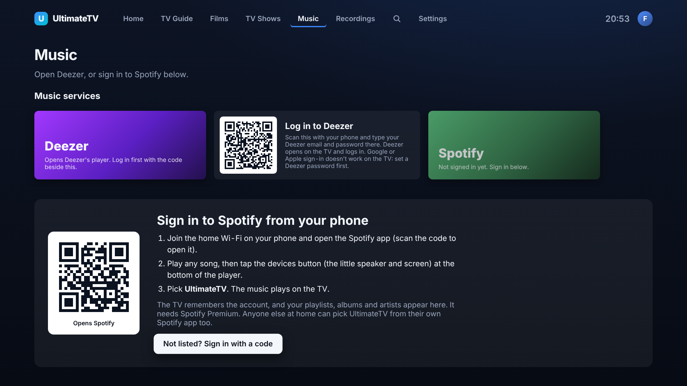
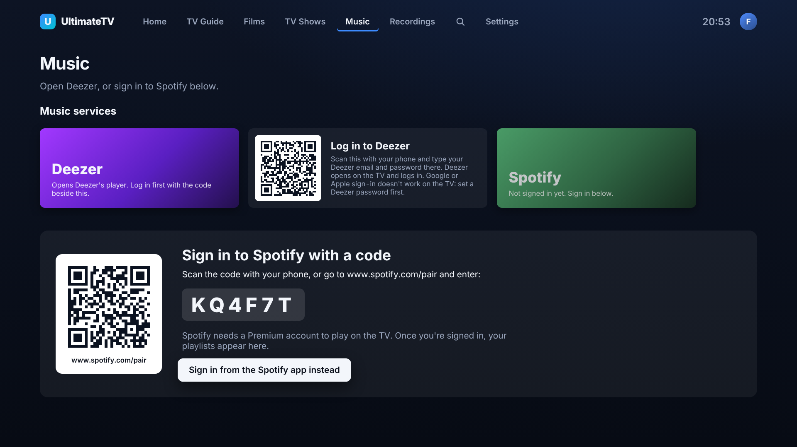

# Music: Spotify and Deezer

The **Music** tab on the TV plays Spotify and Deezer through the TV's speakers. What's playing sits at the top with its controls; below are the music services, then your Spotify playlists, albums and artists. Play/Pause on the remote works from any screen while music plays, and starting a film pauses the music.

Kids profiles don't have a Music tab.



## First time: sign in

Update the box first (Settings › About › Update the box), so it has the Spotify receiver and the latest sign-in screens. Then open the Music tab on the TV, or **Watch › Music** on the phone remote. Both show what still needs doing.

### Spotify (needs Premium)

The TV is a Spotify Connect speaker, like a smart speaker. To sign it in:

1. On a phone on the home Wi-Fi, open the Spotify app (the QR code on the TV opens it).
2. Play any song, then tap the devices button (the little speaker and screen) at the bottom of the player.
3. Pick **UltimateTV** (or whatever the app is called in Settings).

The music moves to the TV, and the TV remembers the account: your playlists, albums and artists appear in the Music tab, and the TV stays signed in after a restart. Anyone else at home can pick the TV from their own Spotify app as well; the TV then plays from their account until someone else picks it.

**The TV isn't in the devices list?** Choose **Not listed? Sign in with a code** under the instructions on the TV (or on the phone's Music page). The TV then shows a code: go to spotify.com/pair on any phone or computer (or scan the QR code), sign in, and enter it. Once you're signed in, the TV makes itself visible to phones again by itself.



### Deezer

Deezer has no app for the box, so the TV opens Deezer's own website player over the TV app.

1. Scan the **Log in to Deezer** QR code in Music services with your phone.
2. Type your Deezer email and password there and press **Log in on the TV**.
3. The TV opens Deezer and fills in its login. The phone says how it went: logged in, what Deezer said if it said no (a wrong password, say), or that Deezer wants something more on the TV, such as an "I'm not a robot" puzzle or a code it emailed you. Do that part on the TV: the arrows and OK work on the page, and the phone remote's keyboard types into it.

**Signed up to Deezer with Google, Apple or Facebook?** Those logins don't work on the TV (Google blocks sign-in inside apps). Give your Deezer account a password first: on deezer.com choose **Log in › Forgot your password?**, enter the email of your Google, Apple or Facebook account, and set a password from the email Deezer sends. Then log in on the TV with that email and password.

## Playing

- **Spotify**: pick a playlist, album or artist in the Music tab (or on the phone's Music page) and press Play or Shuffle, or pick a song. Or play from the Spotify app on your phone and choose the TV as the device. Next and previous are the remote's fast-forward and rewind keys.
- **Deezer**: press the Deezer card. Use the arrows and OK on the page (a blue outline shows where you are). Back returns to the TV app and the music keeps playing; it shows in Now Playing with play/pause and skip.
- Spotify and Deezer pause each other: only one plays at a time.

## When something's wrong

| The TV says | What to do |
|---|---|
| Spotify isn't on this box yet | Update the box (Settings › About). The update builds the Spotify receiver; it takes a few minutes the first time. |
| Spotify is starting… | Normal for a few seconds after the box starts. |
| Spotify isn't starting, with a message from the box | Press **Restart Spotify**. If it keeps failing, the message says why; more is in the box's log (below). |
| The TV isn't in Spotify's devices list | Check the phone is on the home Wi-Fi (not mobile data), or sign in with a code instead. |
| Deezer didn't take that login | The phone shows what Deezer said. Check the password works on deezer.com, or set one (see above). |
| Deezer wants something more | Finish on the TV with the remote; the phone remote's keyboard types into the page. |

On the box, the Spotify receiver's state and log:

```
systemctl --user -M tv@ status ultimatetv-spotify
journalctl --user -M tv@ -u ultimatetv-spotify -n 50
```

The box also writes what the Spotify receiver says is wrong into its diagnostics report on the Hub (`/api/diagnostics?format=text`, see [diagnostics.md](diagnostics.md)).

## How it works

| Part | |
|---|---|
| Spotify receiver | [go-librespot](https://github.com/devgianlu/go-librespot), built by `tools/box/install.sh` and run as the `ultimatetv-spotify` user service of the tv user. It plays through PipeWire to the TV's HDMI output and answers a local API on `127.0.0.1:3678`. |
| Its config | `~tv/.config/go-librespot/config.yml`, written from `tools/box/files/go-librespot.yml` on each box update (the device name is kept). The sign-in is kept in `state.json` beside it. |
| Signing in | By default Spotify Connect's own sign-in (`credentials: zeroconf` with `persist_credentials`), so picking the TV in the Spotify app signs it in and that account is kept. **Sign in with a code** switches the config to `device_auth` with phones turned off (go-librespot can't answer its API while it waits for a code with both on), restarts it, and switches back once signed in. `box/src/spotify.ts` does this. |
| `box/src/spotify.ts` | Reads the receiver's status, the sign-in code, its library and track lists; sends play and control commands. When the receiver doesn't answer it tells "not installed" from "not running", and reads the reason from its log. |
| `box/src/webapp.ts` | Deezer's web player in its own browser profile (the login lasts), the phone login (fills Deezer's form one step at a time, accepts a cookie banner in the way, then watches for the sign-in cookie or Deezer's error), and the remote's keys on the page (`webapp-preload.ts`). |
| `hub/src/musiclogin.ts` | The phone page `/music-login/`. What's typed is kept in memory for two minutes and handed to the TV once; the TV reports back how it went (`POST /api/music/login/:id/result`) and the phone page shows that (`GET /api/music/login/:id/status`). Nothing is written to disk or logged. |
| `ui/src/screens/Music.tsx` | The Music tab, with the sign-in panel and the service cards. |
| Phone remote | Watch › Music asks the TV app (`/api/tv/call/musicStatus`, `musicSetup`, `musicLibrary`, `musicTracks`, `musicPlay`, `musicControl`). |

Deezer's developer API is closed to new apps, so there's no Deezer library in the TV's own screens: Deezer is its web player. Unofficial Deezer clients that sign in with a copied cookie were left out, because they're against Deezer's terms.
