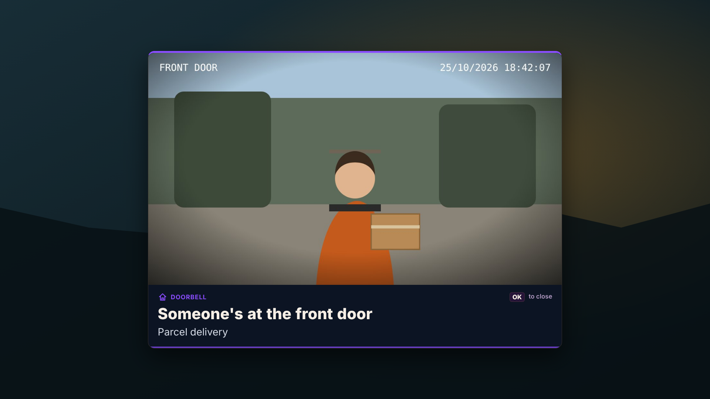
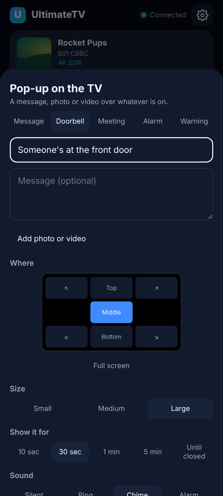

# Pop-ups on the TV

Anything on the home network can put a pop-up on the TV, over whatever is on: the doorbell
showing who's at the door, a meeting about to start, an alarm. A pop-up is any mix of a **title**,
**text**, a **picture** and a **video**, wherever you want it on the screen, for as long as you
want. Send one from the phone remote (**Pop-up** at the bottom) or from Home Assistant, a script or
anything that can make a web request to the Hub.




Pop-ups in the middle or full screen, alarms, and ones that stay until closed take the remote's
**OK** and **Back**: either closes the newest one. Small ones in a corner leave the remote alone and
go by themselves, with a thin line along the bottom running down the time left.

Only paired phones and things holding the Hub's **API key** can send pop-ups (see
[Pairing](pairing.md)). Find the key on the phone's settings page under **Phones** (or on the TV,
Settings › Phones and remotes › Home Assistant key) and send it with every request as the header
`X-Api-Key: utv_…` (or `Authorization: Bearer utv_…`). The key can send pop-ups, news flashes and
key presses, read what's playing and use the media player controls below, and nothing else: it
can't change settings. Still keep the Hub on the home network: don't forward port 8095 on
the router.

## From the phone

Tap **Pop-up** at the bottom of the remote. Choose what it is (Message, Doorbell, Meeting, Alarm,
Warning), write a title and a message, add a photo or video from the phone if you like, tap where
on the TV it goes, its size, how long it stays and its sound. **Pause what's playing** pauses the
film while it shows and carries on when it goes. Pop-ups on the TV now are listed underneath, each
with **Take down**.



## The API

`POST http://192.168.0.19:8095/api/notify` with a JSON body and the `X-Api-Key` header. Everything is optional except that
there must be at least one of `title`, `text`, `image` or `video`.

| Field | What it does | Default |
| --- | --- | --- |
| `title` | Big text at the top (up to 120 characters) | |
| `text` (or `message`) | The message under it (up to 1000 characters; new lines are kept) | |
| `image` | A picture: a web address (`http://…`) or a `data:image/jpeg;base64,…` address. The Hub fetches a web picture **at once** and keeps its own copy, so the TV shows the moment the bell rang and doesn't need to reach the camera | |
| `headers` | Headers for the Hub's fetch of `image`, such as `{"Authorization": "Bearer …"}` | |
| `video` | A video the TV plays on a loop: a web address (MP4 or WebM; the TV plays it from there) or a `data:` address | |
| `muted` | `true` plays the video without sound | `false` |
| `kind` | `info`, `doorbell`, `meeting`, `alarm` or `warning`: the icon, the colour and the defaults below | `info` |
| `position` | `center`, `top`, `bottom`, `top-left`, `top-right`, `bottom-left`, `bottom-right` or `full` (the whole screen) | by kind |
| `size` | `small`, `medium` or `large` | by kind |
| `seconds` | How long it stays; `0` stays until closed with OK or Back (or taken down) | by kind |
| `sound` | `none`, `ping`, `chime` (ding-dong) or `alarm` (beeps again and again until closed) | by kind |
| `pause` | `true` pauses what's playing while it shows | `false` |
| `wake` | `true` turns the TV on (HDMI-CEC, once the Pulse-Eight adapter is in) | `true` for alarms |
| `id` | Your own name for it (letters, numbers, `.`, `-`, `_`). Sending the same id again replaces the old one, so a second ring doesn't stack up | made up |

What each kind starts with:

| Kind | Position | Size | Seconds | Sound |
| --- | --- | --- | --- | --- |
| `info` | bottom right | medium | 15 | ping |
| `doorbell` | center | large | 30 | chime |
| `meeting` | top right | medium | 60 | chime |
| `warning` | top | medium | 30 | chime |
| `alarm` | center | large | until closed | alarm |

The answer is the pop-up as the TV got it, with `warnings` when something was off (say the Hub
couldn't fetch the picture, in which case the TV tries the address itself):

```json
{ "notice": { "id": "doorbell", "kind": "doorbell", "title": "Someone's at the front door", "image": "/api/notify/media/…", "position": "center", "size": "large", "sound": "chime", "until": 1761417727000, "leftMs": 30000, "…": "…" } }
```

### A picture or video as the request body

Send the picture (JPEG, PNG, GIF, WebP) or video (MP4, WebM, MOV) itself as the body, with the
other fields in the address. Handy from a script that has just saved a snapshot:

```sh
curl -X POST "http://192.168.0.19:8095/api/notify?kind=doorbell&title=Front%20door&position=bottom-right" \
  -H "X-Api-Key: $UTV_KEY" -H "Content-Type: image/jpeg" --data-binary @snapshot.jpg
```

Or upload it first with `POST /api/notify/media` (the file as the body), which answers
`{"url": "/api/notify/media/…", "kind": "image"}`, and put that `url` in `image` or `video`.
Uploads can be up to 200 MB. The Hub keeps the last 30 and forgets them when it restarts.

### Other calls

- `GET /api/notify`: the pop-ups showing now.
- `DELETE /api/notify/<id>`: takes one down (from the TV too).
- `DELETE /api/notify`: takes them all down.

### Examples

```sh
# The key from the phone's settings page (Phones › Show the key)
UTV_KEY=utv_…

# A message in the corner for 10 seconds
curl -X POST http://192.168.0.19:8095/api/notify -H "X-Api-Key: $UTV_KEY" -H "Content-Type: application/json" \
  -d '{"title": "Dinner is ready", "seconds": 10}'

# A meeting, top right, without a sound
curl -X POST http://192.168.0.19:8095/api/notify -H "X-Api-Key: $UTV_KEY" -H "Content-Type: application/json" \
  -d '{"kind": "meeting", "title": "Team call in 5 minutes", "text": "Weekly planning", "sound": "none"}'

# An alarm that pauses the film and beeps until someone presses OK
curl -X POST http://192.168.0.19:8095/api/notify -H "X-Api-Key: $UTV_KEY" -H "Content-Type: application/json" \
  -d '{"id": "alarm", "kind": "alarm", "title": "Time to leave for school", "pause": true}'

# Take the alarm down from somewhere else
curl -X DELETE http://192.168.0.19:8095/api/notify/alarm -H "X-Api-Key: $UTV_KEY"
```

## Home Assistant

Put the Hub's API key in `secrets.yaml` (`tv_api_key: utv_…`), add one REST command to
`configuration.yaml` that sends whatever it's given, and restart Home Assistant:

```yaml
rest_command:
  tv_notify:
    url: http://192.168.0.19:8095/api/notify
    method: post
    content_type: application/json
    headers:
      X-Api-Key: !secret tv_api_key
    payload: "{{ notice | to_json }}"
```

Then an automation for the doorbell. The camera's `entity_picture` carries its own access token,
so the Hub can fetch the snapshot without a Home Assistant login; change the Home Assistant address,
the doorbell's entity and the camera's to yours:

```yaml
automation:
  - alias: Doorbell on the TV
    triggers:
      - trigger: state
        entity_id: binary_sensor.front_door_doorbell
        to: "on"
    actions:
      - action: rest_command.tv_notify
        data:
          notice:
            id: doorbell
            kind: doorbell
            title: Someone's at the front door
            image: "http://homeassistant.local:8123{{ state_attr('camera.front_door', 'entity_picture') }}"
            pause: true
```

Or with a long-lived access token (your profile in Home Assistant › Security) instead:

```yaml
            image: http://homeassistant.local:8123/api/camera_proxy/camera.front_door
            headers:
              Authorization: !secret tv_camera_auth   # "Bearer <token>" in secrets.yaml
```

A meeting from the calendar, ten minutes before it starts:

```yaml
  - alias: Meeting on the TV
    triggers:
      - trigger: calendar
        event: start
        offset: "-0:10:0"
        entity_id: calendar.work
    actions:
      - action: rest_command.tv_notify
        data:
          notice:
            kind: meeting
            title: "{{ trigger.calendar_event.summary }} in 10 minutes"
            text: "{{ trigger.calendar_event.location | default('') }}"
```

A live camera stream is a web address the TV plays as `video`, as long as it's MP4 or WebM over
http (the TV can't play RTSP or HLS in a pop-up). A snapshot as `image` is the most reliable.

## Home Assistant the other way: the TV as a media player

Home Assistant can also see what the TV is doing and control it, and be told the moment playback
changes, so the lights dim when a film starts and come back up when it's paused.

- **What's on**: `GET /api/ha/state` (with `X-Api-Key`) answers in Home Assistant's media player
  terms: `state` (`off`, `idle`, `playing`, `paused`, `buffering`), `media_title`,
  `media_series_title`, `media_content_type` (`movie`, `episode`, `channel`, `video`),
  `media_season`, `media_episode`, `media_channel`, `media_duration` and `media_position` in
  seconds, `media_position_updated_at`, `entity_picture`, `source` (the channel, or where a film
  plays from), `volume_level` (0–1), `is_volume_muted`, plus `kind` (`film`, `episode`, `live`,
  `video`), `credits`, `profile` and `kids`. It says `off` when the TV app isn't connected to the
  Hub, or after the box put the TV in standby (until a key is pressed or something plays).
- **Do something**: `POST /api/ha/command` (with `X-Api-Key`) and `{"command": "…", "value": …}`.
  Commands: `play`, `pause`, `play_pause`, `stop`, `volume_set` (value 0–1), `volume_up`,
  `volume_down`, `volume_mute` (value true or false), `channel_up`, `channel_down`,
  `select_source` (value: a channel's number or name), `turn_on` and `turn_off` (the TV over CEC,
  so they need the Pulse-Eight). Home Assistant's own names work too (`media_pause`,
  `media_next_track` for channel up and so on). The answer has the new state. `play` with nothing
  on starts the last live channel.
- **Events**: set a webhook under ⚙ Settings › Phones and remotes › **Playback events webhook** on
  the phone's settings page (or Settings › Alerts on the TV). The Hub posts each of these to it as
  JSON: `started`, `paused`, `resumed`, `stopped`, `credits` (the credits marker from Jellyfin, or
  the last few minutes), `channel_changed` and `profile_switched`. **Send a test event** posts a
  pretend film starting.

The TV tells the Hub within about a third of a second of a change, so events reach Home Assistant
at once. The media player is read every 2 seconds (`scan_interval` below), which is the slowest it
can lag.

The volume is the box player's own (the sound the box sends the TV), not the TV's: the TV's remote
still sets that. It does nothing when the sound goes out untouched (passthrough to a soundbar).

An event looks like this:

```json
{
  "app": "UltimateTV",
  "type": "started",
  "kind": "film",
  "title": "Dune",
  "subtitle": "2021",
  "channel": null,
  "profile": "Gary",
  "kids": false,
  "position": 61,
  "duration": 9360,
  "at": "2026-10-30T20:00:00.000Z"
}
```

For an episode `title` is the series and `subtitle` the episode ("S2 E5 · Cuckoo"); for live TV
`title` and `channel` are the channel and `subtitle` the programme on now, `position` is 0 and
`duration` null. `channel_changed` and `profile_switched` also carry `from`, the channel or profile
before. A recording or catch-up programme counts as a film when it's 80 minutes or longer and has
no series and episode number, as the guide doesn't say which programmes are films.

### Setting it up

With `tv_api_key` in `secrets.yaml` as for pop-ups, add to `configuration.yaml` (change the Hub's
address to yours) and restart Home Assistant:

```yaml
rest:
  - resource: http://192.168.0.19:8095/api/ha/state
    headers:
      X-Api-Key: !secret tv_api_key
    scan_interval: 2
    sensor:
      - name: UltimateTV state
        unique_id: ultimatetv_state
        value_template: "{{ value_json.state }}"
        json_attributes:
          - media_title
          - media_series_title
          - media_content_type
          - media_content_id
          - media_season
          - media_episode
          - media_channel
          - media_duration
          - media_position
          - media_position_updated_at
          - entity_picture
          - source
          - volume_level
          - is_volume_muted
          - kind
          - credits
          - profile
          - kids

rest_command:
  tv_command:
    url: http://192.168.0.19:8095/api/ha/command
    method: post
    content_type: application/json
    headers:
      X-Api-Key: !secret tv_api_key
    payload: '{"command": "{{ command }}", "value": {{ value | default(none) | to_json }}}'

media_player:
  - platform: universal
    name: UltimateTV
    unique_id: ultimatetv
    state_template: "{{ states('sensor.ultimatetv_state') }}"
    attributes:
      media_title: sensor.ultimatetv_state|media_title
      media_series_title: sensor.ultimatetv_state|media_series_title
      media_content_type: sensor.ultimatetv_state|media_content_type
      media_content_id: sensor.ultimatetv_state|media_content_id
      media_season: sensor.ultimatetv_state|media_season
      media_episode: sensor.ultimatetv_state|media_episode
      media_channel: sensor.ultimatetv_state|media_channel
      media_duration: sensor.ultimatetv_state|media_duration
      media_position: sensor.ultimatetv_state|media_position
      media_position_updated_at: sensor.ultimatetv_state|media_position_updated_at
      entity_picture: sensor.ultimatetv_state|entity_picture
      source: sensor.ultimatetv_state|source
      volume_level: sensor.ultimatetv_state|volume_level
      is_volume_muted: sensor.ultimatetv_state|is_volume_muted
    commands:
      turn_on: { action: rest_command.tv_command, data: { command: turn_on } }
      turn_off: { action: rest_command.tv_command, data: { command: turn_off } }
      media_play: { action: rest_command.tv_command, data: { command: play } }
      media_pause: { action: rest_command.tv_command, data: { command: pause } }
      media_play_pause: { action: rest_command.tv_command, data: { command: play_pause } }
      media_stop: { action: rest_command.tv_command, data: { command: stop } }
      media_next_track: { action: rest_command.tv_command, data: { command: channel_up } }
      media_previous_track: { action: rest_command.tv_command, data: { command: channel_down } }
      volume_up: { action: rest_command.tv_command, data: { command: volume_up } }
      volume_down: { action: rest_command.tv_command, data: { command: volume_down } }
      volume_set: { action: rest_command.tv_command, data: { command: volume_set, value: "{{ volume_level }}" } }
      volume_mute: { action: rest_command.tv_command, data: { command: volume_mute, value: "{{ is_volume_muted }}" } }
      select_source: { action: rest_command.tv_command, data: { command: select_source, value: "{{ source }}" } }
```

That gives `media_player.ultimatetv` with the title, picture and controls on a media card. If your
Home Assistant's universal player doesn't take an attribute from the sensor, the sensor's
attributes are still there for automations, and `rest_command.tv_command` works on its own:

```yaml
action: rest_command.tv_command
data:
  command: select_source
  value: "101"
```

Then make an automation with a **Webhook** trigger (Settings › Automations › Create › Webhook) and
paste its address (`http://homeassistant.local:8123/api/webhook/<its id>`) into **Playback events
webhook**. One automation can handle every event, as a webhook id belongs to one automation.

### Example: lights that follow the film

```yaml
automation:
  - alias: TV lights
    triggers:
      - trigger: webhook
        webhook_id: ultimatetv-playback
        allowed_methods: [POST]
        local_only: true
    conditions:
      # Only films and episodes; live TV and the Kids profile leave the lights alone.
      - condition: template
        value_template: "{{ trigger.json.kind in ['film', 'episode'] and not trigger.json.kids }}"
    actions:
      - choose:
          - conditions: "{{ trigger.json.type in ['started', 'resumed'] }}"
            sequence:
              - action: light.turn_on
                target: { entity_id: light.living_room }
                data: { brightness_pct: 10, transition: 4 }
          - conditions: "{{ trigger.json.type == 'paused' }}"
            sequence:
              - action: light.turn_on
                target: { entity_id: light.living_room }
                data: { brightness_pct: 60, transition: 2 }
          - conditions: "{{ trigger.json.type in ['credits', 'stopped'] }}"
            sequence:
              - action: light.turn_on
                target: { entity_id: light.living_room }
                data: { brightness_pct: 100, transition: 10 }
```

To dim only for films, change the condition to `trigger.json.kind == 'film'`.

### Example: pause the film when the doorbell rings

```yaml
  - alias: Doorbell pauses the TV
    triggers:
      - trigger: state
        entity_id: binary_sensor.front_door_doorbell
        to: "on"
    conditions:
      - condition: state
        entity_id: media_player.ultimatetv
        state: playing
    actions:
      - action: media_player.media_pause
        target: { entity_id: media_player.ultimatetv }
      - action: rest_command.tv_notify
        data:
          notice:
            id: doorbell
            kind: doorbell
            title: Someone's at the front door
            image: "http://homeassistant.local:8123{{ state_attr('camera.front_door', 'entity_picture') }}"
```

(A pop-up with `pause: true` pauses and carries on by itself when it goes; this pauses for good,
until someone presses Play.) Without the universal player, use `rest_command.tv_command` with
`command: pause` and a condition on `sensor.ultimatetv_state` instead.

### Not tested yet

None of this has run against a real Home Assistant: the REST sensor, the universal player's
attribute mapping and volume templates, and the webhook trigger are written from Home Assistant's
documentation. `turn_on` and `turn_off` need the Pulse-Eight CEC adapter. See
[TESTING.md](TESTING.md#8f-home-assistant-both-ways).
