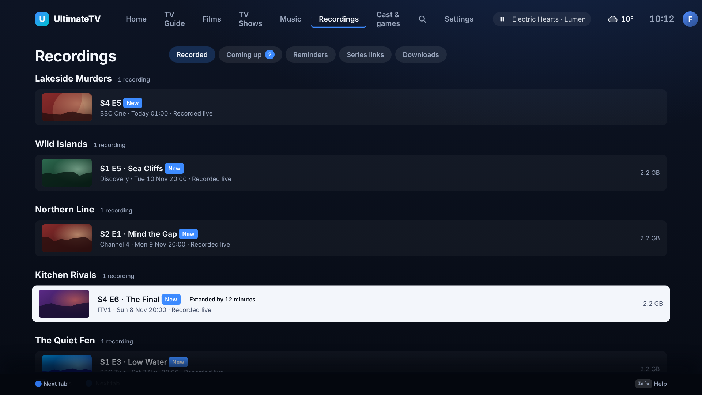
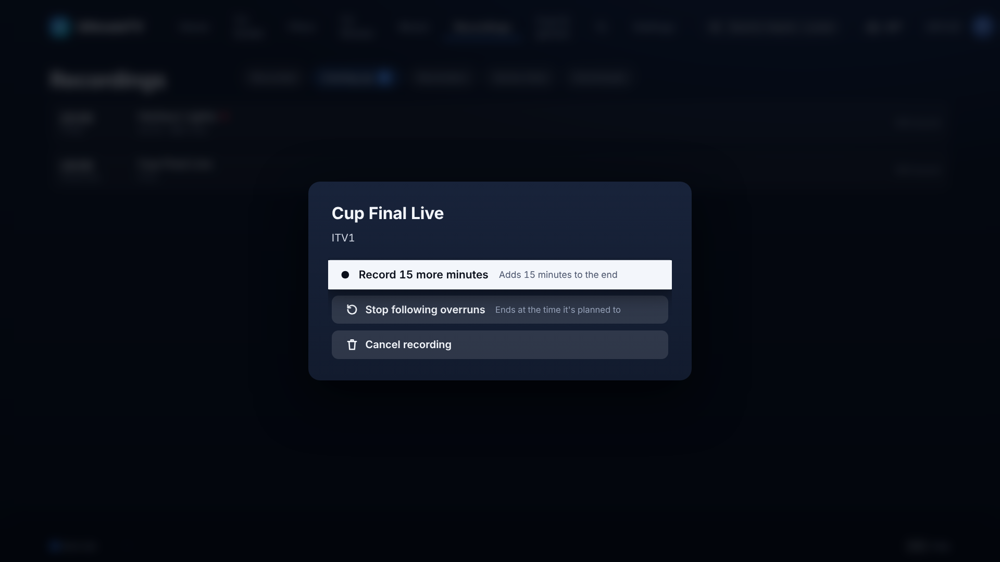
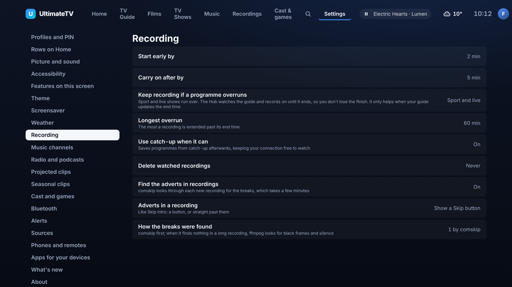

# Recording on when a programme overruns

Issue #230. Live sport and chat shows run past their slot, and a recording that stops at the
guide's end time loses the finish. A recording that follows overruns watches the guide while it
records and carries on until the programme has ended.

## How it works

- While a live recording runs, the Hub looks at the guide every 30 seconds. In the last three
  minutes it also reloads the guide (at most every ten minutes), because the provider updates a
  programme's end time while it is on air.
- When the guide's end time for the programme moves later, the recording's end moves with it:
  the new end time plus the same padding after as before (never less than a minute).
- The extra time is capped by **Longest overrun** (Settings › Recording, 60 minutes unless you
  change it). The recording stops there even if the guide says it's still on.
- **It only helps when your guide moves the end time.** The Hub has no way to see the broadcaster's
  own "now/next" signal over IPTV. If the XMLTV guide never updates, the recording ends on time, and
  **Record 15 more minutes** (below) is the fallback.
- Catch-up recordings never follow: the provider's copy is the whole programme as aired.

## Which recordings follow

Settings › Recording › **Keep recording if a programme overruns**:

| Choice | What it follows |
| --- | --- |
| Sport and live (the default) | programmes categorised as sport or billed as live: football, F1, rugby, cricket, tennis, golf, darts, snooker, boxing, "… Live" |
| Everything | every live recording |
| Off | nothing |

One recording can override this: in **Recordings › Coming up**, OK on it, then **Follow overruns** or
**Stop following overruns**. The choice is kept for that recording only.

## Record 15 more minutes

On a recording that is running or still to come, **Record 15 more minutes** adds 15 minutes to the
end by hand (up to three hours per press). It is how to rescue a recording when the guide wasn't
updated, and it works with the overrun setting off.

## Clashes and the connection count

The extra time counts as recording time everywhere:

- A recording that has been extended shows in the clash check with its new end, so the Recordings
  clash banner reflects the overrun.
- **The Hub won't take the connection from a recording that is about to start on another channel.**
  If following the overrun would clash with it on your plan's connection limit, the first recording
  stops when the next one starts, the TV shows a warning ("… is running over, but … needs the
  connection, so … will stop when it starts."), and the recording is marked as stopped short.
  Recordings on the same channel share one stream, so they never clash.

## What you see

- Recordings › Recorded and Coming up show a flag: **Extended by 12 minutes**.
- The options on a recording say when it hit the limit or stopped short for a clash.

## Where it lives

- `shared/src/overrun.ts`: the setting, which recordings follow it, the wording.
- `hub/src/overrun.ts`: the pure planning of the new end (cap and clash rules); tested in `hub/test/overrun.test.ts`.
- `hub/src/recorder.ts`: the watcher in `recordLive`; tested in `hub/test/recorder.test.ts`.
- `POST /api/recordings/:id/extend {minutes}` and `POST /api/recordings/:id/follow {follow: true | false | null}`
  (paired devices). The screenshots come from `node tools/screenshots/overrun.mjs`.
- Settings: `recording.followOverruns` (`auto` | `on` | `off`) and `recording.maxOverrunMin`.
