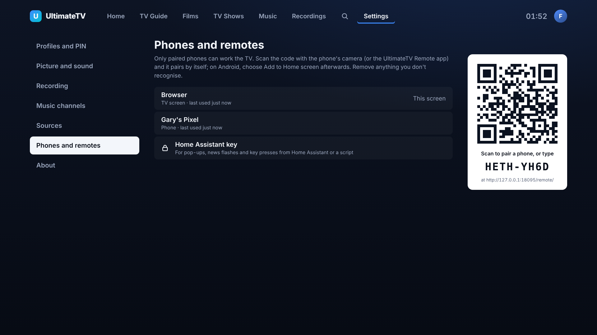
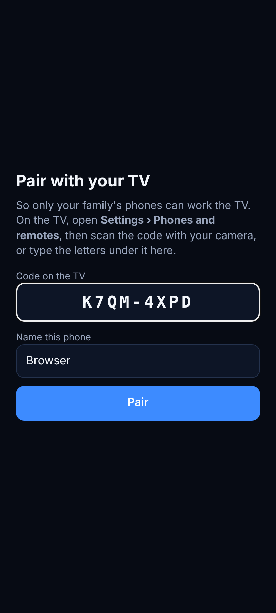

# Pairing phones with the TV

Only phones and screens that have **paired** with the TV can work it. Anything else on the home
network can still open the Hub's pages and browse what's on, but can't press keys, play things,
send pop-ups or news flashes, change settings or start updates. Home Assistant and scripts use a
separate key that can only send pop-ups, news flashes and key presses.

## Pairing a phone

On the TV, open **Settings › Phones and remotes**. It shows a QR code and, under it, a code like
`K7QM-4XPD`.

- **Web remote (any phone):** scan the QR code with the phone's camera. The remote opens and
  pairs by itself. Opened another way, the remote asks for the code: type the letters from the TV.
- **Android remote app:** tap **Scan the TV's code** when the app first opens (it fills in the
  Hub's address too), or on the remote's pairing screen.
- **Android watching app:** Settings › Pair with the TV › **Scan the TV's code**, or type the
  code. Only playing things on the TV needs it; watching on the phone works either way.

The code works once and changes every ten minutes, so a photo of the screen is no use later. Eight
wrong guesses in a row and the TV shows a new one. The QR codes in Settings › Sources and on the
Music screen carry the code too, so scanning those also pairs the phone.

A paired browser keeps its key in a cookie, so the remote, the settings page and the Stats page all
work after pairing once. Clearing the browser's data (or a phone installed as a home-screen app on
iPhone, which has its own storage) needs pairing again.

## Seeing and removing what's paired

**Settings › Phones and remotes** on the TV lists every paired phone and screen, with when each
was last used. Select one to rename or remove it; a removed phone has to scan the code again. The
phone's settings page has the same list under **Phones**, where **Unpair this phone** forgets the
phone it's open on.

## More than one screen

The first screen to open the TV app is trusted at once (the box, the moment the Hub is updated).
Any other screen, such as the TV app opened in a laptop's browser, shows a four-letter code and
waits. It appears at the top of the list on the TV and on the phone's settings page as *"Laptop
wants to join"*: let it in only if it shows the same code.

## Home Assistant and scripts

Pop-ups, news flashes and key presses from Home Assistant or a script need the Hub's **API key**,
sent as the header `X-Api-Key: utv_…` (or `Authorization: Bearer utv_…`). Find it on the phone's
settings page under **Phones › Show the key** (or on the TV under Home Assistant key). **Make a new
key** replaces it if it gets out. See [Pop-ups on the TV](notifications.md) for examples.

## If it goes wrong

- **The TV is waiting to be let in and nothing is paired** (the box was reinstalled, say): on the
  Hub, run `docker compose exec hub node hub/dist/reset-pairing.js` and restart the Hub. It forgets
  every phone and screen and the API key; the next screen to open the TV app pairs itself, then pair
  the phones again.
- **Turning pairing off:** add `PAIRING=off` to the Hub's `.env` and restart it. Anything on the
  network can then work the TV, as before pairing existed. The TV's Settings says so.

## How it works

`hub/src/pairing.ts` keeps the paired devices (the key's SHA-256, never the key itself), the
one-time code, screens waiting to join and the API key, in the Hub's database. The Hub checks a
device's key (the `utv_device` cookie, or the `X-Device-Token` header from the Android apps) before
each controlling route; which route needs what is the `NEEDS` table in `hub/src/server.ts`. The
Hub's event socket, which carries what the phones ask of the TV, only accepts paired screens.

| Call | Who | What it does |
| --- | --- | --- |
| `GET /api/pair` | anyone | Whether the asker is paired |
| `POST /api/pair` `{code, name}` | anyone | Pairs a phone with the TV's code; sets the cookie and answers the token |
| `POST /api/pair/screen` `{name}` | anyone | A screen asks to join: paired at once if it's the first, otherwise `202` with a code to show |
| `POST /api/pair/screen/:id` `{secret}` | the waiting screen | Collects its key once it's let in (`202` while waiting) |
| `GET /api/pair/code` | a paired screen | The code and the address for the QR code |
| `GET /api/devices` | paired | Paired devices and screens waiting |
| `PATCH`, `DELETE /api/devices/:id` | paired | Renames or removes one |
| `POST`, `DELETE /api/devices/pending/:id` | paired | Lets a waiting screen in or turns it away |
| `GET`, `POST /api/pair/api-key` | paired | Shows the API key, or makes a new one |
| `POST /api/pair/forget` | paired | Unpairs the asker |
