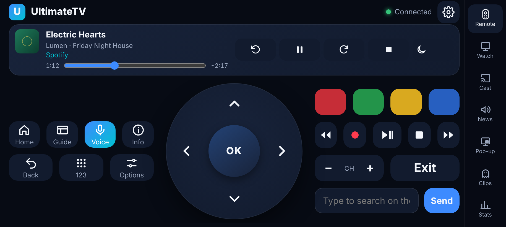
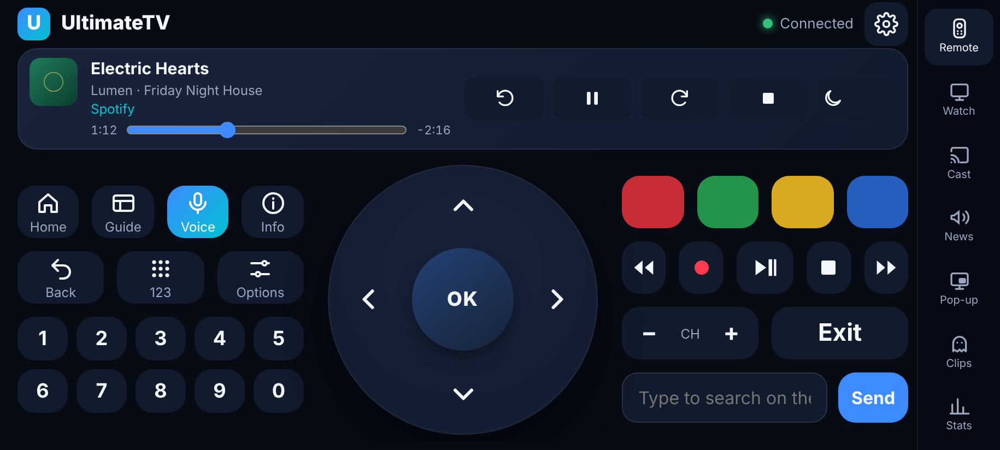
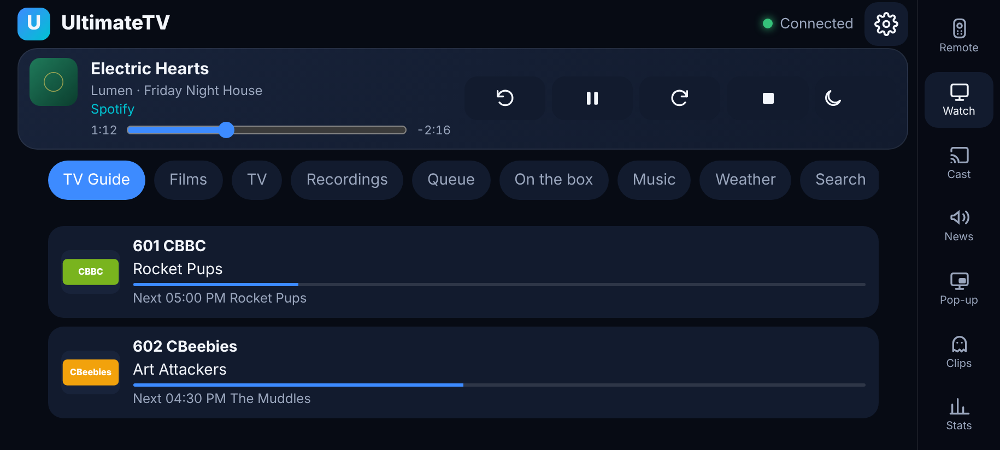
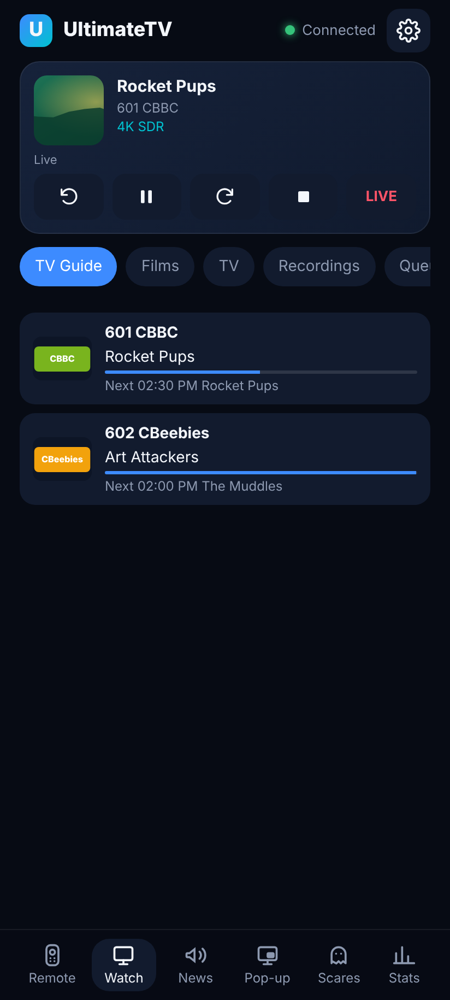
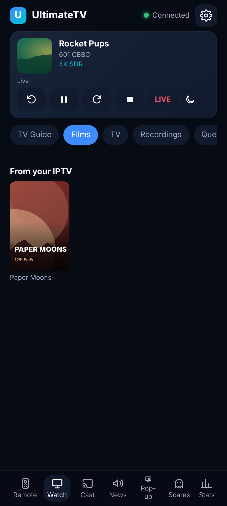
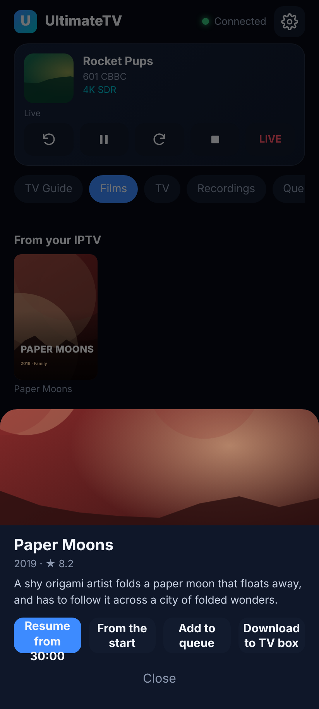
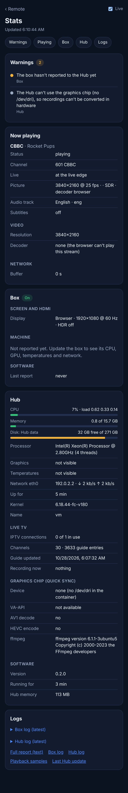
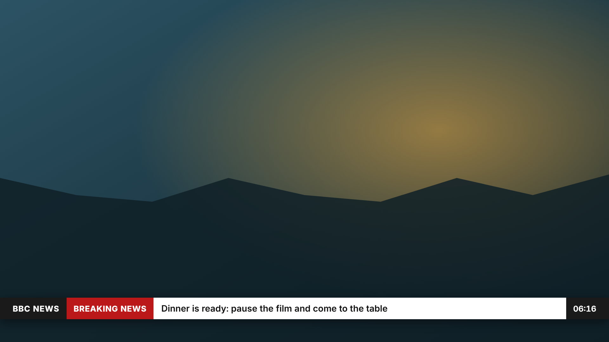
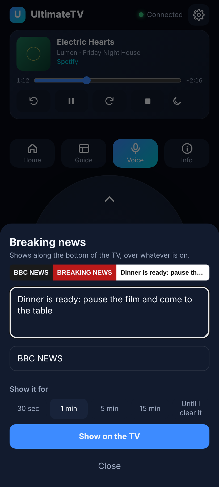

# The phone remote

Any phone on the home Wi-Fi that has paired with the TV ([Pairing](pairing.md)) can drive it: arrows and OK, Back, Home, Guide, Info, the colour keys, numbers, channel up and down, play controls, and typing for search. Key presses go to the Hub, and the Hub passes them to the TV app.

## As a web app (any phone)

On the TV, open **Settings › Phones and remotes** and scan the code with the phone's camera: the remote opens and pairs the phone. (Or open `http://192.168.0.19:8095/remote/` and type the code shown on the TV.) In Chrome, choose **Add to Home screen**.

## As an Android app

The Android app is the same remote in its own app, with two extras: the phone's **volume keys change channel** and the phone's **Back** button is the TV's Back. It keeps the phone's screen on while it's open.

1. On the phone, open `http://192.168.0.19:8095/api/remote/app.apk` in Chrome (or tap **Get the
   Android app** on the web remote). The Hub fetches the latest build from GitHub for you. It's also
   in the latest **CI** run's `ultimatetv-remote-apk` artifact, or build it with
   `cd android && gradle assembleDebug`.
2. Open the downloaded file. Android asks to allow installing from that app the first time.
3. Open **UltimateTV Remote** and tap **Scan the TV's code**, then scan the code in Settings ›
   Phones and remotes on the TV. That finds the Hub and pairs the phone. (Or type the Hub's address
   and tap **Connect**, then type the code from the TV.) The scanner is Google Play services'
   own, so the app needs no camera permission.

When a newer app is on the Hub, the remote shows a banner: tap it to install the update. From 0.3.0
every build is signed with the same key (`android/remote.keystore`), so updates install over the
top. Moving from 0.1 or 0.2 to 0.3 needs the old app uninstalled first, once.

To point it at a different Hub later, use **Change Hub** at the bottom of the remote.

## Sideways

Turn the phone on its side and the remote turns with it (the web app and the Android app from
0.6.0; the Android app follows the phone's rotation lock). The d-pad sits in the middle with Home,
Guide, Voice, Info, Back, 123 and Options on the left and the colour, play, channel and typing keys
on the right, so a thumb on either side reaches its half. The tabs move to a rail down the right
edge and Now Playing becomes a strip along the top. Everything fits without scrolling down to
640 × 360; the screenshot run checks that.

## Now playing

When the TV is playing something, a card at the top of the remote shows it: the title, the
picture and sound quality, and a progress bar you can drag to jump. The buttons skip back or
forward 30 seconds, pause, stop, jump back to live on a live channel, and pick the audio and
subtitle tracks. For Spotify they skip to the previous or next song.

## Watch on the TV

The **Watch** tab at the bottom chooses what the TV plays, without using the TV's menus:

- **Guide**: what's on now and next on every channel. Tap one to watch it, or record this or the
  next programme.
- **Films** and **TV**: the same rails as the TV's home. Tap a poster to play, resume or start
  again, or pick a season and episode.
- **Recordings**: newest first.
- **Music**: your Spotify playlists, albums and artists. Play, shuffle, or start at a song.
- **Weather**: now, hour by hour and the week, with Show on the TV ([weather.md](weather.md)).
- **Search**: films, series, channels, programmes and recordings.
- **Favourites**: a channel's sheet and a film's or show's sheet have **♡ Add to Favourites**. It
  stars it for the profile the TV is on, and fills in once it's a favourite
  ([profiles.md](profiles.md#favourites)).

## Stats

**Stats** (bottom right, and at the top of Settings) shows both machines in one page, refreshed
every 3 seconds: warnings first (dropped frames, a hot CPU, a nearly full disk, a failing IPTV
login), then what's playing and how far through, picture and sound quality, buffer and download
speed, the screen mode and HDMI details, CPU, graphics, memory, temperatures, disks and network
for the box and the Hub, and their recent logs.

## Breaking news

**News** at the bottom of the remote puts a "BREAKING NEWS" bar along the bottom of the TV, in the
style of the BBC News channel, over whatever is on. Type the message, change the channel name if
you like, and choose how long it stays: 30 seconds to 15 minutes, or until you take it down from
the same screen.

## Pop-ups

**Pop-up** at the bottom of the remote puts a message, photo or video on the TV, where you choose:
the doorbell, dinner, a meeting, an alarm. Home Assistant can send the same pop-ups. See
[Pop-ups on the TV](notifications.md).

## Following the TV's features

What's switched off on the TV box (Settings › Features on this screen) goes from the remote too: the Guide button, the Watch tab's lists, Cast, Clips, News and Pop-up. See [features-per-screen.md](features-per-screen.md).

## Settings

Tap ⚙ at the top of the remote for the settings page. It has everything the TV's Settings has
(picture and sound, recording, profiles and PINs, playback stats) plus sources and logins, and:

- **Updates and the TV**: what the Hub and the box run, whether there's something newer, and
  buttons to update either one, reload the TV app or refresh channels and the guide.
- The Hub can only update itself from here once the helper is installed on the Docker LXC:
  `sudo bash /containers/UltimateTV/tools/hub/update.sh --phone-updates`. It adds a systemd path
  unit and service (`ultimatetv-hub-update`) and a runner script in `/usr/local/lib/ultimatetv`.
  When the Hub leaves a request file in its data volume, the service runs `update.sh` as root. It
  can't run anything else, and nothing is added to sudoers. Output: `/api/software/hub/log`.
  To remove it: `systemctl disable --now ultimatetv-hub-update.path` and delete those files.
- Once a PIN is set, changes ask for a grown-up's PIN.

In the Android app the phone's Back button returns from settings to the remote.

## Voice

Tap **Voice** and speak. The Hub works out what you meant:

| Say | What happens |
| --- | --- |
| "watch BBC One", "put on Sky News", "Channel 4" | switches to that channel |
| "channel 101", "channel one oh one" | switches by number |
| "search for Dune", "find Bluey", "play The Office" | searches on the TV |
| "pause", "play", "stop", "fast forward", "rewind", "record" | the play controls |
| "go home", "guide", "back", "OK", "info", "next channel" | the remote's keys |
| "down three times", "right" | arrows (up to 20) |
| "show stats", "stats off", "reload the app" | the TV app |
| "what's the weather like", "will it rain tomorrow" | the forecast on the TV ([weather.md](weather.md)) |

Anything else is searched for. What was heard, and what it did, shows above the buttons and on the TV.

- **Android app**: it uses the phone's speech recogniser (the Google app), so nothing needs setting up.
- **Chrome**: browsers only allow the microphone on https pages, and the Hub is plain http, so the
  Voice button puts the cursor in the text box instead: tap the keyboard's mic key, speak, then Send.

## Tips

- Swipe on the pad to move, tap to press OK, and hold an arrow to repeat.
- Type in the text box at the bottom and press **Send** to type into the TV's search box.
- The phone remote keeps working once the TV remote works over CEC, so both can be used.
