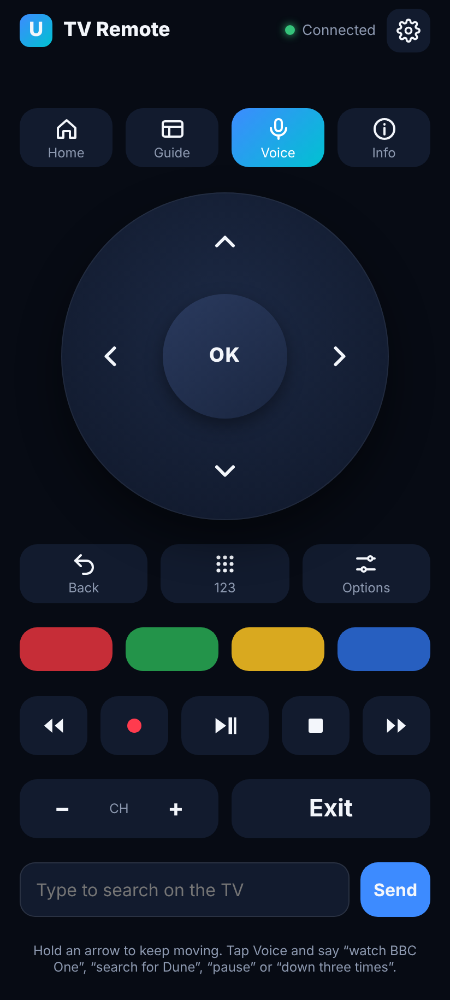
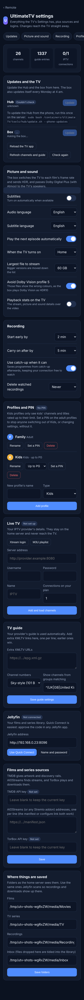
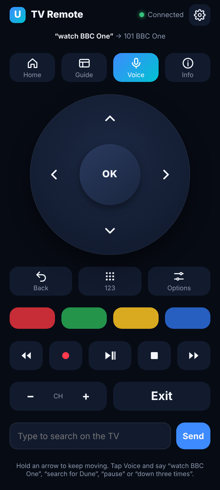

# The phone remote

Any phone on the home Wi-Fi can drive the TV: arrows and OK, Back, Home, Guide, Info, the colour keys, numbers, channel up and down, play controls, and typing for search. Key presses go to the Hub, and the Hub passes them to the TV app.

## As a web app (any phone)

On the TV, open **Settings › Phone remote** and scan the code, or open `http://192.168.0.19:8095/remote/` on the phone. In Chrome, choose **Add to Home screen**.

## As an Android app

The Android app is the same remote in its own app, with two extras: the phone's **volume keys change channel** and the phone's **Back** button is the TV's Back. It keeps the phone's screen on while it's open.

1. Get `app-debug.apk` from the latest **CI** run on GitHub (Actions › CI › the `ultimatetv-remote-apk` artifact), or build it with `cd android && gradle assembleDebug`.
2. Copy it to the phone and open it. Android asks to allow installing from that app the first time.
3. Open **UltimateTV Remote**. It suggests `http://192.168.0.19:8095`; change it if the Hub's address is different, and tap **Connect**.

To point it at a different Hub later, use **Change Hub** at the bottom of the remote.

## Settings

Tap ⚙ at the top of the remote for the settings page. It has everything the TV's Settings has
(picture and sound, recording, profiles and PINs, playback stats) plus sources and logins, and:

- **Updates and the TV**: what the Hub and the box run, whether there's something newer, and
  buttons to update either one, reload the TV app or refresh channels and the guide.
- The Hub can only update itself from here once the helper is installed on the Docker LXC:
  `sudo bash /containers/UltimateTV/tools/hub/update.sh --phone-updates`. It adds a systemd path
  unit and service (`ultimatetv-hub-update`) and a runner script in `/usr/local/lib/ultimatetv`.
  When the Hub leaves a request file in its data volume, the service runs `update.sh` as root. It
  can't run anything else, and nothing is added to sudoers. Output: `/api/software/hub/log`.
  To remove it: `systemctl disable --now ultimatetv-hub-update.path` and delete those files.
- Once a PIN is set, changes ask for a grown-up's PIN.

In the Android app the phone's Back button returns from settings to the remote.

## Voice

Tap **Voice** and speak. The Hub works out what you meant:

| Say | What happens |
| --- | --- |
| "watch BBC One", "put on Sky News", "Channel 4" | switches to that channel |
| "channel 101", "channel one oh one" | switches by number |
| "search for Dune", "find Bluey", "play The Office" | searches on the TV |
| "pause", "play", "stop", "fast forward", "rewind", "record" | the play controls |
| "go home", "guide", "back", "OK", "info", "next channel" | the remote's keys |
| "down three times", "right" | arrows (up to 20) |
| "show stats", "stats off", "reload the app" | the TV app |

Anything else is searched for. What was heard, and what it did, shows above the buttons and on the TV.

- **Android app**: it uses the phone's speech recogniser (the Google app), so nothing needs setting up.
- **Chrome**: browsers only allow the microphone on https pages, and the Hub is plain http, so the
  Voice button puts the cursor in the text box instead: tap the keyboard's mic key, speak, then Send.

## Tips

- Swipe on the pad to move, tap to press OK, and hold an arrow to repeat.
- Type in the text box at the bottom and press **Send** to type into the TV's search box.
- The phone remote keeps working once the TV remote works over CEC, so both can be used.
