# The phone remote

Any phone on the home Wi-Fi that has paired with the TV ([Pairing](pairing.md)) can drive it: arrows and OK, Back, Home, Guide, Info, the colour keys, numbers, channel up and down, play controls, and typing for search. Key presses go to the Hub, and the Hub passes them to the TV app.

## As a web app (any phone)

On the TV, open **Settings › Phones and remotes** and scan the code with the phone's camera: the remote opens and pairs the phone. (Or open `http://192.168.0.19:8095/remote/` and type the code shown on the TV.) In Chrome, choose **Add to Home screen**.

## On an iPhone

There is nothing to install from the App Store: the remote is a web app, and iOS adds it to the Home
Screen from Safari. iOS has no install prompt of its own, so the remote shows a line saying where
the button is.

1. On the TV, open **Settings › Phones and remotes** and scan the code with the iPhone's camera. (Or
   open `http://192.168.0.19:8095/remote/` in Safari and type the code the TV shows.) The remote
   opens and the phone is paired.
2. In Safari, tap **Share** (the square with the arrow), scroll down and choose **Add to Home
   Screen**, then **Add**. The remote says the same thing in a banner the first time it is opened on
   an iPhone; the banner goes away once the remote is on the Home Screen, or when you dismiss it.
3. Open **TV Remote** from the Home Screen. It runs full screen with no address bar, has its own icon
   and dark blue splash screen, and is already paired: the phone keeps its place, and the picker at
   the top still chooses which TV it drives.

It is the same page as the web remote, so everything works this way: the keys and the d-pad, typing a
search, voice, the TV's pop-ups and casting. Watching films on the phone itself is the Android app
below or the browser client in [#81](https://github.com/robertsondean/UltimateTV/issues/81), not this.

- Over the Hub's plain `http://` address the remote installs and works, but Safari won't run a
  service worker on an insecure page, so it needs the network each time. The Hub also answers over
  HTTPS, on the same port and certificate as [the laptop screen share](casting-and-games.md) (`8096`
  by default): open `https://192.168.0.19:8096/remote/`, accept the certificate warning once, and add
  that to the Home Screen instead. There the page is kept on the phone and opens instantly.
- If a Hub update ever leaves an older remote on the Home Screen, close it from the app switcher and
  open it again: the page is refreshed in the background and the old copy cleared.

## As an Android app

The Android app is the same remote in its own app, with two extras: the phone's **volume keys change channel** and the phone's **Back** button is the TV's Back. It keeps the phone's screen on while it's open.

1. On the phone, open `http://192.168.0.19:8095/api/remote/app.apk` in Chrome (or tap **Get the
   Android app** on the web remote). The Hub fetches the latest build from GitHub for you. It's also
   in the latest **CI** run's `ultimatetv-remote-apk` artifact, or build it with
   `cd android && gradle assembleDebug`.
2. Open the downloaded file. Android asks to allow installing from that app the first time.
3. Open **UltimateTV Remote** and tap **Scan the TV's code**, then scan the code in Settings ›
   Phones and remotes on the TV. That finds the Hub and pairs the phone. (Or type the Hub's address
   and tap **Connect**, then type the code from the TV.) The scanner is the app's own, built on
   CameraX and ZXing, so it needs the camera permission and nothing from Google
   ([dependencies.md](dependencies.md)).

When a newer app is on the Hub, the remote shows a banner: tap it to install the update. Every build
is signed with the household's own key, which is kept in the repository's secrets and never in the
repo itself ([android-signing.md](android-signing.md)), so updates install over the top.

**Moving to 0.8.0 needs the old app uninstalled first, once.** Builds up to 0.7.0 were signed with a
key that used to be committed, and Android won't install over a different one. The banner says so
before you tap it: uninstall the old remote, install the new one, then scan the TV's pairing code
again. After that, updates are normal.

To point it at a different Hub later, use **Change Hub** at the bottom of the remote.

## From the shade and the home screen

The Android app puts the TV on the phone itself, so it can be paused without opening anything
(from 0.7.0):

- **In the phone's notifications** while the TV is playing: the title, the year or episode, the
  picture, and how far through it is, with Pause, Back 30 seconds, Forward a minute and Back. A
  live channel gets Channel − and Channel + instead of skipping. It goes away when the TV stops,
  and it shows on the lock screen if the phone shows notifications there. Android 13+ asks once
  for permission to post notifications; without it the tile and the widget still work.
- **In Quick Settings**: add the **TV Remote** tile and tapping it plays or pauses. It reads
  "Pause" while something is playing and "Play" otherwise, and says what the TV is playing in its
  description.
- **On the home screen**: the **TV Remote** widget, which resizes. A small one is the title plus
  Play/Pause, Back and Home; a bigger one adds the d-pad with OK and the four colour keys. Tapping
  the title opens the remote.

None of them poll: the Hub holds one request open until the TV's state changes, so a phone that
isn't playing anything has nothing of ours running at all, and one idle request waits on the Hub
until the TV starts. The TV's state comes from the same report the Hub sends Home Assistant, so
what the shade shows and what Home Assistant sees agree.

## Sideways

Turn the phone on its side and the remote turns with it (the web app and the Android app from
0.6.0; the Android app follows the phone's rotation lock). The d-pad sits in the middle with Home,
Guide, Voice, Info, Back, 123 and Options on the left and the colour, play, channel and typing keys
on the right, so a thumb on either side reaches its half. The tabs move to a rail down the right
edge and Now Playing becomes a strip along the top. Everything fits without scrolling down to
640 × 360; the screenshot run checks that.

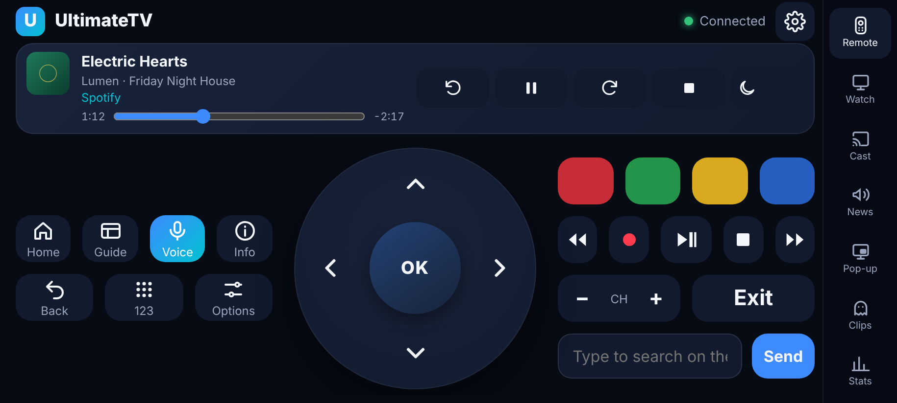
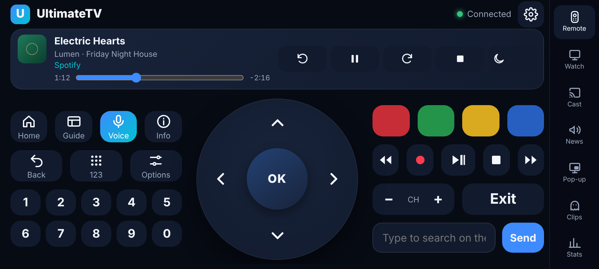
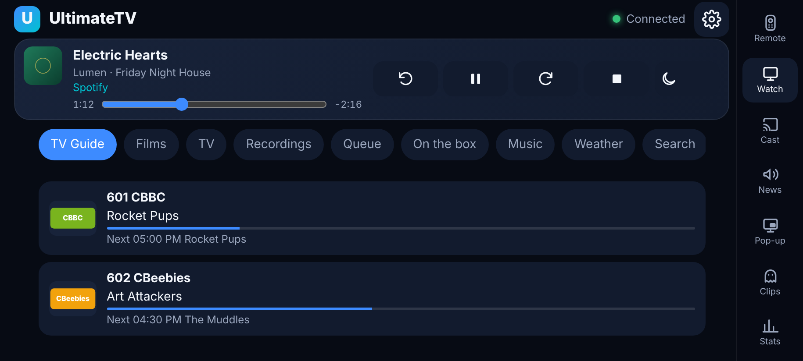

## Now playing

When the TV is playing something, a card at the top of the remote shows it: the title, the
picture and sound quality, and a progress bar you can drag to jump. The buttons skip back or
forward 30 seconds, pause, stop, jump back to live on a live channel, and pick the audio and
subtitle tracks. For Spotify they skip to the previous or next song.

## Two TVs

A second box in another room is a second screen on the same Hub: give it a name when it pairs (TV
Settings › Phones and remotes, or the `setup/` page) and it appears in a picker at the top of the
phone remote. Each room keeps its own now-playing card, sleep timer and pop-ups, so the bedroom
remote comes back controlling the bedroom. The picker only appears once there are two boxes, and
what it is set to is remembered per phone.

The main box — the one everything goes to when nobody says otherwise — is the one that was paired
first. Both boxes can watch different channels; IPTV connections are counted per box, so the second
room asking for the same channel shares the relay rather than taking it away, and a clash warning
says which room it is talking about.

## Watch on the TV

The **Watch** tab at the bottom chooses what the TV plays, without using the TV's menus:

- **Guide**: what's on now and next on every channel. Tap one to watch it, or record this or the
  next programme. A programme that's part of a series also has **Record series**, which asks
  whether to keep every episode or only the latest 3, 5 or 10.
- **Films** and **TV**: the same rails as the TV's home. Tap a poster to play, resume or start
  again, or pick a season and episode.
- **Recordings**: newest first.
- **Reminders**: everything the household has asked to be told about, earliest first, with **✕** to
  take one back. The guide's sheet sets one with **Remind me**.
- **Saved**: everything saved for later, the household's list and the TV profile's alike, with **▶**
  to play it on the TV, **+** to add it to the queue and **✕** to take it off the list. Tap a row to
  open it ([everyday-extras.md](everyday-extras.md#save-for-later)).
- **Music**: your Spotify playlists, albums and artists. Play, shuffle, or start at a song.
- **Weather**: now, hour by hour and the week, with Show on the TV ([weather.md](weather.md)).
- **Search**: films, series, channels, programmes and recordings.
- **Favourites**: a channel's sheet and a film's or show's sheet have **♡ Add to Favourites**. It
  stars it for the profile the TV is on, and fills in once it's a favourite
  ([profiles.md](profiles.md#favourites)).

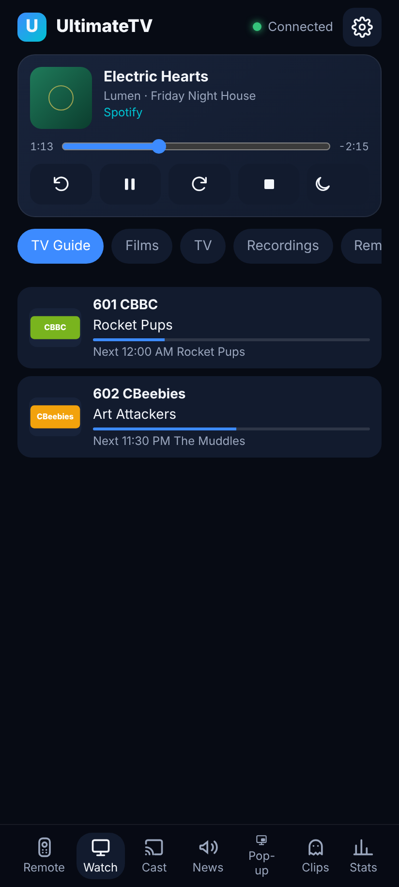
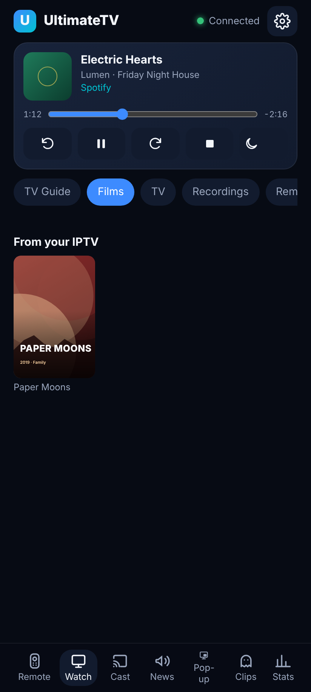
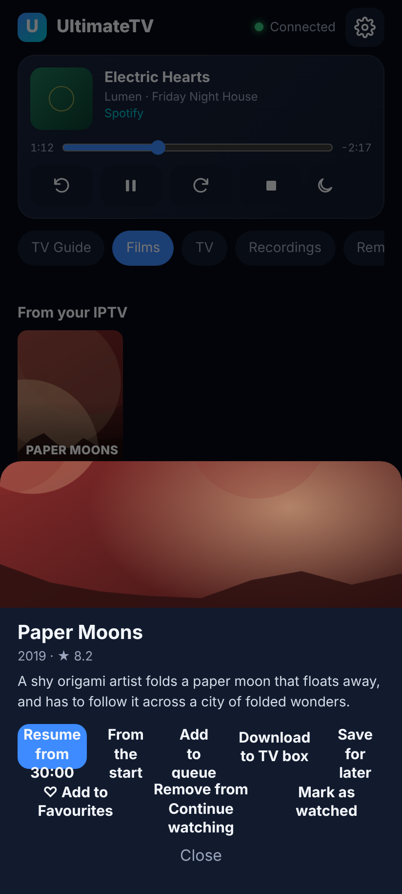

## Watching elsewhere

Watch › **Elsewhere** lists what every TV, phone and tablet in the house is playing. Tap one and the
TV the remote works carries on from the same place; **Move** also stops it where it was, and
**Sync** plays both together, pausing and skipping as one. See
[watching-elsewhere.md](watching-elsewhere.md).

## Stats

**Stats** (bottom right, and at the top of Settings) shows both machines in one page, refreshed
every 3 seconds: warnings first (dropped frames, a hot CPU, a nearly full disk, a failing IPTV
login), then what's playing and how far through, picture and sound quality, buffer and download
speed, the screen mode and HDMI details, CPU, graphics, memory, temperatures, disks and network
for the box and the Hub, and their recent logs.

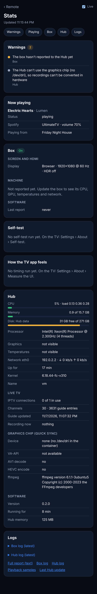

## Breaking news

**News** at the bottom of the remote puts a "BREAKING NEWS" bar along the bottom of the TV, in the
style of the BBC News channel, over whatever is on. Type the message, change the channel name if
you like, and choose how long it stays: 30 seconds to 15 minutes, or until you take it down from
the same screen.

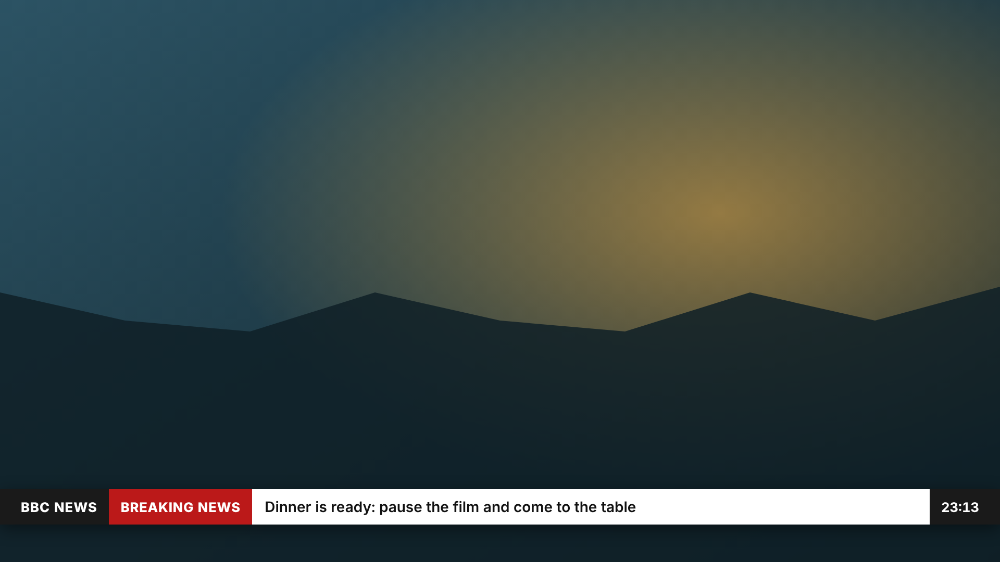
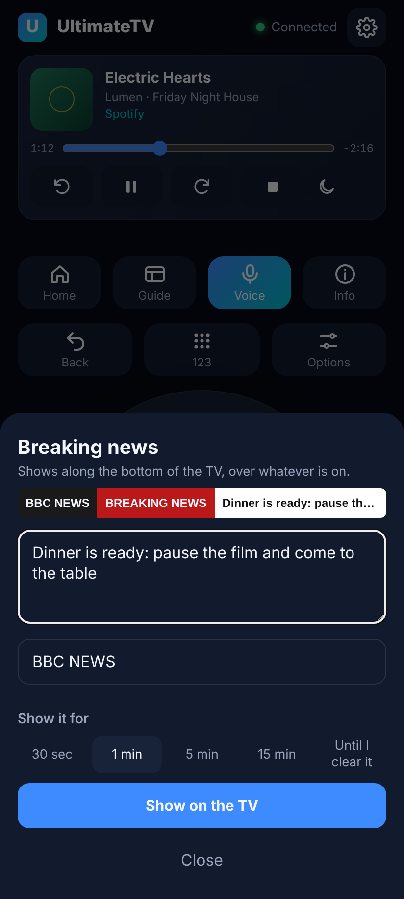

## Pop-ups

**Pop-up** at the bottom of the remote puts a message, photo or video on the TV, where you choose:
the doorbell, dinner, a meeting, an alarm. Home Assistant can send the same pop-ups. See
[Pop-ups on the TV](notifications.md).

## Following the TV's features

What's switched off on the TV box (Settings › Features on this screen) goes from the remote too: the Guide button, the Watch tab's lists, Cast, Clips, News and Pop-up. See [features-per-screen.md](features-per-screen.md).

## Small phones and accessibility

- The seven tabs share the bar equally, down to a 360px-wide phone; the Now Playing buttons fit the card.
- Buttons people tap while watching the TV (settings ⚙, chips, queue and dismiss buttons) are at least 44px.
- Sheets (details, choices, What's new) have a grab handle, close with Escape, and take focus so a screen reader announces them; focus goes back to what opened them.
- The connection status and what Voice heard are announced; the current tab is marked as pressed.
- A keyboard or switch shows a focus ring; the remote's animations stop when the phone asks for reduced motion; pinch-zoom works.

## Settings

Tap ⚙ at the top of the remote for the settings page. It has everything the TV's Settings has
(picture and sound, recording, profiles and PINs, playback stats) plus sources and logins, and:

- **Updates and the TV**: what the Hub and the box run, whether there's something newer, and
  buttons to update either one, reload the TV app or refresh channels and the guide.
- The Hub can only update itself from here once the helper is installed on the Docker LXC:
  `sudo bash /containers/UltimateTV/tools/hub/update.sh --phone-updates`. It adds a systemd path
  unit and service (`ultimatetv-hub-update`) and a runner script in `/usr/local/lib/ultimatetv`.
  When the Hub leaves a request file in its data volume, the service runs `update.sh` as root. It
  can't run anything else, and nothing is added to sudoers. Output: `/api/software/hub/log`.
  To remove it: `systemctl disable --now ultimatetv-hub-update.path` and delete those files.
- Once a PIN is set, changes ask for a grown-up's PIN.

In the Android app the phone's Back button returns from settings to the remote.

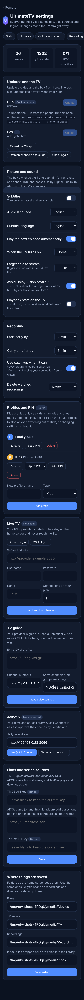

## Voice

Tap **Voice** and speak. The Hub works out what you meant:

| Say | What happens |
| --- | --- |
| "watch BBC One", "put on Sky News", "Channel 4" | switches to that channel |
| "channel 101", "channel one oh one" | switches by number |
| "search for Dune", "find Bluey", "play The Office" | searches on the TV |
| "pause", "play", "stop", "fast forward", "rewind", "record" | the play controls |
| "go home", "guide", "back", "OK", "info", "next channel" | the remote's keys |
| "down three times", "right" | arrows (up to 20) |
| "show stats", "stats off", "reload the app" | the TV app |
| "what's the weather like", "will it rain tomorrow" | the forecast on the TV ([weather.md](weather.md)) |

Anything else is searched for. What was heard, and what it did, shows above the buttons and on the TV.

- **Android app**: it uses the phone's speech recogniser (the Google app), so nothing needs setting up.
- **Chrome**: browsers only allow the microphone on https pages, and the Hub is plain http, so the
  Voice button puts the cursor in the text box instead: tap the keyboard's mic key, speak, then Send.

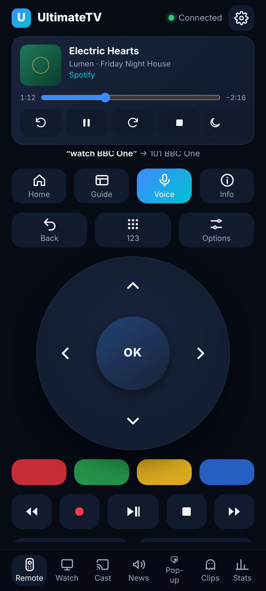

## Tips

- Swipe on the pad to move, tap to press OK, and hold an arrow to repeat.
- Type in the text box at the bottom and press **Send** to type into the TV's search box.
- The phone remote keeps working once the TV remote works over CEC, so both can be used.
