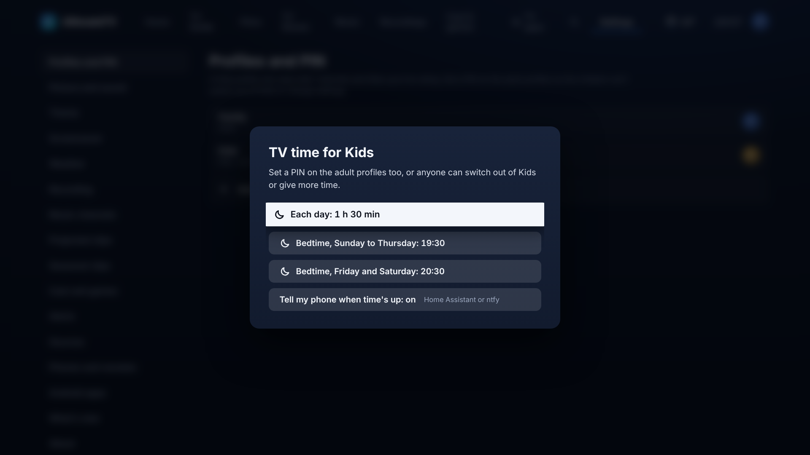
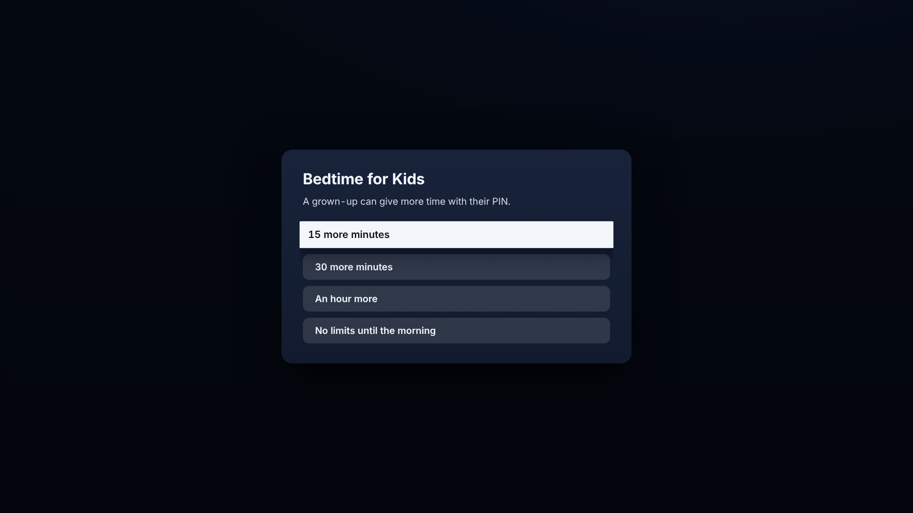

# Profiles and the Kids lock

The TV starts with two profiles, **Family** (adult) and **Kids**. Add, rename or remove them in **Settings › Profiles and PIN**.

## What Kids can see

- **Channels:** only channels in kids' categories (CBBC, CBeebies and the like, from the IPTV playlist's groups). Others are hidden from the guide, Home, search and channel numbers, and can't be tuned.
- **Films and TV:** only titles rated up to the profile's limit (PG by default, and anything up to 15 in the profile's options). Titles with no rating are shown only if their genres include Kids or Family. Jellyfin titles use Jellyfin's own parental rating.
- **No settings, no deleting recordings, no downloads, no series link changes.** The Hub refuses these for a Kids profile even if someone tries from a browser.

## TV time and bedtime

Each Kids profile can have a daily allowance and a bedtime: **Settings › Profiles and PIN › Kids ›
TV time and bedtime** on the TV, or the Kids profile under Profiles on the phone's setup page.

- **Each day:** no limit, or 30 minutes to 4 hours. Time counts only while something plays on
  that profile (paused doesn't count), and starts again at midnight. Watching on two screens at
  once on the same profile counts once.
- **Bedtime:** one for Sunday to Thursday nights and one for Friday and Saturday nights, 18:00 to
  23:00 or none. Bedtime lasts until 6 in the morning.
- **Warnings:** a card says "5 more minutes" and "2 more minutes" before whichever comes first.
- **When time's up** what's on may finish (the episode, the film, or the programme on live TV),
  for 30 minutes at most. Nothing new starts: the next episode, another channel or a new film is
  refused. Then the sound fades and the TV goes back to **Who's watching?**.
- **More time:** pick the Kids profile again and an adult's PIN gives 15, 30 or 60 more minutes, or
  no limits until 6 the next morning. On the setup page the same buttons are under the profile,
  with how long has been watched today.
- **Tell my phone when time's up** sends a message to wherever Settings › Alerts sends (Home
  Assistant or ntfy), once each time.

The Hub keeps the count and refuses to start anything on a Kids profile whose time is up, so a
browser or the Android app can't get round it (the Android app warns and closes its player too).
Bedtime goes by the Hub's clock. Two things to know:

- **Set an adult PIN.** Without one anyone can switch to Family, and more time needs no PIN.
- The allowance is counted from the TV's and the Android app's "still playing" reports every half
  minute. A download played on the phone away from the home Wi-Fi isn't counted, and something
  already playing in a browser isn't cut off by the Hub (it just can't start the next thing).

## Custom guides

Above the TV Guide's grid are the channel lists: all channels, favourites, your custom guides and
each category. Press Up from the top row to pick one, or Blue to step through them.

- **New guide** builds one: OK on a channel on the left adds or removes it; on the right, OK picks
  a channel up so Up and Down move it, and Red takes it out. Blue changes the category on the
  left, Yellow adds everything it shows, and the number keys jump to a channel.
- **Make default** saves the list you're on as the one this profile's guide opens on. Each profile
  keeps its own, Kids included.
- The phone settings page (Guide lists and channels) does all of this too, and also sets the
  order of the lists, every channel's number and category, and favourites.
- Custom guides are shared by the household; only adults can build, change or delete them. A Kids
  profile only sees the kids' channels in them.

## The PIN

Set a 4-digit PIN on the adult profile (**Settings › Profiles and PIN › Family › Set a PIN**). Then:

- Switching from Kids to an adult profile asks for the PIN.
- Once any adult profile has a PIN, every adult profile needs one. An adult profile without its own PIN takes the household PIN (the first one set).
- The setup page asks for the PIN before it changes anything.
- When the TV is turned on, it goes to the profile picker if a PIN is set, so the TV is never left on an adult profile.

Forgotten the PIN? On the Hub, run `docker compose exec hub node hub/dist/reset-pins.js`, which clears every PIN.
