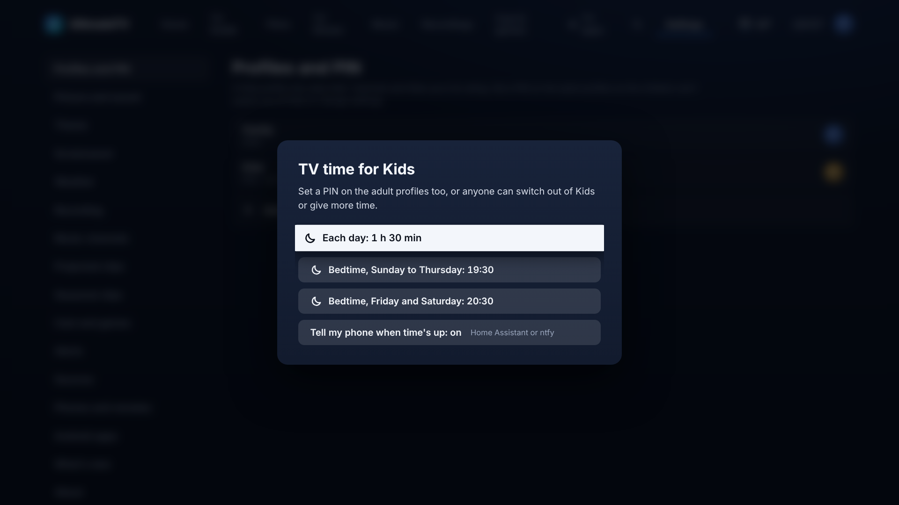
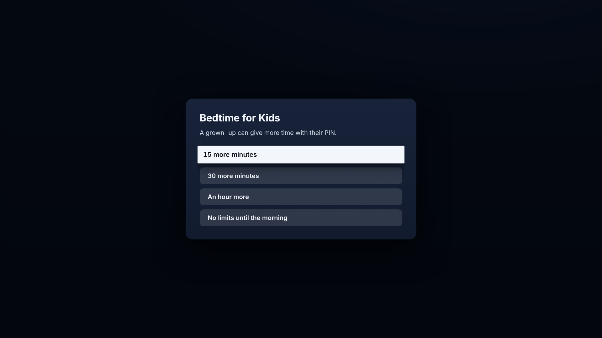
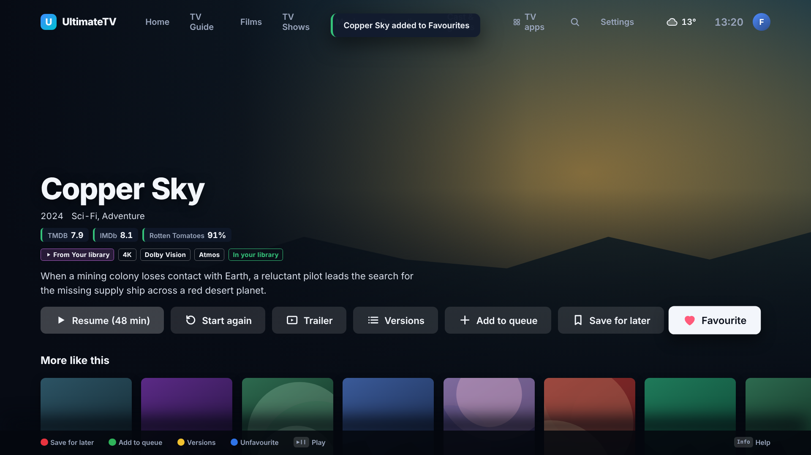
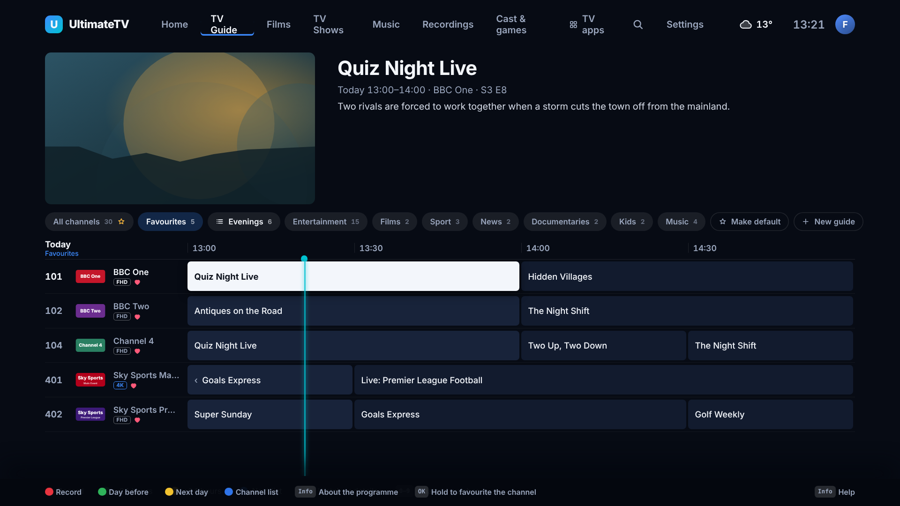

# Profiles and the Kids lock

The TV starts with two profiles, **Family** (adult) and **Kids**. Add, rename or remove them in **Settings › Profiles and PIN**, where a profile can also be a **Guest** (see below).

## What Kids can see

- **Channels:** only channels in kids' categories (CBBC, CBeebies and the like, from the IPTV playlist's groups). Others are hidden from the guide, Home, search and channel numbers, and can't be tuned.
- **Films and TV:** only titles rated up to the profile's limit (PG by default, and anything up to 15 in the profile's options). Titles with no rating are shown only if their genres include Kids or Family. Jellyfin titles use Jellyfin's own parental rating.
- **No settings, no deleting recordings, no downloads, no series link changes.** The Hub refuses these for a Kids profile even if someone tries from a browser.

## A Guest profile

A Guest is for visitors and babysitters: someone who should be able to watch without explaining the
PIN or filling an adult profile with their viewing. Add one in **Settings › Profiles and PIN › Add a
profile › Guest**. It shows in **Who's watching?** as **Guest · up to 12**.

- **Rated like a Kids profile, but for adults:** titles rated up to its limit (12 to start, and
  anything up to 15 in its options). Unlike Kids, anything unrated is allowed, and every channel is
  in the guide.
- **Its own sections:** **Settings › Profiles and PIN › [the Guest] › What a Guest can use** picks
  which sections it has, out of everything except Recordings and Downloads, which a Guest never has.
  **Use the usual sections again** puts back the default list (live TV, films, shows, music, search,
  cast, weather, music video channels and clips).
- **Nothing it watches is kept.** The player still reports where it got to, as it always does, but
  for a Guest nothing is written: no Continue watching, no "Because you watched", no Jellyfin
  progress, and its Home leaves the household's history rails out. Marking something watched
  doesn't stick. There is nothing to clear at the end of the visit because nothing was ever saved.
- **No settings, and no recordings or downloads:** the Hub refuses them for a Guest even if someone
  tries from a browser or the phone, exactly as it does for Kids.

If a profile that was a Guest is changed back to an adult, its section pick is ignored.

## Rows on Home

Home comes with these rows, top to bottom:

| Row | What's in it |
| --- | --- |
| Live now | What's on the channels you watch most, right now |
| Continue watching | Films and series you're part-way through |
| Recently recorded | What the box recorded that you haven't watched |
| Saved for later | Titles you saved with Red (and ones saved from a phone, which every profile sees) |
| Favourites | Titles and channels you starred |
| Next up | The next episode of the series you're watching |
| Because you watched | Films and series like the ones you finished |
| Family films | Kids profiles: family films from TMDB |
| Cartoons and kids' shows | Kids profiles: kids' series from TMDB |
| Films on TV today | Films in today's guide |
| Recently added | New films in Jellyfin |
| Trending this week | What's popular on TMDB |
| New films from your IPTV | Recent additions to IPTV VOD |

Each profile has its own list: **Settings › Rows on Home** on the TV, or **Rows on Home** on a phone at `/setup/`. Switch a row off, move it up or down, or start again from **Simple Home** (Live now, Continue watching and Recently recorded only) or **Everything**. The phone's list also shows which profile it's changing.

A row that's switched off is **never fetched**, so Home loads faster: a Hub with no `Continue watching` row doesn't ask Jellyfin for its resume list at all. The list is kept on the Hub, so it follows the profile to every screen and app, and it's forgotten when the profile is deleted.

Kids start with every row switched on but see fewer of them — its content filter leaves Because you watched, Trending this week and the other discovery rows empty.

## What a parent allows

The rating limit is blunt. Most IPTV films and series carry no certificate at all, the ratings that
do exist were written for another country's TV, and a genre guess can let an odd title through or
keep back something harmless. So a parent can say yes or no to one title or one channel, and that
answer wins over the rating **both ways**.

- **On the TV:** open a film, series or channel's details page as an adult profile and use **Allow
  for Kids** or **Hide from Kids**. An allowed title is shown and plays even when its certificate is
  15 or 18; a hidden one is kept back even when it's a U. Pressing the same button again puts it back
  under the rating.
- **From a phone:** `/setup/` › **Profiles** has the same two lists for each Kids profile, with
  **Allow something** and **Hide something** to add by name and **Stop allowing** / **Stop hiding**
  to take one off.
- **How it matches:** by the title's own id where there is one, and by its name otherwise, because a
  broadcast's id is a single airing (`programme:film4:1793600000000`) and the parent meant the film,
  not that showing of it. The name match ignores case, accents, "The"/"A", "&" and a trailing
  `(UK)`, `(HD)` or year — so *The Dune (UK)* meets *Dune*, but *Dune: Part Two* doesn't.
- **Kept on the Hub**, one list per Kids profile, and forgotten when the profile is deleted. Adults
  have no such lists.

## Ask a parent

When a Kids or Guest profile opens something it isn't allowed (from a link, a cast, a page it had open), the page says "This isn't on your profile yet" and offers **Ask a parent**.

- **Where it lands:** a pop-up on the TV when an adult profile is on, a sheet on every paired phone remote (with **Allow once**, **Always allow** and **No**), and a message to Home Assistant or ntfy when Settings › Alerts points at one. A phone that was a moment too slow is told someone has already answered.
- **The answer:** the first adult to answer wins. **Allow once** lets the title through that Kids or Guest profile for six hours. **Always allow** adds it to the Kids profile's allow list (see [What a parent allows](#what-a-parent-allows)); a Guest has no list, so it only gets Allow once. **No** shows the child "Not now".
- **No spam:** one profile can make three requests in ten minutes, asking again for the same title returns the first request, and a No isn't asked again for ten minutes. A request nobody answers lapses after half an hour.
- **Safe:** a request holds only the title, the profile and the time. A Kids or Guest profile can never answer a request, even with a PIN, and a phone with no profile needs an adult PIN once one is set. **Set an adult PIN**, or anyone with a paired phone can answer.
- **The record:** the week's requests, with when and what was said, are listed under each Kids profile on `/setup/`.
- **Not covered yet:** the Android app doesn't show the request (use the phone remote or the TV), and the button is only on a title's page, not on the guide's channels.

## The week a Kids profile watched

The same `/setup/` page shows, under each Kids profile, **the last seven days**: how long it was
watched each day, what was played, the week's total, and how many times a PIN was locked out after
too many wrong tries (see [The PIN](#the-pin)). The titles come from what the profile was playing
and the minutes from the same clock the TV time limits use, so a title that was only on for a minute
still shows while the total stays honest. Nothing is sent anywhere unless you have Settings › Alerts
pointing at Home Assistant or ntfy.

## TV time and bedtime

Each Kids profile can have a daily allowance and a bedtime: **Settings › Profiles and PIN › Kids ›
TV time and bedtime** on the TV, or the Kids profile under Profiles on the phone's setup page.

- **Each day:** no limit, or 30 minutes to 4 hours. Time counts only while something plays on
  that profile (paused doesn't count), and starts again at midnight. Watching on two screens at
  once on the same profile counts once.
- **Bedtime:** one for Sunday to Thursday nights and one for Friday and Saturday nights, 18:00 to
  23:00 or none. Bedtime lasts until 6 in the morning.
- **Warnings:** a card says "5 more minutes" and "2 more minutes" before whichever comes first.
- **When time's up** what's on may finish (the episode, the film, or the programme on live TV),
  for 30 minutes at most. Nothing new starts: the next episode, another channel or a new film is
  refused. Then the sound fades and the TV goes back to **Who's watching?**.
- **More time:** pick the Kids profile again and an adult's PIN gives 15, 30 or 60 more minutes, or
  no limits until 6 the next morning. On the setup page the same buttons are under the profile,
  with how long has been watched today.
- **Tell my phone when time's up** sends a message to wherever Settings › Alerts sends (Home
  Assistant or ntfy), once each time.

The Hub keeps the count and refuses to start anything on a Kids profile whose time is up, so a
browser or the Android app can't get round it (the Android app warns and closes its player too).
Bedtime goes by the Hub's clock. Two things to know:

- **Set an adult PIN.** Without one anyone can switch to Family, and more time needs no PIN.
- The allowance is counted from the TV's and the Android app's "still playing" reports every half
  minute. A download played on the phone away from the home Wi-Fi isn't counted, and something
  already playing in a browser isn't cut off by the Hub (it just can't start the next thing).

## Favourites

Each profile has its own favourite films, TV shows and guide channels. Starring something on one
profile doesn't change another's.

| Where | How |
| --- | --- |
| A film's or show's page | **Blue**, or the **Add to Favourites** button (a filled heart once it's a favourite) |
| Watching a film or episode | **Green**, or Options (Yellow) › Favourites |
| Live TV | **Green** stars the channel on the banner |
| TV Guide | **Hold OK** for about a second on a channel, or Info › *Add BBC One to Favourites* |
| Phone remote | The **♡ Add to Favourites** button on a film's sheet and a channel's sheet. It stars it on the profile the TV is on |
| Android app | The heart on a title's page and beside each channel in the guide |

What follows the profile watching:

- The guide's **Favourites** list (and its count) is that profile's channels, and so is the **Live
  now** row on Home, which leads with them.
- A **Favourites** row on Home, after Saved for later.
- Films and TV Shows have **Everything / Favourites** chips at the top; Favourites shows just that
  profile's films or shows. The Android app has the same chips under Films & TV.
- Kids can only star what their profile is allowed to watch.

When favourites became per profile, every profile that existed got a copy of the household's
favourite channels, so nothing was lost. A profile made after that starts with none. With no
profile chosen (the phone's settings page, Guide lists and channels), the star is still the
household's own and only changes what shows with no profile. Favourites live in the Hub's database,
so the nightly backup keeps them; deleting a profile deletes its favourites.

## Custom guides

Above the TV Guide's grid are the channel lists: all channels, favourites, your custom guides and
each category. Press Up from the top row to pick one, or Blue to step through them.

- **New guide** builds one: OK on a channel on the left adds or removes it; on the right, OK picks
  a channel up so Up and Down move it, and Red takes it out. Blue changes the category on the
  left, Yellow adds everything it shows, and the number keys jump to a channel.
- **Make default** saves the list you're on as the one this profile's guide opens on. Each profile
  keeps its own, Kids included.
- The phone settings page (Guide lists and channels) does all of this too, and also sets the
  order of the lists, every channel's number and category, and the household's favourites (used
  when no profile is chosen; each profile has its own, see [Favourites](#favourites)).
- Custom guides are shared by the household; only adults can build, change or delete them. A Kids
  profile only sees the kids' channels in them.

## The PIN

Set a 4-digit PIN on the adult profile (**Settings › Profiles and PIN › Family › Set a PIN**). Then:

- Switching from Kids to an adult profile asks for the PIN.
- Once any adult profile has a PIN, every adult profile needs one. An adult profile without its own PIN takes the household PIN (the first one set).
- The setup page asks for the PIN before it changes anything.
- When the TV is turned on, it goes to the profile picker if a PIN is set, so the TV is never left on an adult profile.
- Five wrong PINs lock that profile out for a minute, and each further wrong try doubles the wait up to an hour. The count is kept per profile and per device (or address), survives a Hub restart, and is forgotten after an hour without a wrong try or as soon as the right PIN goes in. The TV and the phone show "Too many tries, wait N minutes" while it lasts.

Forgotten the PIN? On the Hub, run `docker compose exec hub node hub/dist/reset-pins.js`, which clears every PIN and any lockout.
