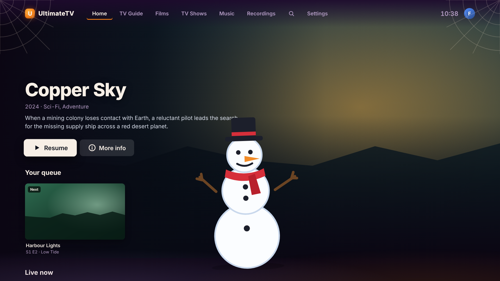
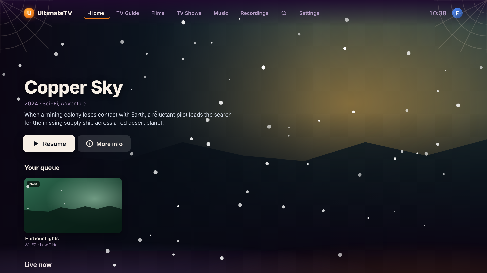
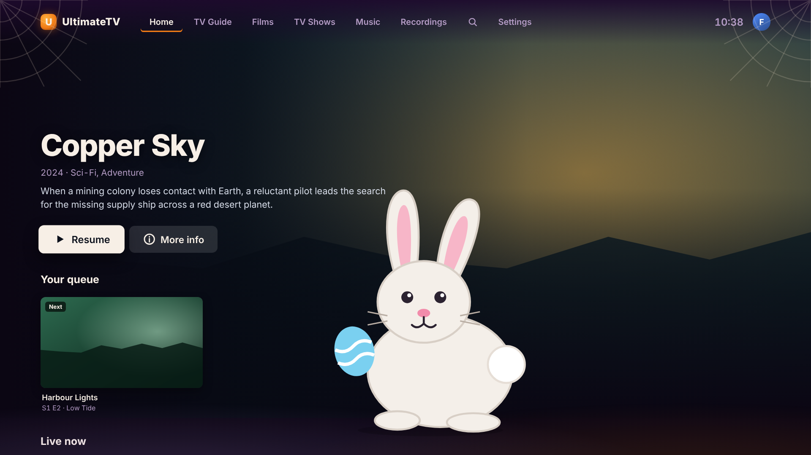
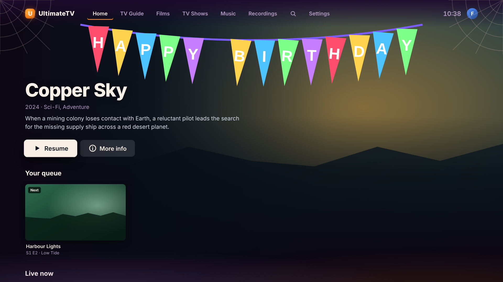
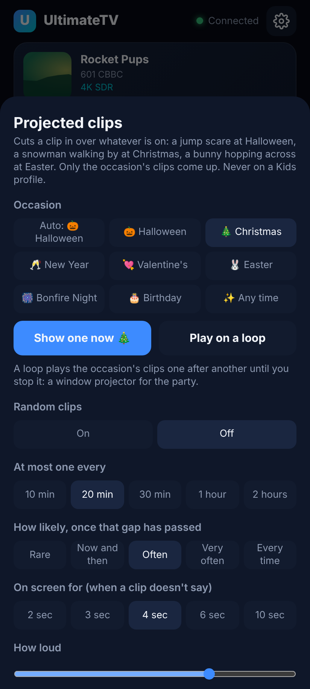
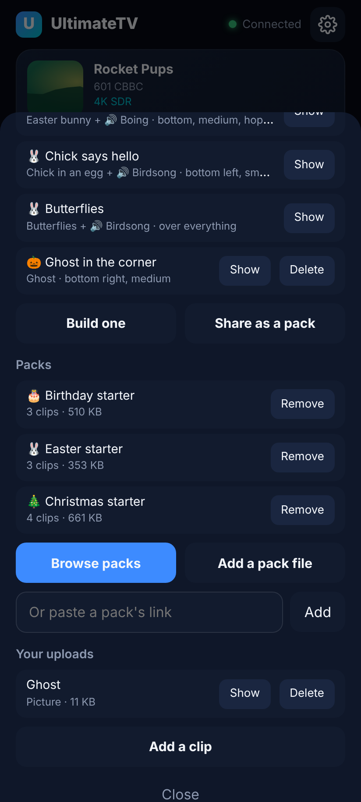
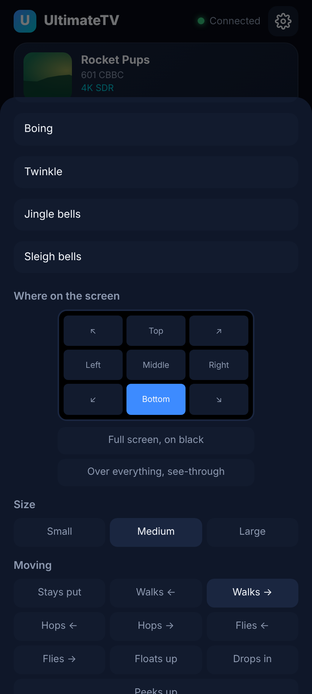
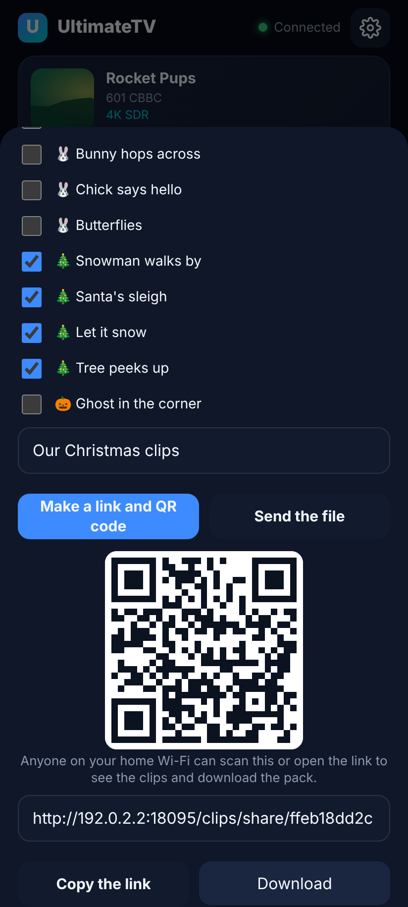
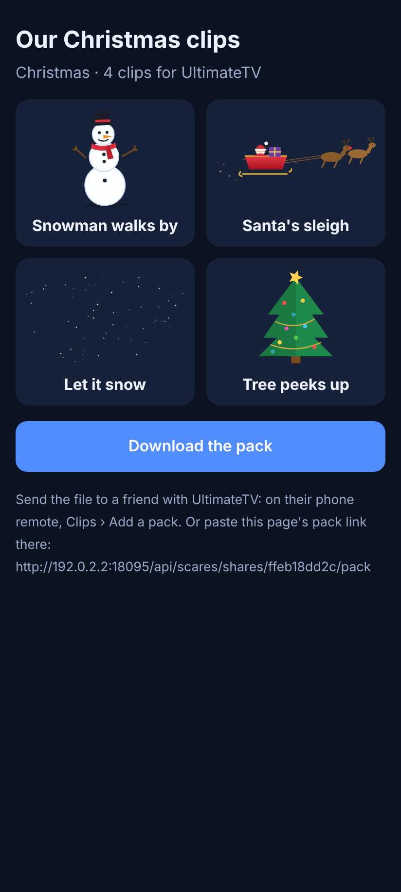

# Projected clips: seasonal clips, packs and the community list

Jump scares grew up. A **projected clip** is any short picture, video or sound cut in over
whatever is on: a jump scare at Halloween, a snowman strolling along the bottom of the screen at
Christmas, the Easter bunny hopping across, hearts floating up on Valentine's, balloons and a
banner on a birthday, fireworks for Bonfire Night and New Year. Clips can be shared as **packs**,
and the Hub can browse a **community list** of packs.

Everything from [Halloween's jump scares](halloween.md) still works as before: clips uploaded for
jump scares, scares built on the phone, the random timer and **Scare them now**.

Never on a Kids profile, as before: the TV leaves clips off there, whoever sends one.






## Occasions

Each built clip is for one occasion, and only the current occasion's clips come up, at random or
from **Show one now**. The occasion is **Auto** by default, which goes by the date:

| Occasion | Auto picks it |
| --- | --- |
| Halloween | 25 October to 1 November |
| Bonfire Night | 4 to 6 November |
| Christmas | 1 to 26 December |
| New Year | 31 December and 1 January |
| Valentine's | 10 to 14 February |
| Easter | Palm Sunday to Easter Monday (worked out for each year) |
| Birthday | never: pick it on the day |
| Any time | the rest of the year |

Pick one by hand on the phone remote's **Clips** tab (**Occasion**) or on the TV in
**Settings › Projected clips › Occasion**; pick Auto again afterwards.

Scares built before occasions existed, and pictures and videos uploaded on their own, are
Halloween's, so a jump scare never turns up at Christmas. With nothing at all for Halloween the TV
still draws (and screams) its own scare; any other occasion with nothing says so instead.

## The starter packs

Six packs come with the Hub, drawn and synthesised for this project (nobody else's pictures or
music). Add them all on the TV with **Settings › Projected clips › Add the starter packs**, or one
at a time on the phone with **Clips › Browse packs**.

| Pack | Clips |
| --- | --- |
| Christmas starter | Snowman walks by (sleigh bells), Santa's sleigh across the top (Jingle Bells), Let it snow (falling snow over everything), Tree peeks up (twinkle) |
| Easter starter | Bunny hops across (boing), Chick says hello (birdsong), Butterflies |
| Valentine's starter | Hearts floating up (music box), Cupid flies by (harp) |
| Birthday starter | Balloons floating up (Happy Birthday), Happy Birthday banner dropping in (party horn), Confetti |
| Halloween starter | Ghost drifts by (ghostly wail), Spider drops in, Bats |
| Fireworks | Fireworks over everything and a rocket going up, for Bonfire Night and again for New Year |

The pictures are animated SVGs with see-through backgrounds and the sounds are WAVs, made by
[`tools/packs/make-starter-packs.mjs`](../tools/packs/make-starter-packs.mjs).

## On the phone: the Clips tab




- **Occasion**: Auto or one by hand.
- **Show one now** (**Scare them now** at Halloween): one of the occasion's clips on the TV at once.
- **Play on a loop**: the occasion's clips one after another, a second or few apart, until you
  press **Stop the loop** or Back on the TV remote. A window projector for a party: put the TV (or
  a projector on the box) in the window with the snow or the ghosts going.
- **Random clips** and the rest: as for jump scares (how often, how likely, how loud, live TV too,
  only while watching).
- **Built clips**: the occasion's first, each with Show (and Delete, for your own; a pack's go with
  the pack). **Build one** and **Share as a pack** are under the list.
- **Packs**: what's installed, with Remove. **Browse packs**, **Add a pack file**, or paste a pack's
  link.
- **Your uploads**: pictures, videos and sounds you added yourself (a pack's own files are kept
  with the pack, not listed here).

### Building a clip



As for a built scare (picture or video, sound, where, size, how long), plus:

- **For**: the occasion.
- **Over everything, see-through**: a picture over the whole screen with the programme showing
  through, for snow, hearts, confetti or fireworks drawn on a transparent background.
- **Moving**: walks, hops or flies across (left or right) along the row you picked (top, middle or
  bottom); floats up from the bottom, drops in from the top (and goes back up) or peeks up from the
  bottom edge, in the column you picked. Picking a motion makes it last 12 seconds, since crossing
  an 85-inch screen takes longer than a jump scare; built clips can last up to a minute.

A transparent GIF, PNG, WebP or SVG looks best. Animated GIFs and SVGs keep animating while they
move, so a walking figure can swing its arms.

## Sharing packs




**Share as a pack** puts the built clips you tick, and the pictures and sounds they use, into one
`.utvpack` file:

- **Make a link and QR code**: a page on the Hub showing the clips with a **Download the pack**
  button. Anyone on your home Wi-Fi can scan it. The Hub keeps the last 20 links.
- **Send the file**: the phone's own share sheet (WhatsApp, email, Drive), or a download where the
  phone has none.

To bring a pack in on another UltimateTV: **Clips › Add a pack file**, or paste a link to a pack
file into **Or paste a pack's link**. A pack with the same id as one already there replaces it;
**Remove** takes a pack's clips, built clips and files away together.

Share links only work on your own network: the Hub isn't on the internet. To share further, send
the file, or put it on the community list.

## The community list

**Browse packs** shows the starter packs and the packs on the community list, a JSON file the Hub
reads from this repository:
[`community/clips/index.json`](../community/clips/index.json). It's read when you open Browse packs
and kept for half an hour.

How it's kept safe:

- **Curated, not open upload.** Packs reach the list only by a pull request to this repository that
  someone reviews and merges (see [community/clips/README.md](../community/clips/README.md)). There's
  no upload button pointing at a server anyone could fill.
- **CI checks every pack** with the Hub's own checks, and checks the list is up to date with the
  files (`node tools/packs/index-packs.mjs --check`).
- **Checksums.** Each entry carries the pack's size and SHA-256. The Hub downloads only over https
  from GitHub (`raw.githubusercontent.com`, `github.com` and GitHub's file hosts), refuses anything
  bigger than the list says or than 60 MB, and keeps a pack only if its checksum matches.
- **No executable content.** A pack is JSON with each file inside as base64: no archive to unpack,
  nowhere for a file to land but the clip folder, under a name the Hub makes up. Each file must
  really be a picture, video or sound (checked from its first bytes, not what the pack says). SVG
  pictures are refused if they carry scripts, event handlers, embedded web pages, entities or links
  to anything outside the picture. Every clip is served with a sandboxing Content-Security-Policy
  and `nosniff`, and the TV only ever shows clips in ``, `<video>` and `<audio>`.
- **Limits.** 24 files and 24 built clips a pack, 15 MB a file, 40 MB of files a pack, 20 packs on a
  Hub.
- **Scary is labelled.** Jump scares and anything frightening are marked **scary** on the list (the
  reviewer adds the pack's id to `community/clips/scary.json`), so a family Christmas pack can't
  hide a jump scare.
- **Kids profiles never see any clip**, from any pack.
- **Turn it off.** The list address is a setting (`libraryUrl` in `PUT /api/scares`); an empty one
  turns the community list off, and a fork can point at its own.

What moderation still depends on: a reviewer looking at every picture and listening to every sound
before merging (CI can tell a file is a real PNG, not that it's suitable), honest names, and nobody
sending in pictures or music they don't have the right to share. Pull requests from strangers can
be closed without merging; a pack that turns out badly is removed from the list by deleting it and
regenerating the index, and Hubs that installed it keep their copy until someone presses Remove.

## For scripts: the API

Everything the phone does is on the Hub's API (the controlling routes need a paired device or the
API key, as for jump scares):

| Route | Does |
| --- | --- |
| `GET /api/scares` | Settings, clips, built clips, packs, the current occasion and the loop |
| `PUT /api/scares` | Settings, including `season` (`auto` or an occasion) and `libraryUrl` |
| `POST /api/scares/now` | `{ mixId }`, `{ clipId }`, `{ theme }` or `{}` for one of the occasion's |
| `POST /api/scares/loop` | `{ theme }` starts the loop, `{ theme: null }` stops it |
| `POST /api/scares/mixes` | Builds a clip: `{ visualId, audioId, spot, size, motion, theme, seconds, muteVideo, name }` |
| `POST /api/scares/packs` | Brings in a pack: the `.utvpack` file as the body |
| `POST /api/scares/packs/link` | Brings in a pack from `{ url }` |
| `DELETE /api/scares/packs/:id` | Removes a pack and everything that came with it |
| `POST /api/scares/packs/export` | `{ name, theme, mixIds }`: the pack file, as a download |
| `POST /api/scares/shares` | `{ name, mixIds }`: a share link, its pack link and QR code |
| `GET /clips/share/:id` | The share page |
| `GET /api/scares/library` | Starter packs and the community list |
| `POST /api/scares/library/install` | `{ id, from: "starter" \| "community" }` |

A Home Assistant automation could, say, `POST /api/scares/now` with `{ "theme": "christmas" }`
when the doorbell rings in December.

## The pack format

```json
{
  "format": "ultimatetv.clips",
  "version": 1,
  "id": "our-christmas",
  "name": "Our Christmas",
  "theme": "christmas",
  "description": "Optional, up to 300 characters",
  "author": "Optional",
  "clips": [
    { "key": "snowman", "name": "Snowman", "type": "image/svg+xml", "data": "<base64>" },
    { "key": "bells", "name": "Sleigh bells", "type": "audio/wav", "data": "<base64>" }
  ],
  "mixes": [
    { "name": "Snowman walks by", "visual": "snowman", "audio": "bells", "spot": "bottom", "size": "medium", "motion": "walk-left", "seconds": 18 }
  ]
}
```

- `id`: 2 to 48 lower-case letters, digits and dashes.
- `theme`: `halloween`, `christmas`, `newyear`, `valentines`, `easter`, `bonfire`, `birthday` or
  `everyday`. A built clip can have its own `theme` (the fireworks pack has New Year ones).
- `spot`: `top-left`, `top`, `top-right`, `left`, `center`, `right`, `bottom-left`, `bottom`,
  `bottom-right`, `full` (on black) or `overlay` (see-through, whole screen).
- `size`: `small`, `medium` or `large` (a third, a half, or most of the screen's height).
- `motion`: `still`, `walk-left`, `walk-right`, `hop-left`, `hop-right`, `fly-left`, `fly-right`,
  `rise`, `drop` or `peek`.
- `seconds`: 0 (the general setting) to 60.
- Files: MP4, WebM or MOV video; JPEG, PNG, GIF, WebP or SVG picture; MP3, OGG, WAV or M4A sound.
  Files no built clip uses are dropped.

## Not tested on the box yet

Built and checked with the tests and screenshots in a browser, not on the TV box. Things to try:
the SVG animations' smoothness on the N150's GPU while a 4K film plays, that the starter packs'
WAV sounds play over the film's audio, the loop for an evening, and sending a pack between the
phone and WhatsApp in the Android remote app (its WebView may not offer the share sheet; the
download link on the share page works there).
