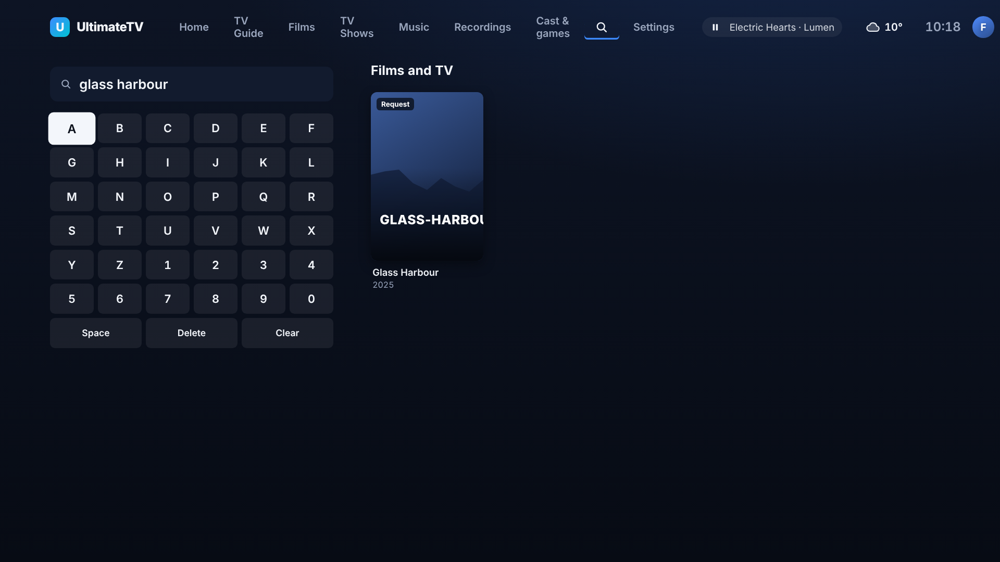
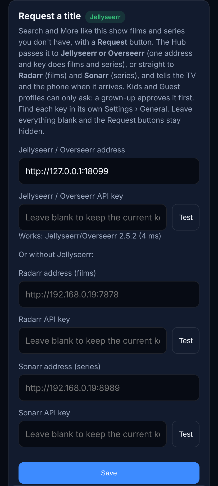
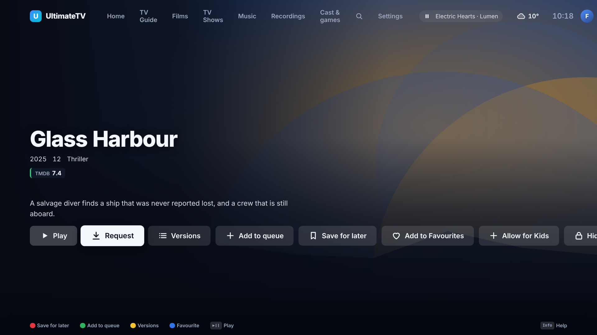
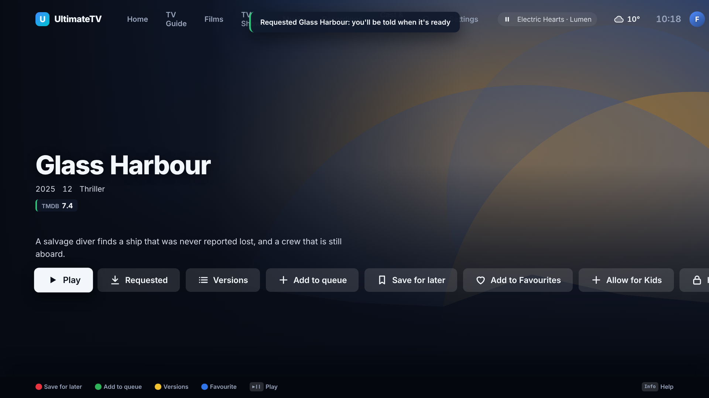
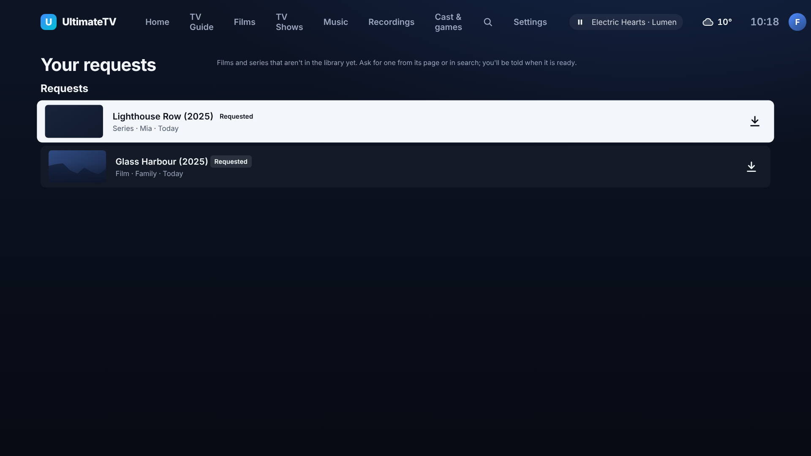
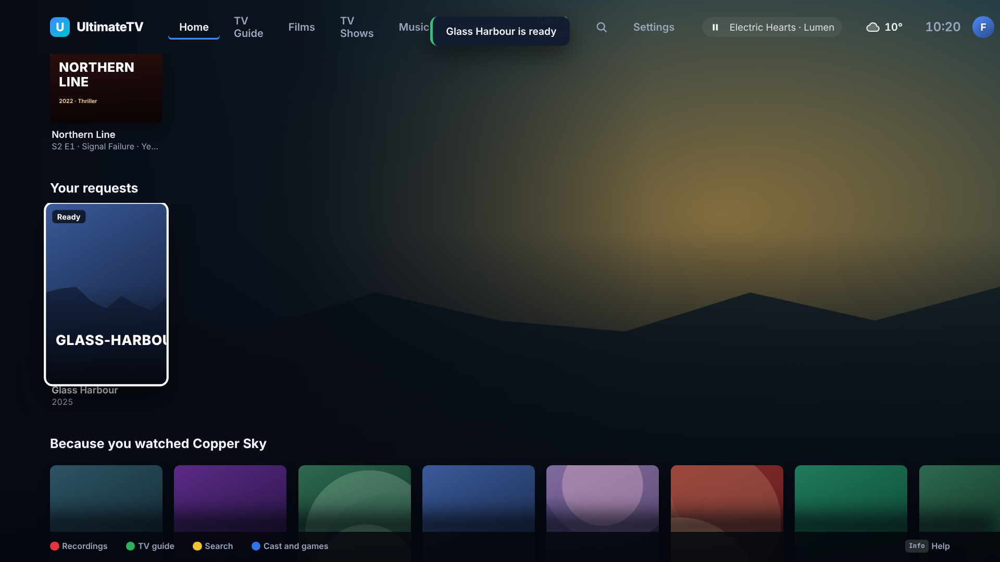
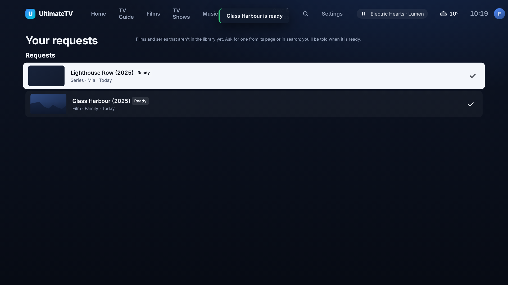
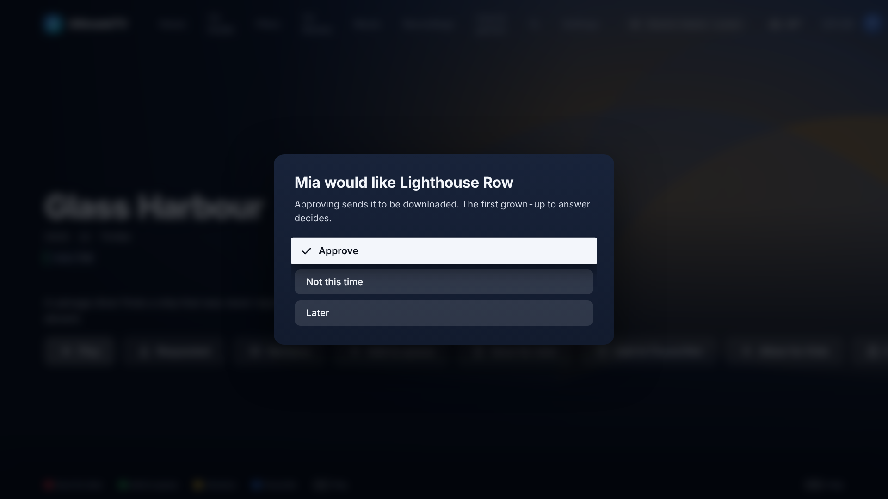

# Request a title that isn't in the library

Issue #225. Search and More like this show films and series you don't have, with a **Request**
button. The Hub passes the request to Jellyseerr/Overseerr (or straight to Radarr and Sonarr),
follows it until it arrives, and tells the TV and the phone ("Dune: Part Two is ready"). Kids and
Guest profiles can only ask: a grown-up approves first, as with Ask a parent.

It is **off until you set it up**: with nothing configured there is no Request button, no
Requests chip on Home and no row, anywhere.

## Setting it up

On the phone's setup page there is a **Request a title** section (`/setup/#requests`).

- **Jellyseerr or Overseerr**: its address and API key (Jellyseerr › Settings › General). One
  program handles films and series, and its own approval rules and quality profiles apply. If it is
  set up, it is used for everything.
- **Or Radarr and Sonarr directly**: Radarr for films, Sonarr for series (each one's key is in
  Settings › General). Either can be left out; then only the other kind can be requested. The Hub
  adds the title with the program's **first quality profile and first root folder** and tells it to
  search straight away. Sonarr finds a series by its TheTVDB id, which the Hub gets from TMDB, so a
  TMDB key is needed (it is already needed for search).
- **Test** beside each key asks the program who it is and whether the key works ("Works:
  Jellyseerr/Overseerr 2.5.2"), and says what is wrong if not (wrong key, wrong address, Radarr has
  no root folder). Leave the key blank to test the saved one.

Keys stay on the Hub: the settings the TV and phone read only say whether each is set.

## What you see

- **Search**: a title no source has carries a **Request** badge. One that was asked for says
  **Requested**, **Downloading** or **Ready**.
- **More like this** keeps titles nothing can play (marked Request) when Requests are on; without
  Requests they are left out, as before. With a Stremio add-on connected, almost everything plays,
  so More like this is unchanged.
- **A title's page**: **Request** (a Kids or Guest profile sees **Ask for it**) when no library,
  media server or IPTV source has the title. After that the button is the status
  (Requested, Downloading, Ready), and OK opens Your requests.

- **Your requests** (Home › Requests): everything this profile asked for and how far each got.
  A grown-up sees everyone's, with a **Waiting for a grown-up** section on top.

- **Home row**: "Your requests" shows what is on its way and what arrived in the last two weeks.
  Settings › Home rows can hide or move it; Simple Home leaves it off.

## When it arrives

The Hub asks the program how each open request is getting on every five minutes (the first time
about 90 seconds after it starts). When one is ready:

- the TV pops up "Glass Harbour is ready" for the profile that asked;
- the phone remote shows the same as a message the next time it checks (while it is open);
- Home Assistant or ntfy, where Settings › Alerts points, is told too, so you hear when you are
  out of the room.

How "ready" is decided: Jellyseerr says the media is available (or partly, for a series); Radarr
says the film has a file; Sonarr says the series has at least one episode file (the rest follow as
they air or download). "Downloading" is Jellyseerr's processing state, or the title being in
Radarr's or Sonarr's download queue. A request that Jellyseerr's owner declines is marked
**Not this time**.

## Kids and Guest profiles

A Kids or Guest profile can ask but nothing is sent until a grown-up says yes. The request waits as
"Waiting for a grown-up" and:

- an adult profile on the TV gets a pop-up with **Approve** and **Not this time** (Later leaves it
  for a phone);
- the phone remote shows the same as a sheet (with the adult PIN field if a PIN is set);
- the first answer wins; a second adult gets "Someone has already answered".

A child cannot answer its own request, and can have eight waiting at once. A request that was
declined can be asked for again later. A child only ever sees its own requests.

## Limits

- A title needs a TMDB id (`tmdb:movie:…` or `tmdb:series:…`), which is what search and More like
  this give. Titles that exist only in an IPTV catalogue are already playable.
- A series is requested with **all seasons** (Jellyseerr) or monitored in full (Sonarr).
- A title with a Stremio add-on source still shows Request, as an add-on is not a library copy.
  It is hidden when it is in the library, a media server or IPTV.
- The Hub looks every five minutes, not instantly, and a request deleted in the program is marked
  failed after ten minutes.

## For developers

- `shared/src/requests.ts`: the types (`TitleRequest`, `RequestsView`, `RequestSettings`) and the
  status labels. Hub events: `requests.changed`, `request.awaiting`, `request.ready`.
- `hub/src/services/requests.ts`: `JellyseerrClient`, `RadarrClient`, `SonarrClient` and the Test
  button (`testRequestApp`). `backendsFrom` picks Jellyseerr over Radarr/Sonarr.
- `hub/src/requests.ts`: the list (in the settings database under `title-requests`), approvals,
  the refresh job and the routes (`GET/POST /api/requests`, `POST /api/requests/:id/answer`,
  `POST /api/requests/test`; the first three need pairing, Test needs an adult).
  `TitleDetails.requesting` carries `requestable` and the latest request to the page.
- `ui/src/requests.ts`, `ui/src/screens/Requests.tsx`, the button in `Details.tsx`, the chip in
  `Home.tsx`; the phone's sheet is in `hub/public/remote/phone.js`; the setup section is in
  `hub/public/setup/index.html`.
- The demo Hub (`DEMO=1`) has three made-up titles no source has (`demoRequestables`). Screenshots:
  `node tools/screenshots/requests.mjs` (it starts a pretend Jellyseerr).
