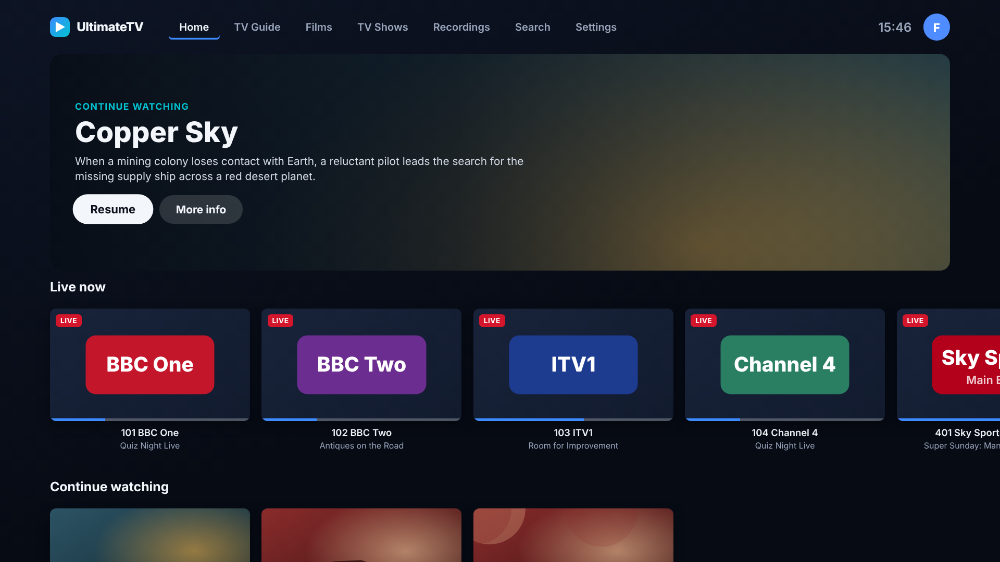

# Samsung TVs

UltimateTV has an app for Samsung smart TVs (Tizen). It looks like the TV app (same top bar, cards,
rails and themes) and plays through the TV's own player, **AVPlay**, so the picture is decoded by the
set's hardware. It was written for Gary's second TV, a **UE50NU7020** (2018, Tizen 4.0), and uses nothing
newer than that set's web engine (Chromium 56), so it should run on newer Samsungs too.

**Not tested on a real TV.** The screens were run in a desktop browser against a demo Hub
(`node tools/screenshots/samsung.mjs`, also in CI) and AVPlay was written from Samsung's documentation.
Treat the first install as an experiment, and send back what the screen shows if something is off.

## Does the TV need jailbreaking? No

Samsung's own **Developer Mode** lets you install your own apps. You sign the app with a free Samsung
developer certificate tied to your TV, then push it over the network. Nothing is modified on the TV.
The catches: the signed app stops working when the certificate expires, and has to be signed and
installed again then (and after a factory reset).

## What you need

- A computer on the same home network as the TV (Windows, macOS or Linux).
- A free **Samsung account**.
- **Tizen Studio** with the **TV Extensions** and **Samsung Certificate Extension** (from its Package
  Manager). Tizen Studio is what Samsung's own certificate flow for a Tizen 4.0 set uses. Newer tools
  (Apps2Samsung, Samsung's VS Code extension) list Tizen 5.5 and newer, which a 2018 set is not, so check
  Settings › Support › About this TV first; if it says Tizen 5.5 or higher, Apps2Samsung also works with
  `UltimateTV.wgt`.

## Install, step by step

1. **Get the package.** Run `tools/samsung/build.sh` in a checkout of this repository (needs `zip`).
   It writes `samsung/build/UltimateTV.wgt`. The CI run for the commit also checks the app, and the
   same folder (`samsung/`) can be imported straight into Tizen Studio instead.
2. **Put the TV in Developer Mode.** On the TV open **Apps**, then App Settings (or the Apps panel), and
   press **1 2 3 4 5** on the remote (use the 123 button if there is no number pad). Switch **Developer
   mode** on, type the **computer's IP address** into *Host PC IP*, press OK, then **hold the power
   button for 5 seconds** to restart the TV. Afterwards the Apps screen shows a "DEVELOP MODE" tag.
   The TV's own IP is under Settings › General › Network › Network Status.
3. **Connect Tizen Studio to the TV.** Tools › Device Manager › Remote Device Manager › **+**. Name it,
   enter the TV's IP address, Add, then switch the connection **On**.
4. **Make the certificate.** Tools › Certificate Manager › **+** › Samsung › TV. Make a new *author*
   certificate (sign in with the Samsung account, choose a password, keep the backup it offers) and a
   new *distributor* certificate with privilege **Public** and **Add individual DUIDs**. The TV's DUID
   is added for you when it is connected in Device Manager. (It is also at Menu › Support › Contact
   Samsung › Unique Device ID.) The DUID is what ties the certificate to your TV, which is why a package
   signed for another TV won't install on this one.
5. **Install.** In Tizen Studio use File › Import › Tizen › Tizen Project, pointing at the `samsung/`
   folder (or the `.wgt` via *Archive file*), then right-click the project › **Run As › Tizen Web
   Application**. From a terminal the equivalent is
   `sdb connect <TV-IP>`, `tizen package -t wgt -s <certificate-profile> -- samsung/` and
   `tizen install -n <the .wgt it wrote> -t <device id from sdb devices>`.
6. **Open UltimateTV** from the TV's Apps (or Recent Apps).

## First run

1. The app looks for the Hub at `http://192.168.0.19:8095`. If it can't reach it, choose **Change Hub
   address** and type the right one with the on-screen keyboard.
2. If another screen is already paired (the box, say), this TV shows a four-letter code. On the main TV
   open **Settings › Phones and remotes** and allow **Samsung TV** after checking the code matches
   ([pairing.md](pairing.md)).
3. Choose who's watching. Profiles with a PIN ask for it (the number keys work); a Kids profile only
   sees what it sees on the main TV. The app remembers the profile.

## What it does

| | |
|---|---|
| Home | Hero, Live now, Continue watching, Next up, Saved for later, Favourites, New episodes, recordings and the rest of the profile's rows, in the profile's order |
| TV Guide | Every channel with what's on now (with a progress bar) and next, in the same lists as the guide (All, Favourites, categories). OK plays it live; **CH+/CH−** change channel in the player |
| Films, TV Shows | The Hub's browse rails |
| Titles | Details with Play or Resume, seasons and episodes (with watched ticks and progress) |
| Recordings | Finished and in-progress recordings play; scheduled ones show their status |
| Search | On-screen keyboard, results for films, shows, channels and recordings |
| Settings | Hub address, who's watching, picture quality (4K or 1080p), check the Hub, unpair |
| Player | Pause, ±10 s (◄ ►) and ±60 s (rewind, fast-forward), skip intro / recap / credits (press OK when the button shows), next episode, audio and subtitle tracks (▼ or the blue key), progress reported to the Hub so the TV, phones and Jellyfin carry on from the same place |
| Looks | The Hub's theme (including the seasonal ones) is applied on every start |

Not in this version (they stay on the main TV and the phone): music channels, Cast & games, the family
board, recordings management, downloads, the Versions list on a title, and the screensaver.

## What plays, and what doesn't

The app tells the Hub the set's limits (`X-Max-Height`, `X-Max-Bitrate` and `X-Codecs`, as the Android app
does), so the Hub picks a version that fits (up to 4K HEVC, H.264 or VP9 at about 40 Mbit/s), and has
Jellyfin make a smaller HLS copy when the only version is too big. **Picture quality: Up to 1080p** in
Settings lowers the limits.

- The 2018 sets are **HDR10 only**; there is no Dolby Vision.
- **DTS and TrueHD sound is not decoded** by these sets. A film whose only sound is DTS plays with no
  sound; pick another version on the main TV, or let Jellyfin transcode it.
- Subtitles come from the file or from the Hub's external files. The TV loads SRT and SMI, not every
  format Jellyfin offers.
- Live TV and recordings play from the Hub's relay, so they share the one IPTV connection like every
  other screen: the Hub asks first if a recording or the box has it.

## Updating, and when it stops working

The app is stored on the TV, so a new version means building and installing it again (steps 1 and 5). The
Hub's data and who's watching are kept. If the app stops opening, the certificate has probably
expired: make a new one in Certificate Manager and install again. Keep the author certificate's backup,
because an update signed with a different one installs as a separate app.

## How it's built

`samsung/` is a plain web app with no build step (ES2015 only, since Chromium 56 has no object spread,
optional chaining, flex gap or CSS grid, and CI checks that with `esbuild --target=chrome56`):

- `js/util.js` pure helpers (tested in `samsung/test`), `js/hub.js` the Hub client and pairing, `js/nav.js`
  remote keys and spatial focus, `js/player.js` AVPlay (and a `<video>` fallback for a desktop browser),
  `js/app.js` the screens, `css/app.css` the look.
- It calls the Hub's own routes (`/api/home`, `/api/browse`, `/api/nownext`, `/api/titles`, `/api/play`,
  `/api/progress`, …) with the paired device token and the profile headers, so Kids and Guest rules apply
  as they do everywhere. `config.xml` has `<access origin="*">`, which lets the app call the Hub (which has
  no CORS headers) from the TV.
- Developing without a TV: `npm run build && node tools/screenshots/samsung.mjs` runs a demo Hub, drives
  the app with the arrow keys and writes the screenshots in `docs/screenshots/samsung/`.
