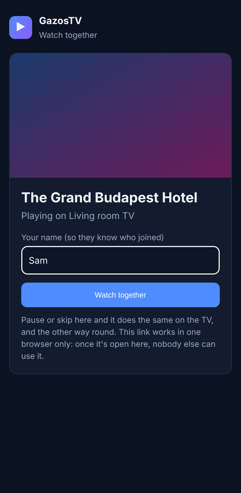

# Share Play

Share Play ([issue #210](https://github.com/gazoscalvertos/UltimateTV/issues/210)) makes a one-off
link to the film or episode the TV is playing. Whoever opens the link watches along in an ordinary
web browser (Chrome, Edge, Firefox or Safari, on a phone, tablet or laptop) with nothing to install,
kept in step with the TV: pause or skip on either and both do it.

It is built on [Sync play](watching-elsewhere.md): the browser joins the TV's Sync play group as one
more member, so everything there about the shared clock applies here too.

## Making a link

| From | How |
| --- | --- |
| Phone remote | Browse › **Elsewhere**: the TV's film has a **Share** button. The sheet shows a QR code, the link, **Send link** (the phone's share sheet: WhatsApp, Messages, email) and **Copy**. Links you've made are listed at the top of Elsewhere, with who opened them and how long they have left; ✕ cancels one. |
| TV | In the player, Options › **Share Play** › Watch together with a link. A QR code and the link come up on the screen, with **Cancel the link**. |

Kids and Guest profiles can't make links. Only films and TV episodes from Jellyfin can be shared:
not live TV, IPTV, recordings or Plex (see [Not done yet](#not-done-yet)).

## What the person with the link sees



A page with the title, its picture and **Watch together** (and an optional name, so the TV can say
"Sam is watching along"). The picture starts at the TV's place. A line under it says whether it's
in step, and shows who paused or skipped. **Stop watching** leaves; the TV carries on alone.

The browser plays a 720p H.264/AAC copy that Jellyfin makes on the fly (the same one the Android app
downloads), so it plays in every browser and needs about 3.5 Mbit/s. The TV keeps playing the
original. Small drifts are corrected by playing a touch faster or slower; anything over 4 seconds
(1 second when paused) jumps back into line.

## How the link is kept to one person

- The link's token (22 random characters) is the only key.
- The **first browser to open it** is given a secret of its own, as a cookie that only that link's
  pages send. From then on the link turns any other browser away ("already opened on another
  device"). The same browser can close the page and come back.
- A link **finishes** when the TV moves on to something else (the next episode included), when it's
  cancelled, or after 6 hours. A Hub restart ends every link. At most 10 exist at once.
- The browser never talks to Jellyfin: the Hub fetches the video for it and takes Jellyfin's key out
  of every playlist, and the picture comes through the Hub too. The page sends no referrer, and asks
  search engines not to index it.

## Home Wi-Fi, or another house

Without the tunnel, a link points at the Hub's address on the home network
(`http://192.168.0.19:8095/share/…`), so it works for anyone on the home Wi-Fi and not from outside.

For someone in another house, the household chose (2026-11-04) to publish the share pages, and only
those, through a **Cloudflare Tunnel**. A tunnel connects out from the house, so no port is opened on
the router, and it answers on an `https://` address of your own with Cloudflare's certificate.

### Setting it up (once, on the Docker LXC)

You need a free Cloudflare account with a domain on it (any domain you own, moved to Cloudflare's
DNS). Then, in the UltimateTV folder:

```sh
bash tools/share/setup-tunnel.sh watch.yourdomain.com
```

It prints a Cloudflare sign-in link (open it on any computer and pick the domain), creates a tunnel
called `ultimatetv-share`, points `watch.yourdomain.com` at it, writes `share-tunnel/config.yml`,
sets `SHARE_URL=https://watch.yourdomain.com` and adds `share` to `COMPOSE_PROFILES` in `.env`, and
starts the `share-tunnel` container next to the Hub. It finishes by checking from the internet side
that `/share/` answers and `/api/health` is a 404. New links use the new address from then on;
`tools/hub/update.sh` keeps the tunnel running across updates.

`bash tools/share/setup-tunnel.sh --off` stops it and makes links home-only again.

### What is and isn't on the internet

- The tunnel's config sends only paths starting `/share/` to the Hub; anything else is a 404 from
  Cloudflare before it reaches the house.
- The Hub refuses anything but `/share/` that arrives through the tunnel too (it knows by
  Cloudflare's `Cf-Connecting-IP` header and the `SHARE_URL` hostname), so a mistake in the
  tunnel's config can't publish the TV app, the API or the setup page.
- Under `/share/` there is the watch page, `hls.js`, and the routes a link uses. Every one of them
  needs a live link's token, and all but the first look also need the secret of the browser that
  opened it. Nothing there can control the TV, change a setting or reach Jellyfin directly.
- `share-tunnel/` holds the tunnel's key; it is in `.gitignore` and readable only by the tunnel.

Each person watching uses about 3.5 Mbit/s of the home connection's upload.

## Not done yet

- Live TV, IPTV films and recordings: these would need the Hub to make the browser copy itself with
  ffmpeg (Jellyfin does it for its own library).
- Plex: the Hub has no smaller copy for Plex yet (the same gap as Android downloads from Plex).
- The Android app has no Share button yet; use the phone remote or the TV.
- More than one person per link: make a second link.
