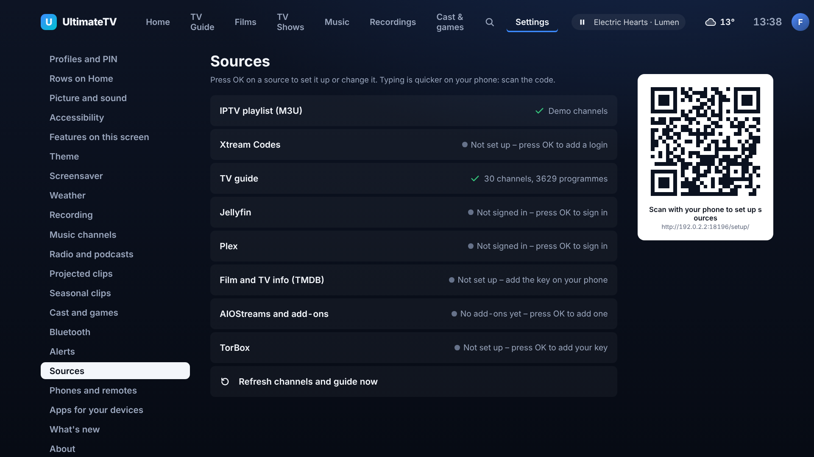
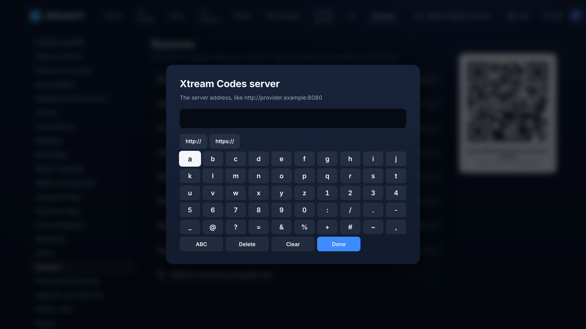

# Setting up sources from the TV

Settings › Sources lists every provider with a status that says what to do next. Press OK on a
row to set it up or change it; the phone's QR code stays beside the list for the times typing on
a phone is quicker.

| Row | OK does |
| --- | --- |
| IPTV playlist (M3U) | Asks for the playlist link. When one is added, offers to add another or remove one. |
| Xtream Codes | Asks for the server, username and password. |
| Jellyfin | Lists servers found on the network (or type an address), then Quick Connect or username and password. |
| Plex | Lists servers found on the network (or let plex.tv choose, or type an address), then shows a code for plex.tv/link. |
| AIOStreams and add-ons | Adds a Stremio add-on by link (`https://` or `stremio://`), or removes one. |
| TorBox | Asks for the API key; offers a different key or removal once set. |
| TV guide, TMDB | Read-only here: TMDB's key is added on the phone. |

The keyboard has the punctuation a web address needs, `http://` and `https://` shortcuts, and
takes text sent from the phone remote too. Passwords and keys show as dots.

## Finding servers

`GET /api/discover` asks the network for servers (about 1.5 seconds) and the TV lists what answers:

- **Jellyfin**: a UDP broadcast of `who is JellyfinServer?` to port 7359; servers reply with JSON
  (`Address`, `Id`, `Name`).
- **Plex**: a GDM multicast `M-SEARCH * HTTP/1.0` to 239.255.255.250:32414; servers reply with
  headers (`Resource-Identifier`, `Name`, `Content-Type: plex/media-server`, `Port`) from their own
  address.

Broadcasts don't cross a Docker bridge network, so a Hub in a default container may find nothing
(run it with host networking to find servers). That is never an error: the TV falls back to
**Type an address**, and Plex can also be left to plex.tv.

## Who can do it

Only adult profiles: Kids and Guest never see the setup (Settings itself is closed to them) and
the Hub's setup routes, including `/api/discover`, ask for an adult and the profile's PIN. If the
PIN hasn't been entered yet, the TV asks for it when you try.

## Adding a provider (for developers)

`ui/src/sources.ts` builds the rows from a generic list (id, label, kind, status, next step);
`ui/src/screens/Sources.tsx` maps each id to its setup in `setups`, and `rowOptions` is where a
per-row Options menu (test, pause, remove, reorder) plugs in.
