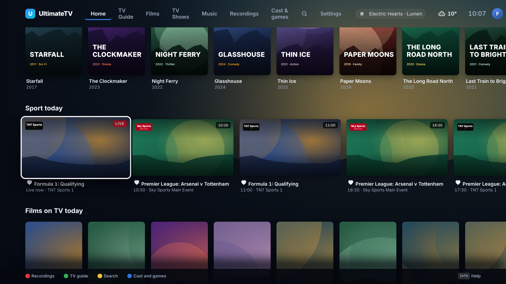
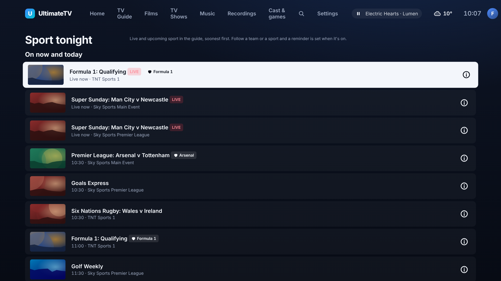
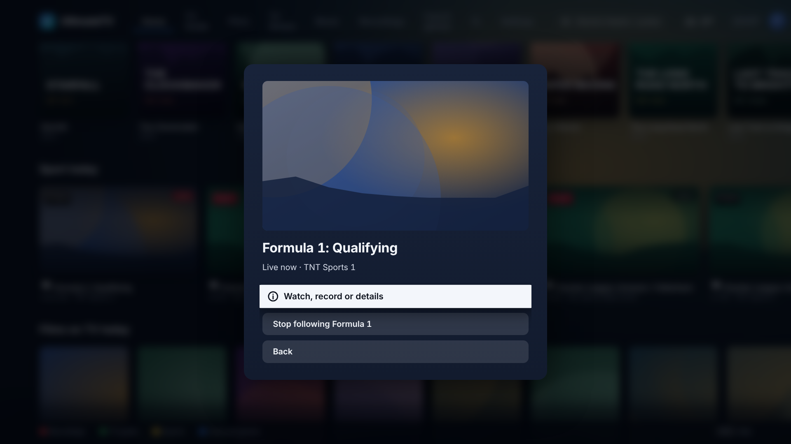
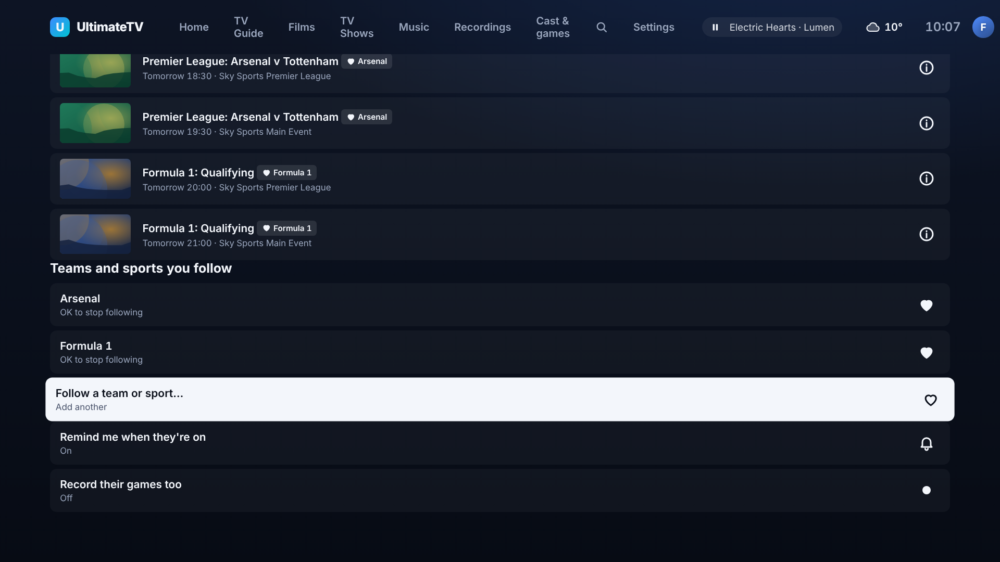

# Sport tonight: what's on, and your teams

Issue #231. Live and upcoming sport from the guide, with favourite teams and sports per profile,
the way Sky Q and YouTube TV make live sport a front-door feature.

## What you see

- **Sport today row on Home** (before Films on TV today): every sport programme still to come today
  (until 4am), soonest first, live games first, with the channel's logo, a **LIVE** badge or the
  kick-off time, and a heart on the ones that are about your teams. Your teams come first in the row.
- **Sport screen** (Home › Sport): *On now and today* (the whole list), *Your teams, the next seven
  days*, the teams and sports you follow, and two switches.

- **OK on a game** offers **Watch, record or details** (the usual programme card: Watch while live,
  Record, Remind me), **Follow Arsenal** / **Follow Tottenham** (the two sides of "Arsenal v
  Tottenham", or "Formula 1" from "Formula 1: Qualifying"), and **Stop following** when it is one of
  yours.

- **Following**: Follow a team or sport… opens the on-screen keyboard (or type on the phone remote).
  OK on a followed name stops following it.

## What counts as sport

A guide entry is sport when its category says so ("Sport", "Football", "Formula 1", "Rugby",
"Cricket", "Tennis", "Golf", "Boxing", "Darts", "Snooker" and similar), or it is on a channel in the
**sport** category (Settings can move a channel by hand; that wins). Filler between events ("Close",
"Off air", teleshopping) is left out. Hidden channels and music video channels are skipped, and a
game on two channels at the same kick-off is listed once.

## Favourites and reminders

Each profile has its own list (the household's TV with no profile has one too). A favourite matches
whole words in a sport programme's title, subtitle or description, so "Arsenal" finds "Premier League:
Arsenal v Tottenham" and "Formula 1" finds a highlights show that mentions it, but "Arsenal" does not
match "Arsenals of the world". Case and accents are ignored.

- **Remind me when they're on** (on by default): when a favourite's game is in the guide (looked at
  every half hour, up to a week ahead) the Hub sets a reminder, the same reminder the guide's Remind
  button makes.
- **Record their games too** (off by default): the Hub also schedules a recording. Pairs with the
  recording overrun work in #230. A **Kids** profile's favourites never record by themselves.
- Each game is handled once per profile, so a reminder you take off is not made again.
- A Guest cannot keep favourites.

## Kids

A Kids profile only sees sport on channels it is allowed. By default that is kids' channels only, so
the row is empty and hidden; a parent who allows the **sport** category (Settings › Profiles) or a
sport channel gets the row and the screen. The Home chip is for adults only.

## Home row

Settings › Home rows can hide or move **Sport today**; Simple Home leaves it off. The row is not built
when it is off.

## For developers

- `shared/src/sport.ts`: what counts as sport (`isSportProgramme`), favourite matching
  (`matchFavourite`), the sides of a fixture (`teamsIn`) and the types. `sport.changed` is a Hub event.
- `hub/src/sport.ts`: settings (kv `sport:<profile>`), the day's list, Home's row and the check that
  sets reminders and recordings (kv `sport-handled`). `hub/src/sportroutes.ts`: `GET /api/sport`,
  `PUT /api/sport/settings`, `POST /api/sport/teams`, `DELETE /api/sport/teams?name=` (writes need
  pairing). The row is added in `GET /api/home` as a `sport` rail with `sport: SportMatch[]`.
  `index.ts` runs the check two minutes after start and then every half hour.
- `ui/src/sport.ts`, `ui/src/screens/Sport.tsx`, `SportCard` in `ui/src/components/Rail.tsx`.
- The demo Hub (`DEMO=1`) has fixtures on its sport channels and follows Arsenal and Formula 1.
  Screenshots: `node tools/screenshots/sport.mjs`.
- Tests: `hub/test/sport.test.ts`.

## Not done yet

- A phone remote or Android screen (the Android Home leaves the row out for now).
- Results and live scores, standings, and a stream or app for sport that is not in the guide.
- Matching by team badges or the guide's own team data: it is words in titles and descriptions only.

Untested against a real guide and the box: built and checked on the demo Hub only.
