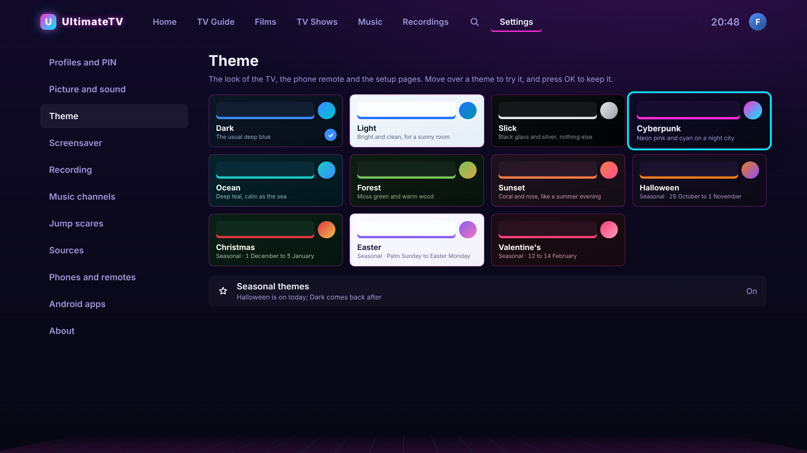
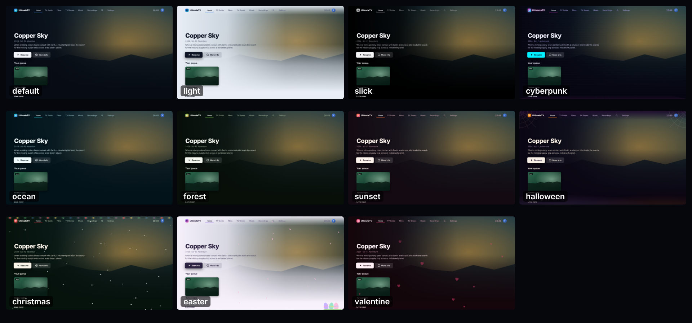
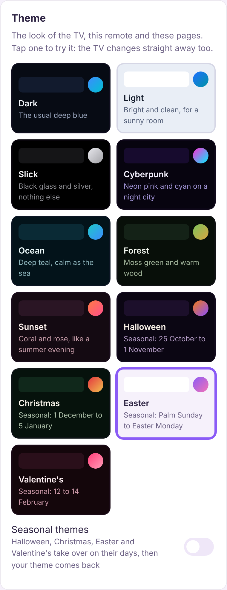

# Themes

The look of the app, worn by the TV, the phone remote and the Hub's web pages (the phone's
settings page, Stats, the music sign-in page) alike. Chosen in either place:

- TV › **Settings › Theme**: move over a theme and the whole app tries it on at once. Press OK to
  keep it; move away without pressing OK and the one you had comes back.
- Phone remote › ⚙ › **Theme**: tap a theme to wear it. The TV changes straight away too.

| Theme | Looks like | Extras on the TV |
| --- | --- | --- |
| Dark | The usual deep blue | |
| Light | Bright and clean, for a sunny room | |
| Slick | Black glass and silver, nothing else | |
| Cyberpunk | Neon pink and cyan on a night city | Faint scan lines and a neon grid on the horizon |
| Ocean | Deep teal | |
| Forest | Moss green and warm wood | |
| Sunset | Coral and rose | |
| Halloween | Orange on deep purple | Cobwebs, fog and bats (never on a Kids profile) |
| Christmas | Red and gold on pine green | Snow and a string of fairy lights |
| Easter | Spring pastels (a light theme) | Drifting blossom and eggs in the grass |
| Valentine's | Rose and crimson | Hearts floating up |

None of the extras appear while something is playing.

## Seasonal themes

With **Seasonal themes** on (the default), four themes come out by themselves on their days and
your own theme comes back afterwards:

| Theme | When |
| --- | --- |
| Valentine's | 12 to 14 February |
| Easter | Palm Sunday to Easter Monday (worked out for each year) |
| Halloween | 25 October to 1 November |
| Christmas | 1 December to 5 January |

The TV looks again every hour, so a TV that's never reloaded still changes on the day. Turn
Seasonal themes off to keep your theme all year; picking a seasonal theme yourself wears it all
year too.

A Hub updated from before themes keeps what it had: "Auto (Halloween week)" becomes Dark with
Seasonal themes on, and "Plain" or "Halloween" picked by hand keep the seasons off.

## How it works

- The themes are in `shared/src/themes.ts`: each is a palette of CSS custom properties
  (`--bg`, `--panel`, `--fg`, `--accent`, `--sel` for a focused row, and so on). The TV puts the
  palette on the page in `ui/src/store.ts`; the decorations are `ui/src/components/Halloween.tsx`
  and `ThemeDecor.tsx`.
- The Hub keeps `theme` and `seasonal` (`PUT /api/settings` with `{"theme":"cyberpunk"}` or
  `{"seasonal":false}`), and `GET /api/settings` adds `themeNow`, the one worn today.
- `/theme.js` is the palettes for the phone and web pages, with today's theme put on as the page
  loads so it never flashes the wrong colours. `utvTheme.apply("light")` puts on another.

