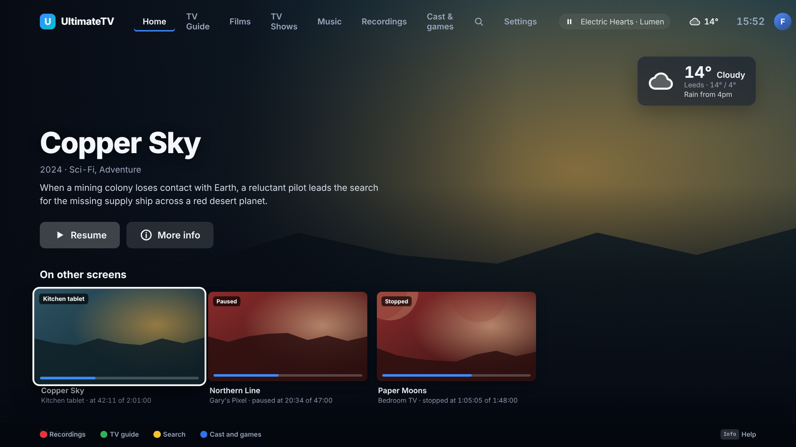
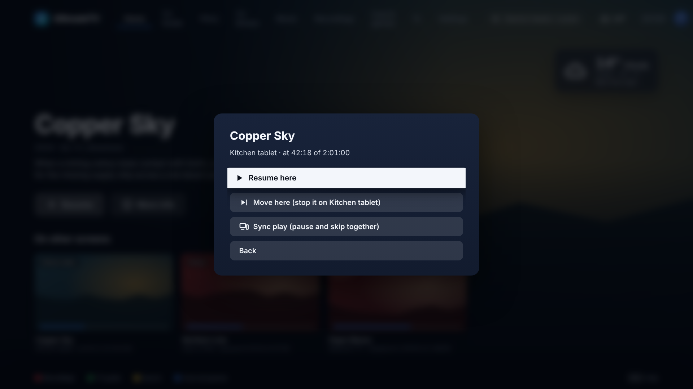
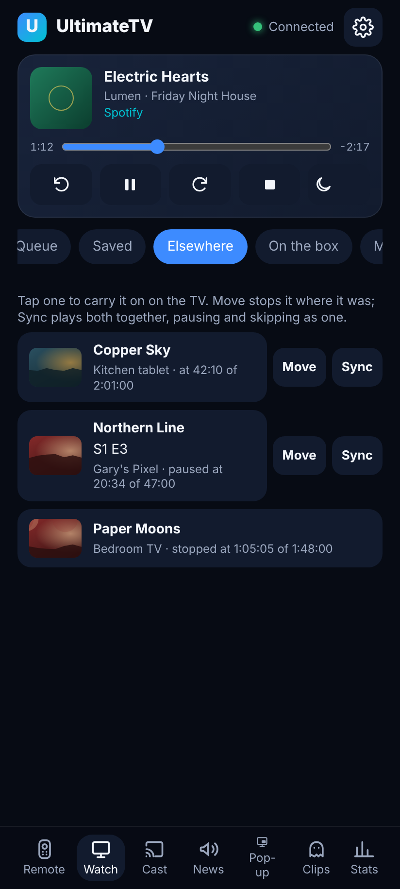

# Watching elsewhere and Sync play

Every screen that plays (a TV box, the desktop app, the Android app on a phone or tablet) tells the
Hub what it's playing every five seconds. Any other screen can then see that list and:

- **Resume here**: carry on from the same place on this screen. The other screen keeps going.
- **Move here**: the same, and the other screen stops (on its next report, within five seconds).
  This is "swap from the TV to the tablet" at bedtime, or back again in the morning.
- **Sync play**: play it here too, in step. Pausing, playing or skipping on any of them does it on
  all of them, so the same film can be on in the kitchen and the living room.

A screen that stops (or is switched off, and goes quiet for 45 seconds) stays in the list as
*stopped* for four hours, so it can still be carried on from where it was. Something watched to
the end isn't offered.

## Where it is

| App | Where |
| --- | --- |
| TV | Home › **On other screens**, a row under the hero. OK on one offers Resume here, Move here and Sync play. While in Sync play a small **Sync** chip in the top bar lists who's in it, and the player's Options › Sync play leaves it. |
| Android app (0.7.0) | Home › **Elsewhere** lists them with Resume here, Move here, Sync play and, for another phone's film, On the TV. In the player, the TV-and-phone button at the top right moves what's playing to the TV, or Sync plays it with the TV. |
| Phone remote | Watch › **Elsewhere**. Tap one and the TV the remote works carries on from there; **Move** also stops it where it was; **Sync** plays both together. |

Kids and Guests only see things their profile may watch.

To watch along with someone who doesn't have the app, use [Share Play](share-play.md): a link that
opens in any web browser and joins the TV's Sync play.

## How Sync play stays in step

The Hub keeps one clock for the group: where the film was, whether it's paused, and when that was
true (by the Hub's own clock; every screen learns the difference from its own). Each member works
out where it should be from that, and if it is more than 2.5 seconds out (1 second when paused) it
seeks back into line. A screen still opening the file lines up once it's playing.

A pause, play or seek on any member is sent to the Hub, which moves the clock and wakes every
member's long poll at once, so the other rooms follow within a moment. While a member is applying
the group's clock, its own pause and seek aren't sent back.

A member leaves when it stops, starts something else (including the next episode) or goes quiet
for a minute; once only one screen is left the group ends and everyone carries on on their own.
Live TV syncs play and pause only: both screens are on the same channel already, and the Hub's live
relay shares one IPTV connection for one channel.

## The Hub's side

Everything is in memory (`hub/src/watching.ts`); a Hub restart forgets it and the players tell it
again within seconds.

| Route | Who | What |
| --- | --- | --- |
| `POST /api/watching` | any player | What it's playing (`shared/src/watching.ts` `WatchReport`). Answers with commands for it (`pause`, `stop`, `sync`) and its Sync play group's clock. Open like `/api/progress`: it changes no settings. |
| `GET /api/watching` | paired | Every other screen's playback, filtered by the asking profile. |
| `POST /api/watching/:device/command` | paired | `{ "type": "pause" | "stop" }`, delivered on that screen's next report. |
| `POST /api/sync` | paired | `{ "with": "<device>" }`: join (or start) the group for what that screen plays. |
| `GET /api/sync/:id?since=&wait=` | paired | The group's clock, held open until it changes (at most 25 s). |
| `POST /api/sync/:id/action` | paired | `{ "action": "play" | "pause" | "seek", "positionMs" }`. |
| `POST /api/sync/:id/leave` | paired | Leave the group. |
| `POST /api/tv/call/watchHere` | paired | Asks a TV box to Resume, Move or Sync what another screen plays (the phone remote and the Android app's On the TV). |

A screen is known by its pairing; an Android app that hasn't paired with the TV is known by its own
id (`X-Device`) and can be seen by others, but needs pairing to see them.

## Not tested on the hardware yet

Written without a box, a second TV or the Android app in hand (the Android code is compiled only
by CI). Worth checking: how close two rooms really stay with mpv on the box against ExoPlayer on a
phone, a TV going to sleep in the middle of Sync play, and Move here from a phone that has
picture-in-picture open.
