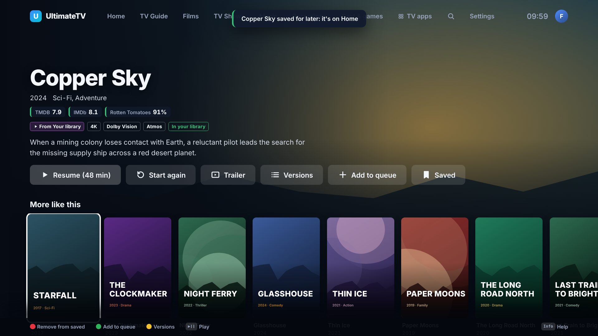

# Trailers, scores and subtitles

Three things that help decide what to watch and then watch it comfortably. All of them are built and pass their tests against the demo Hub; none has run on the box or the Hisense yet.

## Trailers and review scores

A film or series page shows its scores under the title, and a **Trailer** button next to Play.


- **Scores:** TMDB's own score, and IMDb, Rotten Tomatoes and Metacritic from [OMDb](https://www.omdbapi.com/apikey.aspx). A free OMDb key allows 1,000 lookups a day and the Hub keeps each answer for a week. Add the key on the phone's setup page under **Scores and subtitles** (or `OMDB_API_KEY` in the Hub's `.env`). Without it, only TMDB's score shows. Green is 70 or over, amber 50 to 69, red under 50.
- **Trailer:** the official English trailer from TMDB (a teaser if there's no trailer). It's a YouTube video, which mpv on the box plays through yt-dlp, in 4K when YouTube has it. Back stops it. In a laptop browser the demo page shows the artwork instead.

## More like this, and Because you watched

At the bottom of every film and series page, **More like this** lists TMDB's recommendations. With AIOStreams set up almost anything plays, so the whole list shows. Without it, only titles in Jellyfin or the IPTV catalogue are kept, with a badge saying which.



Home gets a **Because you watched …** rail from the latest film or series played (watched to the end or at least five minutes in). Kids profiles only see what their rating allows in both.

## Subtitles

### Turning them on

Each profile chooses in Settings › Profiles › (a profile) › **Subtitles**:

- **On:** whenever there are any.
- **Only for other languages:** when the speech isn't in the subtitle language (English), plus forced subtitles for signs and short foreign bits.
- **Off.**
- **As the household:** follows Settings › Picture and sound › Subtitles.

The box asks mpv for the right ones (`sid=auto` with `subs-with-matching-audio`), so a film's own subtitles are used first.

### Fetching ones a film doesn't have

TorBox and IPTV copies often come without subtitles. With [OpenSubtitles](https://www.opensubtitles.com) set up:

- **By themselves:** when a profile wants subtitles and the film has none in English (or, for "only for other languages", the speech isn't English), the Hub finds the most downloaded match and the box adds it a few seconds after the film starts. A note says so.
- **By hand:** Yellow (Options) › Subtitles › **Find more online** lists every match, most downloaded first, with SDH (sounds described) and machine-translated ones marked. If the words come early or late, the copy is a different cut: try the next one.

To set it up, make a free account at opensubtitles.com, open your profile › API consumers, add one, and paste its key on the phone's setup page under **Scores and subtitles**. The username and password are optional: without them OpenSubtitles allows 5 downloads a day, with them 20 (more with VIP). The Hub keeps each file for a month, so watching again costs nothing. Environment variables work too: `OPENSUBTITLES_API_KEY`, `OPENSUBTITLES_USERNAME`, `OPENSUBTITLES_PASSWORD`.

Jellyfin's own OpenSubtitles plugin is still worth installing for the library: it saves subtitles next to the files, and the TV picks those up with no lookup at all.

### How they look

Settings › Picture and sound (or the phone's setup page) sets the look for everyone:

| Setting | Choices | Default |
|---------|---------|---------|
| Subtitle size | Small, Medium, Large, Huge | Large (25% bigger than mpv's usual, for an 85" screen across the room) |
| Subtitle background | Outline, Dark box | Outline |
| Subtitle colour | White, Yellow | White |
| Subtitle position | Bottom, Raised | Bottom |

A change applies straight away to whatever is playing. The dark box needs mpv 0.38 or newer (Arch has it).


## Skip intro everywhere

Skip intro, Skip recap and Skip credits show up wherever Jellyfin knows where they are. Jellyfin
only knows that for some files out of the box; the **Intro Skipper** plugin listens to each series
and fills them in for the whole library, recordings that land in Jellyfin included.

- Plugin: [github.com/intro-skipper/intro-skipper](https://github.com/intro-skipper/intro-skipper),
  repository URL `https://intro-skipper.org/manifest.json` (it serves the right build for your
  Jellyfin version). It needs Jellyfin's own ffmpeg (`jellyfin-ffmpeg`, already in the Jellyfin
  LXC's packages).
- Install it from any computer on the home network with an admin API key (Jellyfin › Dashboard ›
  API Keys):

  ```sh
  export JELLYFIN_URL=http://192.168.0.23:8096 JELLYFIN_API_KEY=…
  node tools/jellyfin/intro-skipper.mjs install   # adds the repository, installs, restarts Jellyfin
  node tools/jellyfin/intro-skipper.mjs scan      # starts detection now rather than tonight
  node tools/jellyfin/intro-skipper.mjs check     # 20 random episodes and the markers found
  node tools/jellyfin/intro-skipper.mjs check --series "Harbour Lights"
  ```

  Or by hand: Dashboard › Plugins › Repositories › add the URL above, Catalog › Intro Skipper ›
  Install, restart Jellyfin.
- Settings used: the plugin's defaults, which detect intros and credits (and recaps and previews) and
  run every night. In Dashboard › Plugins › Intro Skipper leave **Automatically skip** off: the TV has
  its own button, and the plugin's auto skip only works in Jellyfin's own apps. The first run over a
  big library takes hours; a series needs at least two episodes in a season before its intro is
  found.

On the TV:

- **Skip intro** (OK) appears for the length of the intro and jumps to its end. The same for recaps.
- **Skip credits**: when the credits are marked, the Up Next card appears as they start and counts
  down 15 seconds, then the next episode plays (with **Play the next episode automatically** on, or
  when something is queued). Back hides it and the credits carry on, so a scene after the credits
  isn't missed. Without credits markers it's the last 30 seconds as before.
- Jellyfin's "Commercial" segments (from a commercial-detection plugin) show as **Skip adverts**,
  like recordings with their adverts found ([everyday-extras.md](everyday-extras.md)).

Recordings the Hub plays itself (rather than through Jellyfin) don't get intro markers: only the
copies Jellyfin has in its library do.

Not tested yet: the plugin hasn't been installed on the Jellyfin LXC, so the markers, the Skip
intro jump and the credits hand-over have only run against the demo Hub. Check with
[TESTING.md](TESTING.md#8f-skip-intro-and-accessibility).

## For developers

| Part | Where |
|------|-------|
| Trailers | `hub/src/services/tmdb.ts` (`trailer`, `pickTrailer`) |
| Scores | `hub/src/services/omdb.ts` |
| More like this, Because you watched | `hub/src/library.ts` (`extras`, `similarTo`, `playable`, `becauseYouWatched`), `GET /api/titles/:id/extras` |
| OpenSubtitles | `hub/src/services/opensubtitles.ts`, `hub/src/subtitles.ts` (`GET /api/subtitles`, `POST /api/subtitles/download`, `GET /api/subtitles/files/:id.srt`), `ui/src/subtitles.tsx` |
| Subtitle look and mode in mpv | `box/src/player.ts` (`subtitleProps`, `subtitleModeProps`, `addSubtitle`) |
| Skip markers, Up Next in the credits | `shared/src/segments.ts` (`skipMarkersFrom`, `creditsHandover`), `hub/src/services/jellyfin.ts` (`segments`), `ui/src/screens/Player.tsx` |
| Intro Skipper install and check | `tools/jellyfin/intro-skipper.mjs` |

The TV app checks for the box's new methods (`addSubtitle`, `setSubtitleStyle`) before using them, so an older box keeps working until it updates: fetched subtitles and the style wait for the update.
