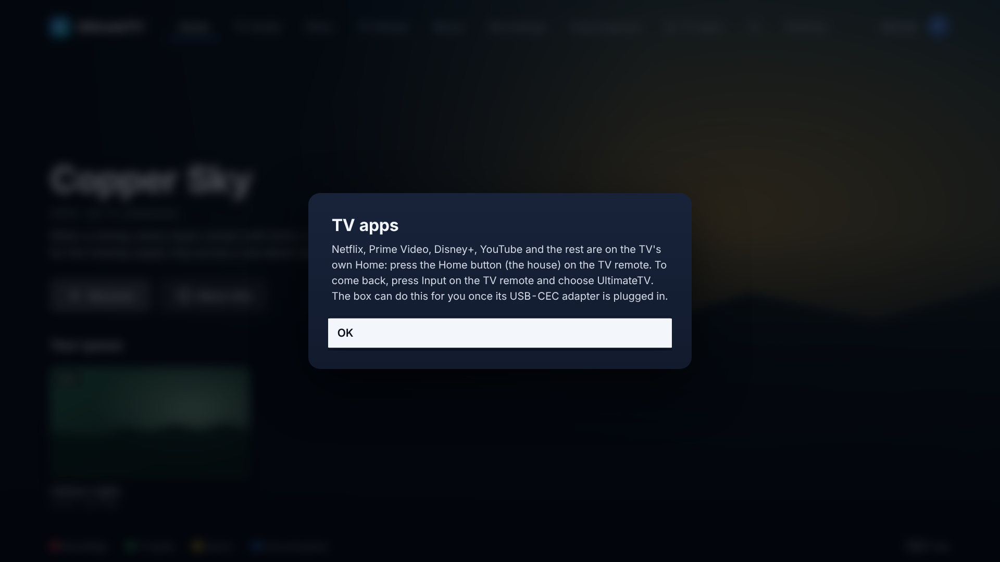
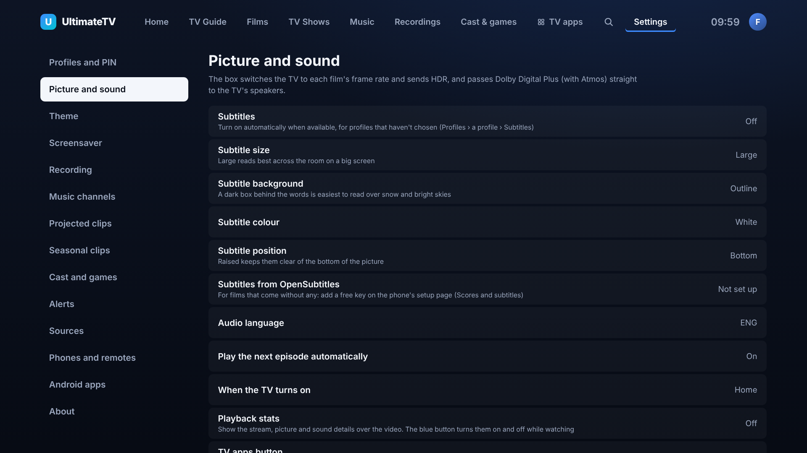

# TV apps, trailers, scores and subtitles

Four things that help decide what to watch and then watch it comfortably. All of them are built and pass their tests against the demo Hub; none has run on the box or the Hisense yet.

## TV apps (Netflix, Prime Video, Disney+)

Netflix, Prime Video, Disney+, YouTube and BBC iPlayer stay on the Hisense's own Home, where they play in 4K with Dolby Vision. On Linux their copy protection would keep them to low resolution, so UltimateTV doesn't try to play them itself.

**TV apps** along the top of every screen hands the screen back to the TV:

1. Whatever is playing stops and the music pauses.
2. A note says how to come back, for a couple of seconds.
3. The box tells the TV over HDMI-CEC that it's stepping down (`<Inactive Source>`), then presses the TV's Home key for it (the CEC "root menu" key).

To come back, press **Input** on the TV remote and pick **UltimateTV**. The TV tells the box it's been picked, and the app opens on Home (or Who's watching if a PIN is set), as it does when the TV is switched on.

The same button is on the phone remote's **Cast** sheet (Go to the TV's apps).

Kids profiles see the button too. The TV remote's own Home and Netflix buttons get there anyway, so the lock that matters is a Kids profile in Netflix, Prime Video and Disney+ themselves.

**Needs the Pulse-Eight USB-CEC adapter.** Without it (or on a box that hasn't been updated) the button explains instead: press the Home button on the TV remote, and Input to come back.

**If the TV stays on UltimateTV**, try the other ways in Settings › Picture and sound › TV apps button (or on the phone's setup page):

| Setting | What the box sends |
|---------|--------------------|
| Step down, then Home (the default) | `<Inactive Source>`, then the Home key |
| Step down only | `<Inactive Source>`: many TVs go back to their last app |
| Press Home only | The Home key |

By hand on the box: `cec-ctl -d /dev/cec0 --to 0 --inactive-source phys-addr=1.0.0.0` (the box's address is in its log at start-up) and `cec-ctl -d /dev/cec0 --to 0 --user-control-pressed ui-cmd=root-menu`.

While the TV shows its own apps the box doesn't suspend, even with `SUSPEND_WHEN_TV_OFF=1`, so it's there when Input picks it again. It still suspends once the TV goes to standby.

## Trailers and review scores

A film or series page shows its scores under the title, and a **Trailer** button next to Play.

- **Scores:** TMDB's own score, and IMDb, Rotten Tomatoes and Metacritic from [OMDb](https://www.omdbapi.com/apikey.aspx). A free OMDb key allows 1,000 lookups a day and the Hub keeps each answer for a week. Add the key on the phone's setup page under **Scores and subtitles** (or `OMDB_API_KEY` in the Hub's `.env`). Without it, only TMDB's score shows. Green is 70 or over, amber 50 to 69, red under 50.
- **Trailer:** the official English trailer from TMDB (a teaser if there's no trailer). It's a YouTube video, which mpv on the box plays through yt-dlp, in 4K when YouTube has it. Back stops it. In a laptop browser the demo page shows the artwork instead.

## More like this, and Because you watched

At the bottom of every film and series page, **More like this** lists TMDB's recommendations. With AIOStreams set up almost anything plays, so the whole list shows. Without it, only titles in Jellyfin or the IPTV catalogue are kept, with a badge saying which.

Home gets a **Because you watched …** rail from the latest film or series played (watched to the end or at least five minutes in). Kids profiles only see what their rating allows in both.

## Subtitles

### Turning them on

Each profile chooses in Settings › Profiles › (a profile) › **Subtitles**:

- **On:** whenever there are any.
- **Only for other languages:** when the speech isn't in the subtitle language (English), plus forced subtitles for signs and short foreign bits.
- **Off.**
- **As the household:** follows Settings › Picture and sound › Subtitles.

The box asks mpv for the right ones (`sid=auto` with `subs-with-matching-audio`), so a film's own subtitles are used first.

### Fetching ones a film doesn't have

TorBox and IPTV copies often come without subtitles. With [OpenSubtitles](https://www.opensubtitles.com) set up:

- **By themselves:** when a profile wants subtitles and the film has none in English (or, for "only for other languages", the speech isn't English), the Hub finds the most downloaded match and the box adds it a few seconds after the film starts. A note says so.
- **By hand:** Yellow (Options) › Subtitles › **Find more online** lists every match, most downloaded first, with SDH (sounds described) and machine-translated ones marked. If the words come early or late, the copy is a different cut: try the next one.

To set it up, make a free account at opensubtitles.com, open your profile › API consumers, add one, and paste its key on the phone's setup page under **Scores and subtitles**. The username and password are optional: without them OpenSubtitles allows 5 downloads a day, with them 20 (more with VIP). The Hub keeps each file for a month, so watching again costs nothing. Environment variables work too: `OPENSUBTITLES_API_KEY`, `OPENSUBTITLES_USERNAME`, `OPENSUBTITLES_PASSWORD`.

Jellyfin's own OpenSubtitles plugin is still worth installing for the library: it saves subtitles next to the files, and the TV picks those up with no lookup at all.

### How they look

Settings › Picture and sound (or the phone's setup page) sets the look for everyone:

| Setting | Choices | Default |
|---------|---------|---------|
| Subtitle size | Small, Medium, Large, Huge | Large (25% bigger than mpv's usual, for an 85" screen across the room) |
| Subtitle background | Outline, Dark box | Outline |
| Subtitle colour | White, Yellow | White |
| Subtitle position | Bottom, Raised | Bottom |

A change applies straight away to whatever is playing. The dark box needs mpv 0.38 or newer (Arch has it).

## For developers

| Part | Where |
|------|-------|
| CEC hand-over | `box/src/cec.ts` (`tvApps`, `tvAppsCommands`), `ui/src/tvapps.ts` |
| Trailers | `hub/src/services/tmdb.ts` (`trailer`, `pickTrailer`) |
| Scores | `hub/src/services/omdb.ts` |
| More like this, Because you watched | `hub/src/library.ts` (`extras`, `similarTo`, `playable`, `becauseYouWatched`), `GET /api/titles/:id/extras` |
| OpenSubtitles | `hub/src/services/opensubtitles.ts`, `hub/src/subtitles.ts` (`GET /api/subtitles`, `POST /api/subtitles/download`, `GET /api/subtitles/files/:id.srt`), `ui/src/subtitles.tsx` |
| Subtitle look and mode in mpv | `box/src/player.ts` (`subtitleProps`, `subtitleModeProps`, `addSubtitle`) |

The TV app checks for the box's new methods (`tvApps`, `addSubtitle`, `setSubtitleStyle`) before using them, so an older box keeps working until it updates: TV apps explains which button to press, and fetched subtitles and the style wait for the update.
