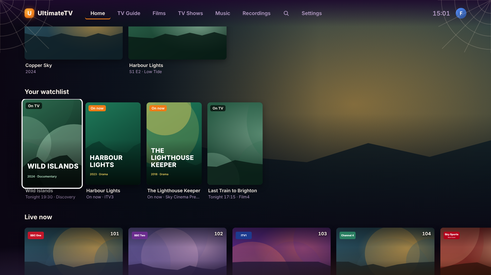
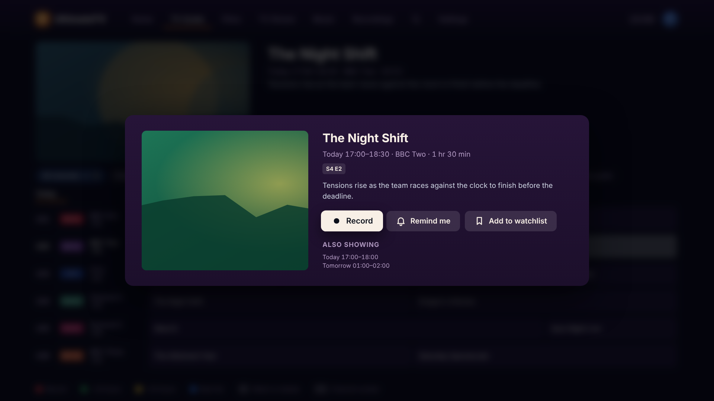
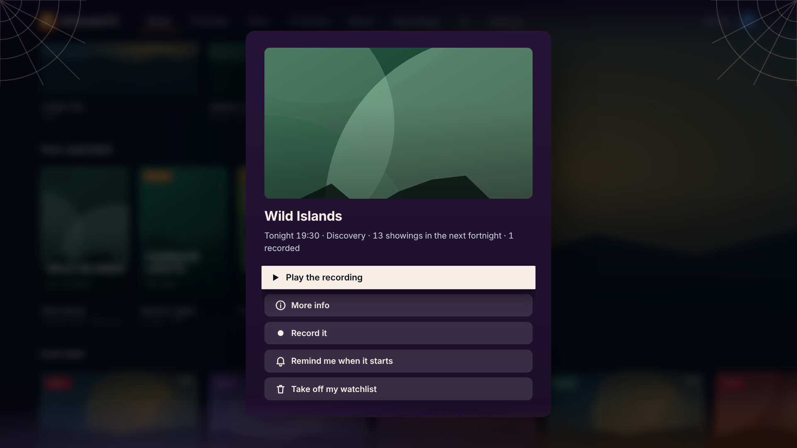
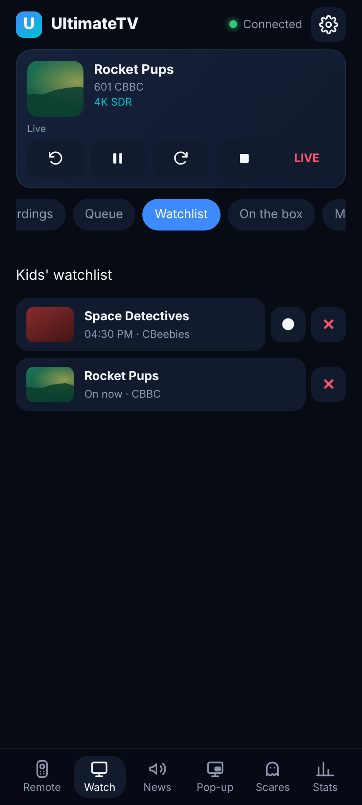

# Watchlist

Each profile keeps its own list of films and shows to watch some day. The list sits on Home as
**Your watchlist**, and each one says when it's next on TV ("Tonight 21:00 · Film4", "On now ·
ITV3") or that it's recorded, so something you meant to watch doesn't slip past.

## Adding to it

- **A film or series:** **Add to watchlist** on its page. The button turns into **On your
  watchlist**; press it again to take it off.
- **From the guide:** open a programme's card (OK in the guide) and choose **Add to watchlist**.
  A show is followed by its series, so every episode in the guide counts. A film is matched by its
  name and year, so a remake with the same name isn't mistaken for it.
- **From the phone:** **Add to watchlist** on a film's or series' sheet, or on a channel's now and
  next. The phone adds to the watchlist of the profile the TV is on.

## What selecting one offers

- **Play the recording** when there's one (the newest, if there are several).
- **Watch on (channel)** when it's on now.
- **Record it** or **Remind me when it starts** when it's on later. Record works as everywhere
  else, so a show asks about a series link.
- **More info** opens a film's or series' page. Something added from the guide that isn't in the
  library offers **Find it in films and TV**, which opens Search with its name typed in.
- **Take off my watchlist.**

The Hub looks two weeks ahead in the guide, on the channels the profile can watch, and at
finished recordings. The row updates as recordings finish and the guide refreshes.

## On the phone

The remote's **Watch** tab has a **Watchlist** list for the profile the TV is on (or was on last,
when the TV is off). Tap one to play its recording, watch it if it's on now, or open its sheet;
● records its next showing and ✕ takes it off.

## Kids

A Kids profile has its own watchlist and can add to it, but only what the profile could watch
anyway: titles within its rating, programmes on its channels. Showings and recordings on other
channels are left out.

## For scripts

| Call | What it does |
|---|---|
| `GET /api/watchlist` | The profile's watchlist, each entry with `onTv`, `showings`, `recordingId` and `recordings` |
| `POST /api/watchlist` | Adds `{ title: TitleRef }` or `{ programmeId }` |
| `DELETE /api/watchlist/:id` | Takes one off |

The TV sends its profile as usual. The phone (or a script with a paired device's token) names one
with `?profile=<id>` or `profile` in the body. Adding and removing need a paired device. A
`watchlist.changed` event goes out with the profile's id. Deleting a profile deletes its watchlist.
