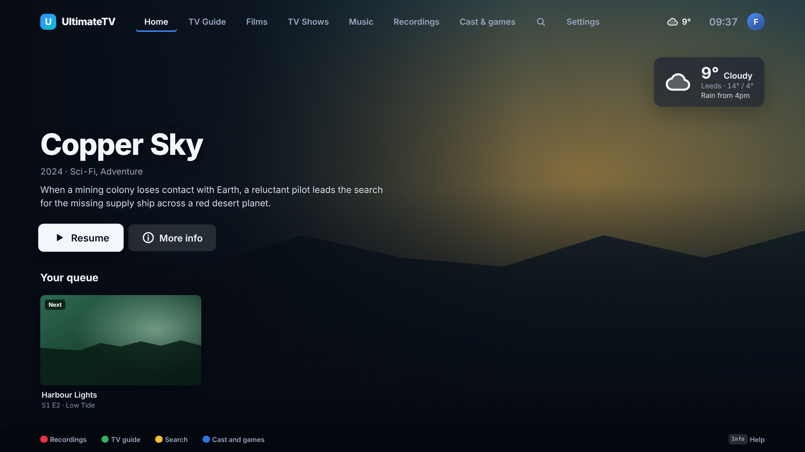
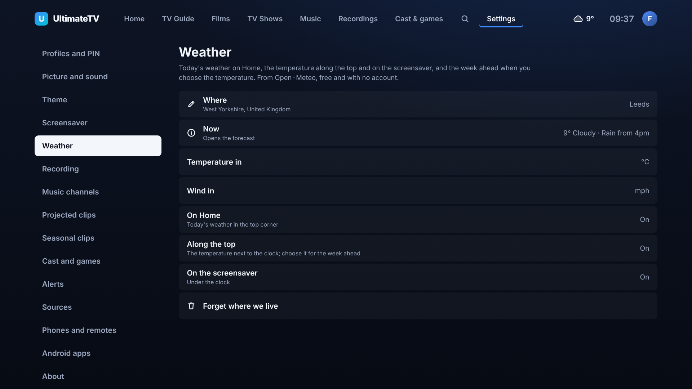
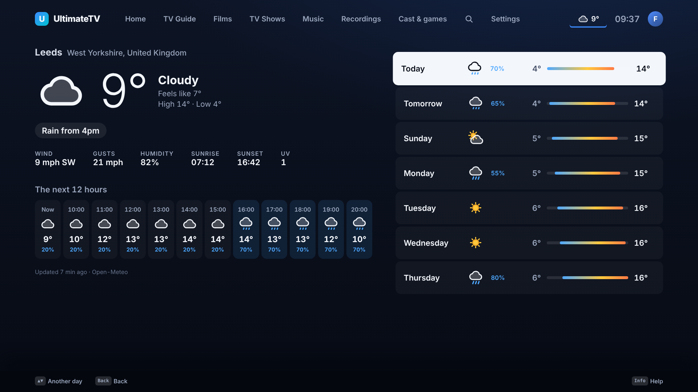
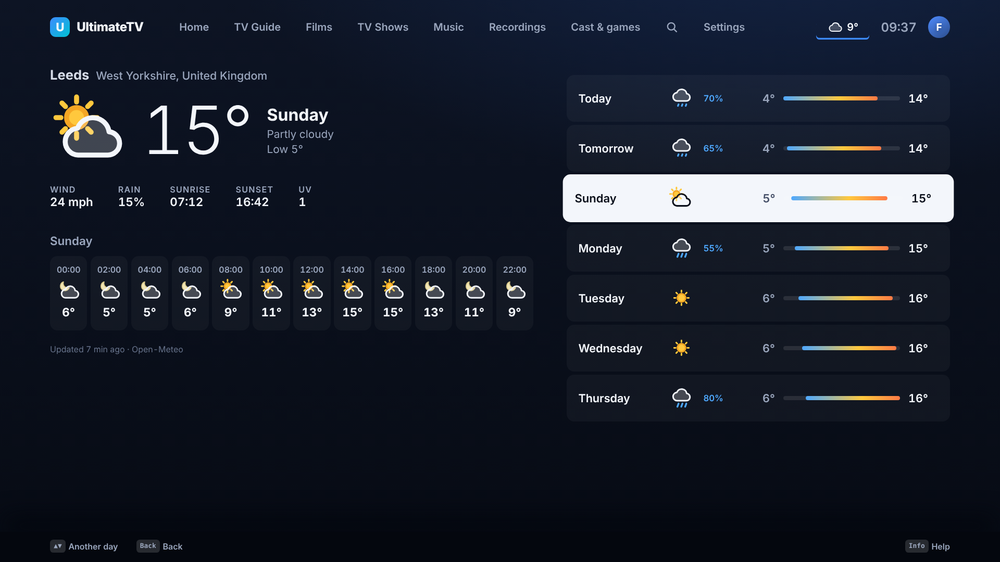
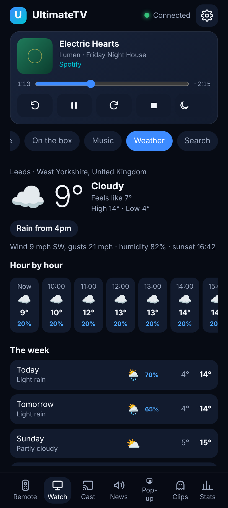

# Weather

Today's weather on Home, the temperature next to the clock, the week ahead a press away, and the
weather under the screensaver's clock. The forecast comes from [Open-Meteo](https://open-meteo.com),
which is free and needs no account or key. UK postcodes are placed with
[postcodes.io](https://postcodes.io), also free.

## Setting it up

Say where you live once, on the TV or the phone:

- **TV:** Settings › Weather › Where. Type a town or a postcode on the on-screen keyboard; if
  there are several (Newport, say) pick the right one.
- **Phone:** the remote's ⚙ Settings › Weather. Type a town, a postcode (`LS6 2AB`, or just `LS6`),
  or a latitude and longitude (`53.8, -1.55`), tap Find, then Use.

The same pages choose °C or °F, mph or km/h, and where the weather shows: on Home, along the top, and
on the screensaver. Changes reach the TV straight away.

## Where it shows

- **Home:** a card in the top corner with the temperature, what it's doing, today's high and low,
  and the one thing worth knowing: "Rain from 4pm", "Rain until about 2pm", "Frost tonight",
  "Windy, gusts up to 50 mph", or "Dry all day".
- **Along the top:** the temperature next to the clock on every main screen. Move up to it and press
  OK for the forecast.
- **The forecast:** now on the left (feels like, wind and gusts, humidity, sunrise, sunset, UV) with
  the next twelve hours under it; the week down the right. Move down the days to see each day's
  hours. Back returns.
- **The screensaver:** under the clock, as it moves round the corners.
- **By voice:** "what's the weather like", "weather forecast", "will it rain tomorrow". With a film
  playing, the TV says the weather in a line instead of leaving the film.
- **On the phone:** the remote's Watch tab › Weather: now, hour by hour for the next day, the week,
  and **Show on the TV**.

| | |
|---|---|
|  |  |

## How it works

- The Hub fetches the forecast for the saved place every half hour (`hub/src/weather.ts`) and keeps
  the last one, so a restart or a dropped connection still shows something. When a fetch fails, the
  old forecast stays and Settings › Weather says so.
- Temperatures and wind are kept in °C and km/h and changed to the household's units on the screen,
  so switching units needs no new forecast.
- The weather codes and the "Rain from 4pm" line are worked out in `shared/src/weather.ts`, used by
  the TV; the phone page asks for them ready-made with `GET /api/weather?words=1`.
- In demo mode the Hub makes up a week for Leeds, so the screens can be tried without a network.

## API

| Call | Who | What |
|------|-----|------|
| `GET /api/weather` | paired | The settings and the forecast (`?words=1` adds the words for each weather code and the headline) |
| `PUT /api/weather/settings` | paired, grown-up | `place` (`{ name, detail?, lat, lon }` or `null`), `temperature` (`c`/`f`), `wind` (`mph`/`kmh`), `onHome`, `inTopBar`, `onScreensaver` |
| `GET /api/weather/places?q=` | paired | Places for a town, a UK postcode or `lat, lon` |
| `POST /api/weather/refresh` | paired | Fetches a new forecast now |
| `POST /api/weather/show` | paired | Opens the forecast on the TV |

The TV hears `weather.changed` when a new forecast lands, and `weather.show` to open it.

## Not yet

- Weather warnings (the Met Office's need an account) and pushing them through Alerts.
- Reading a Home Assistant weather entity or the household's own weather station instead.
- The Android watching app has no weather screen.
